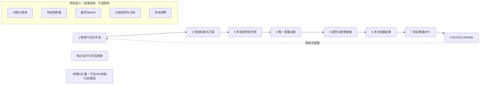
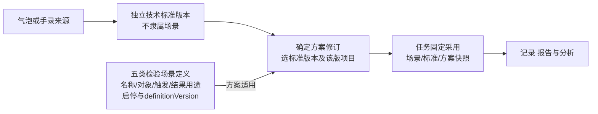
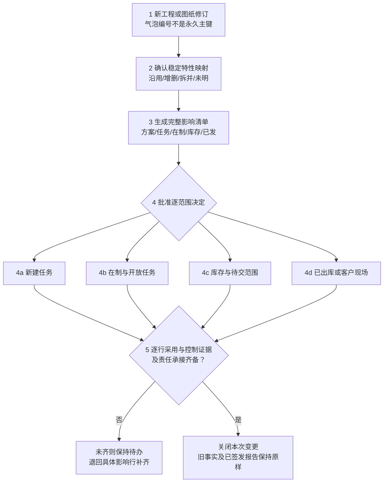
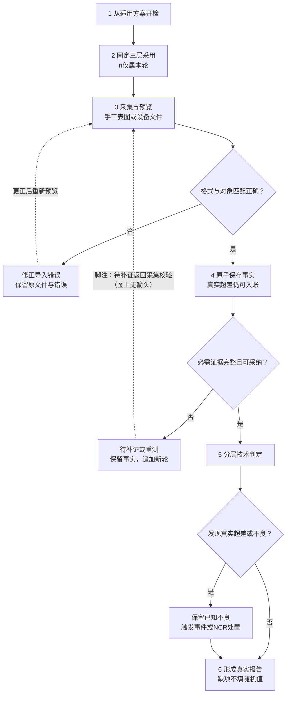
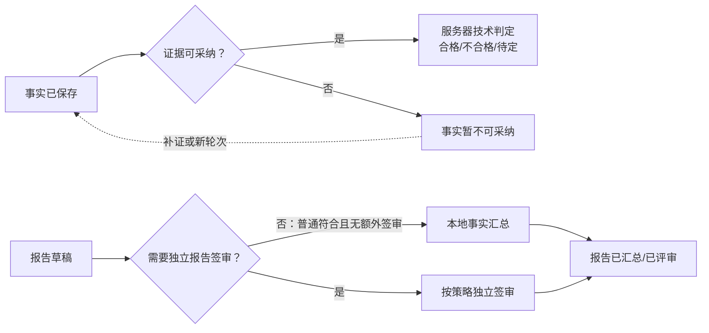
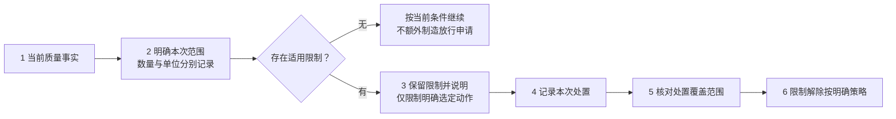
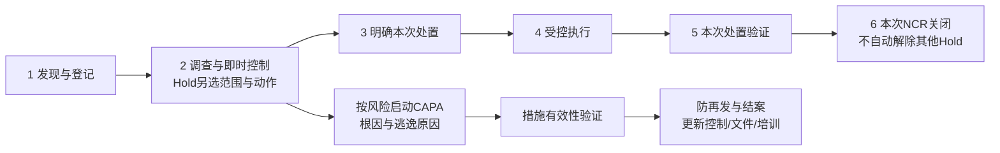

# V3 业务图 01–08 研读摘要

> **资料性质**：业务图是 V3 资料（内部已有 QMS 设计方案，设计日期 2026-11-15）的配套图册，不是云质商用产品资料。本摘要不涉及、也不推断云质的能力。
>
> **出处写法**
> - `图01` 指 `业务图/01_*.png` 与同名 `.svg`。"图01·框「X」"指图内标题为 X 的方框；"图01·注"指图内的说明文字或脚注。
> - `SVG文字 Lnnn` 指 `_原文提取/业务图_文字标注.txt` 的行号。
> - `V3方案 pN` 指《QMS系统完整设计方案V3.pdf》第 N 页；`V3目录 pN` 指《QMS功能与页面设计目录V3.pdf》第 N 页。
> - P 编号、F 编号、R 编号、A 编号、CMD 编号、W 编号都按 V3 资料原文抄录。
>
> **标记约定**
> - 【推断】表示我的推断或建议，原文没有这样写。
> - 「…」内是本文自拟的标签。
> - "…"内是原文原词。

---

## 0. 来源与阅读范围

| 来源 | 范围 | 方式 | 说明 |
|---|---|---|---|
| `_原文提取/业务图_文字标注.txt` | 第 3–432 行，即图01–08 的 SVG 文字，全部读完 | 逐行精读 | 图08 段在 L400–431 |
| `业务图/01_完整业务架构.png` … `08_NCR与CAPA双闭环.png` | 8 张 PNG | 用 Read 工具逐张看图。对图01 的回馈虚线、图05 左侧分支、图06 第二泳道做了局部裁剪放大，核对箭头方向 | 尺寸见 §2 各图基本信息 |
| `业务图/01–08_*.svg` 原文件 | 8 个 SVG | 用只读脚本提取每个方框的描边/填充色，并检查 `<title>/<desc>`/注释 | 没有隐藏元数据。`<text>` 元素数依次为 01=51、02=64、03=83、04=38、05=43、06=68、07=29、08=30 |
| 原 PDF《QMS系统完整设计方案V3.pdf》 | 渲染后看图核对：p5–p14、p16、p18、p20–p22、p46。p1–p4、p15、p17、p19、p23 以及 p24–p70 的相关段落只读了抽取文本 | Read 工具缺少 pdftoppm，无法直接渲染 PDF。改用 macOS PDFKit（Swift 脚本，只写 /tmp）把这些页渲染成 PNG 后看图核对 | 已核对图01–08 的图题位置、是否内嵌、所在章节，以及 p5–6、p8、p11–12 的表格和 p46 第 17 章候选表 |
| 原 PDF《QMS功能与页面设计目录V3.pdf》 | 正文抽取文本读了 p1–p4、p26–p40、p54–p69；渲染核对了 p58 | 同上 | 用来对照 P 编号、R 规则、A 验收场景 |

**无法识别或需要说明的内容**

1. **8 张 PNG 文字全部可读，没有无法识别的内容。** SVG 文字与 PNG 一致。唯一的版面差异是图03 IQC 行的"不等于实物已接收"：SVG 文字流里它紧挨着"不等于已收货入库"（L141–143），按 PNG 版面它属于第 4 列「形成什么结果与权限」，不属于第 5 列。本文按 PNG 版面处理。
2. **哪些图在 V3方案 PDF 中内嵌，已渲染逐页确认。**
   - 内嵌了图本体：图01（p7）、图04（p14）、图05（p16）、图07（p20）、图08（p22）。
   - 只有图题、注明"完整尺寸图见本地交付图册"的：图02（p9）、图03（p10）、图06（p18）。这三张的内容只能依据图册 PNG/SVG。
3. **文件名、图内标题、PDF 图题三者不一致。** 详见 §2 各图基本信息。本文引用时以图内标题为准。
4. **图08 的版式与其他 7 张不同。** 没有页脚"QMS 系统完整设计 V3 | 业务控制与协作 | 2026-11-15"：PNG 上看不到，SVG 的 30 个 `<text>` 中也没有。配色也略有不同：红 #A13A35、琥珀 #A77422、灰 #CAD5DF，其余 7 张用的是 #B64035、#A57913、#46657B。
5. **业务图编号没有 09。** 图册目录是 01–08、10、10b、11、12、13、13b、14–17，共 18 张；V3方案正文也没有"图09"。这与本次范围无关，只作记录。
6. **图上的流向箭头经放大确认，以下三处要特别说明。**
   - 图01：虚线"改进与变更"从「NCR与CAPA/8D」指回「图纸气泡与手录」。
   - 图05：「待补证或重测」没有画出返回箭头，"返回采集校验"只写在脚注里。
   - 图06：第二泳道的红色虚线从「事实暂不可采纳」指回「事实已保存」。
7. **配色语义是我从 SVG 色值归纳的【推断】，原文没有图例。**
   - 蓝 #3566A3：起点、输入、支撑。
   - 青 #087F8C：常规步骤。
   - 琥珀 #A57913：判断、需决定、待确认。
   - 红 #B64035：异常或限制分支。
   - 绿 #247F59：完成、闭合、改进。
   - 灰蓝 #46657B：状态节点或保障能力。

8. **交叉参考编号有缺号，以原文为准，不要补号。**
   - V3目录第 4 节「共用控制规则」（p57–58）列到 R36，但没有 R19、R20、R22，实有 33 条。已渲染 p58 确认，不是抽取遗漏。
   - 第 5 节「验收场景」（p59–67）列到 A51，但没有 A17、A23–A29、A41、A43，实有 41 个。
   - V3方案附录核心命令共 20 条：CMD01–CMD12、CMD15–CMD22。原文说明 CMD13/14 是未确认的外部执行候选，"移到附录后不重排编号"（p62）。
---

## 1. 核心摘要

V3 业务图 01–08 配套 V3方案第 3–8 章，画的是质量部门主链：图纸气泡或手录形成标准 → 方案 → 五类检验 → 事实与判定 → 报告 → 限制与处置 → NCR/CAPA。

- **图01**：8 步主链加 5 项按需调用的贯穿能力。NCR/CAPA 验证后经"改进与变更"反馈回图纸和标准。不依赖 ERP/MES/WMS。行业 FAI、其他方法、集成为"待确认扩展"。
- **图02**：场景、标准、方案、任务四个对象分离。标准来自气泡或手录、不隶属场景；方案显式引用标准版本；任务固定三层快照；停用和新修订不回写在途任务。
- **图03**：对比五类检验与行业 FAI 的触发、依据、结果和"不能代替什么"。FAI 只作术语解释。
- **图04**：气泡编号不是永久主键。先做稳定特性映射，再出影响清单、逐范围决定；四个范围证据齐备才关闭变更，旧事实和已签发报告不回写。
- **图05**：格式错、证据缺、真实超差分三路处理。超差照样入账并触发 NCR，报告不补造数值。
- **图06、07**：任务、事实/技术、报告、实物限制各记状态。Hold 只限制选定范围和动作，局部复检不推导整批接受。
- **图08**：NCR 本次处置与 CAPA 长期改进分开，CAPA 按风险启动、不强制。

对气泡识别软件，图01、02、04、05 给出了接口要求：特性要有稳定身份；识别结果先形成标准版本再被方案引用；换版时做特性映射；导入时按特性匹配。

---

## 2. 分章节/分项详述

### 2.0 八张图的基本信息与对应章节

| 图 | 文件名（PNG 像素） | 图内标题 | V3方案图题 | PDF 位置 | 主要对应章节 |
|---|---|---|---|---|---|
| 01 | 01_完整业务架构（3400×3000） | 01 质量部门业务架构 | 图01 质量部门业务架构 | p7 内嵌 | 第 3 章 业务架构与责任边界（3.1 p5–7；3.2 p7–8） |
| 02 | 02_产品与批次生命周期（3200×3360） | 02 场景 标准 方案与检验生命周期 | 图02 场景 标准 方案与检验生命周期（只有图题） | p9 | 4.1 产品流转、对象生命周期与工程顺序（p9）；4.2.1 检验场景的基础定义（p10）；4.4 生命周期交接（p11–12） |
| 03 | 03_检验类型与业务区别（3200×3220） | 03 不同检验类型的业务区别 | 图03 检验类型与业务区别（只有图题） | p10 | 4.2 不同检验类型的业务差异（p9–10）；4.3 正交分类维度（p11） |
| 04 | 04_变更与逐范围采用（3400×3160） | 04 变更与逐范围采用 | 图04 变更与逐范围采用 | p14 内嵌 | 5.1 对象与版本（p13）；5.2 工程变更与逐范围采用（p13–14） |
| 05 | 05_检验与导入（3400×2920） | 05 检验与导入：事实、完整性与技术判定 | 图05 检验与导入 | p16 内嵌 | 第 6 章 检验执行与真实证据（6.1–6.4，p15–17）；2.3 必须改变的关键控制（p3–4） |
| 06 | 06_独立状态与门禁（3600×4400） | 06 独立状态与按策略门禁 | 图06 独立状态与门禁（只有图题） | p18 | 7.1 六类独立结果（p18）；7.2 避免过度审批（p18–19）；7.3 报告与 CoC（p19） |
| 07 | 07_用途资格与执行（3400×2580） | 07 质量限制、处置与范围核验 | 图07 质量限制与处置范围 | p20 内嵌 | 7.4 明确范围的质量限制（p19–20）；附录 A5.2（p59–60） |
| 08 | 08_NCR与CAPA双闭环（3600×2460） | 08 NCR当前处置与CAPA长期改进 | 图08 NCR 与CAPA 双闭环 | p22 内嵌 | 第 8 章 当前实物风险与处置闭环（8.1–8.4，p21–23）；9.1 CAPA 与 8D（p24） |

页脚：01–07 都有"QMS 系统完整设计 V3 | 业务控制与协作 | 2026-11-15"，图08 没有。

---

### 2.1 图01 质量部门业务架构

**副标题**："图纸气泡或手录形成标准，开展各项检验，以真实数据分析和问题改进闭环；量具与MSA提供测量系统评价。"（SVG文字 L5）

**主旨**：一张图交代质量部门的主链、按需调用的贯穿能力、独立运行原则，以及待确认的扩展。

**A. 主链（8 框，蛇形排布，实线箭头）**

图上第一行从左到右，在右端折下，第二行从右到左。

| 步 | 框名 | 框内要点（原文） | 出处 |
|---|---|---|---|
| 1 | 图纸气泡与手录 | "图面定位与结构化特性 / 或规范来源与手工要求" | 图01；L7–9 |
| 2 | 检验标准与方案 | "标准版本与方案修订分开 / 方案引用标准及适用场景" | L10–12 |
| 3 | 多场景检验任务 | "IQC/生产首件/IPQC / FQC/OQC按实际适用" | L13–15 |
| 4 | 唯一质量证据 | "轮次/实体样本/原始实测 / 依据与采纳记录可复现" | L16–18 |
| 5 | 报告与接受依据 | "事实汇总/明确签审策略 / 技术结论与报告状态分开" | L19–21 |
| 6 | 本次质量结果 | "逐项符合/计数批接受 / 结论覆盖明确依据与范围" | L22–24 |
| 7 | 真实数据SPC | "明确产品/方案/特性 / I-MR引用检验实测点" | L25–27 |
| 8 | NCR与CAPA/8D（绿框） | "本次问题与原因措施 / 验证后反馈标准和检验" | L28–30 |
| 回馈 | 虚线"改进与变更" | 从框 8 指回框 1（已放大确认箭头方向） | L31；图01 |

**B. 贯穿能力（5 框）**

图上注明"在需要的阶段调用，不按下列方框顺序执行"（L32）。

| 框名 | 要点 | 出处 |
|---|---|---|
| 问题与改进 | "NCR/客诉/明确限制 / CAPA/8D与有效性" | L33–35 |
| 供应商质量 | "资料/真实来料质量 / 原NCR回复与验证" | L36–38 |
| 量具与MSA | "建档/校准/研究矩阵 / 交叉Gage R&R分析" | L39–41 |
| 过程监控与分析 | "SPC/能力/缺陷分析 / 不代替单批接受" | L42–44 |
| 体系保障 | "审核/文件/培训 / 各自对象与关闭依据" | L45–47 |

**C. 底部声明**

| 内容 | 原文 | 出处 |
|---|---|---|
| 全局规则 | "普通合格不必经过Hold、NCR或CAPA；异常按实际范围处理，改进按需要启动。" | L48 |
| 独立运行与可选连接（蓝框） | "产品/工序、账号权限与版本审计贯穿各业务 / 无ERP/MES/WMS也能正常新建与闭环" | L49–51 |
| 待确认扩展（琥珀框） | "行业FAI/其他方法/集成 / 确认需求后再定义范围" | L52–54 |

**Mermaid 还原**

**状态与门禁**：图上没有状态机。门禁性质的表述只有两条：
- 普通合格不经过 Hold/NCR/CAPA；
- "过程监控与分析……不代替单批接受"。

**与 V3方案对应**

- 3.1（p5）："业务主线优先服务质量部门：图纸/手工标准、五类检验、SPC、NCR/CAPA/8D、量具及MSA 应从正常入口连续办理。"五类检验"仍各有独立业务入口、建单场景和结果用途"。
- 3.1 表（p5–6）列出 11 个业务模块：质量策划与检验依据、检验管理、不合格管理、纠正与改进、客户投诉、供应商质量、计量器具管理、过程监控与质量分析、审核管理、受控文件管理、培训管理。
- p6 另写明：质量限制"是跨来源控制能力……不要求必须先有NCR"；工作台、零件/工序、账号权限"均不另称质量闭环模块"。
- p7 图下正文："对象之间以明确ID 关联。量具失准形成影响评估，保留原始测量和历史报告；需要限制产品时，由有权限人员选择本次对象范围及受限动作。统计信号可以提示调查，不能直接批准产品或修改原值。"
- 3.2 主数据与权威源（p7–8 表）分"独立模式 / 接入外部系统后"两种情况，覆盖 9 类对象（人员与组织、零件与工程修订、工艺路线与设备、质量批次与样本、订单与实际数量、检验场景定义、检验标准版本、检验方案修订、技术要求与证据）。规则包括"同一个字段只允许一个权威来源"，以及冲突"不根据'最后更新时间较新'自动覆盖批准内容"。这一节对应框「独立运行与可选连接」。
- 方案 p2 定下的当前核心业务：五类检验、图纸气泡与手工标准、方案、报告、真实数据 SPC、NCR/CAPA/8D、量具，以及"可正常建立研究的MSA"。客诉、供应商质量、审核、文控、培训和基础权限"继续保留为关联业务与支撑"。

**对应的目录导航**（V3目录 p2–3）：
- 质量策划组：P02/P06/P08/P05
- 检验管理组：P11–P17
- 质量问题与改进组：P23/P25/P26
- 供应商质量：P27
- 计量管理：P31/P51
- 质量分析：P37/P50
- 体系管理：P39/P41/P43
- 基础资料：P45/P46/P61
- 系统管理：P47–P49

【推断】主链画成首尾相连的 8 步，但从底部声明和方案 4.1（p9："不能排成每个对象都必须走完的流水线"）看，它表达的是逻辑依赖和数据流向，不是每张单据必须依次走完的强制流程。SPC 也不是每次检验后的必经步骤。

---

### 2.2 图02 场景 标准 方案与检验生命周期

**副标题**："场景限定方案适用；气泡或手录形成标准版本；方案确定引用，任务固定采用；五类检验按实际业务进入。"（L59）

**主旨**：把四个技术对象（场景、标准、方案、任务）的关系与五类检验的业务位置分开画，并说明跨阶段的问题与保障能力。全图分三个泳道。

**泳道 1「基础定义与技术策划对象关系」**

| 步 | 框 | 要点 | 出处 |
|---|---|---|---|
| 1 | 气泡或手录来源 | "图纸与特性来源可追溯 / 不由场景派生技术要求" | L65–67 |
| 2 | 独立技术标准版本 | "产品/图版/项目/单位公差 / 标准不隶属于场景" | L68–70 |
| 3 | 确定方案修订 | "选标准版本及该版项目 / 适用场景和执行安排" | L71–73 |
| 3′ | 五类检验场景定义（蓝框，位于框 3 上方） | "名称/对象/触发/结果用途 / 启停与definitionVersion"；用标注"方案适用"的箭头指向框 3 | L62–64、L77 |
| 4 | 任务固定采用 | "场景/标准/方案快照 / 实际样本数仅归本轮" | L74–76 |
| 5 | 记录 报告与分析（框 4 下方） | "真实实测与固定采用 / 支持本轮报告及SPC" | L78–80 |
| 注 | 版本采用规则 | "新标准须由新方案修订显式采用；新方案不回写旧任务。" | L81 |
| 注 | 停用规则 | "停用只阻止新采用，在途录测/提交/复检及历史分析继续按原快照。" | L82 |

**泳道 2「五类检验的业务位置」**：5 框之间画了箭头。

| 框 | 要点 | 出处 |
|---|---|---|
| 到货与来料检验 | "IQC：实际样本和项目 / 结论覆盖明确来料范围" | L85–87 |
| 开工与设置确认 | "生产首件确认 / 仅覆盖当前设置条件" | L88–90 |
| 过程加工 | "IPQC：时段/工序证据 / 异常定位受影响范围" | L91–93 |
| 完工范围检验 | "FQC：实测与适用判批 / 实物入库另有确认" | L94–96 |
| 待发运与交付 | "OQC与明确客户资料 / 检验不代表实际交付" | L97–99 |
| 注 | "按实际事件进入；同批可有独立任务，不强制依次走完五个场景。" | L100 |

**泳道 3「跨阶段问题与保障」**：5 框之间没有箭头。

| 框 | 要点 | 出处 |
|---|---|---|
| 本次不合格处置（红） | "事实、范围、处置与凭据 / 当前问题验证后关闭" | L103–105 |
| 明确质量限制（红） | "按选定对象与动作建立 / 解除仅作用所选记录" | L106–108 |
| 必要的系统改进 | "根因、措施、长期验效 / 不是每条NCR必走" | L109–111 |
| 量具与MSA研究 | "量具建档/校准资料 / Gage R&R研究矩阵" | L112–114 |
| 文件培训与追溯 | "受控文件与必要培训 / 保留原值和历史依据" | L115–117 |
| 注 | "异常可在任何质量控制点触发；下排能力按需要关联，不按方框先后串成强制流程。" | L118 |

**图底声明**

- "普通实测不自动整批接受，只证明被检样本与项目；计数批接受须有明确方案。质量问题按需要进入NCR/CAPA/8D并反馈技术标准与方案的新修订。场景维护不是BPM，不新增自定义场景或动态菜单。"（L119–120）
- "量具、文件、培训按需提供准备并持续保障；工程开发分期不是本图中的质量生命周期。"（L121）

**Mermaid 还原（泳道 1）**

**与 V3方案对应**

- 4.1（p9）给出三条生命周期，并说明它们不是必经流水线：
  - 产品生命周期 8 阶段：要求识别、设计与工艺质量策划、试制验证、量产导入、稳定生产、变更再验证、交付后支持、停产归档。
  - 批次生命周期：到货或开批……退回、返工或报废。
  - 检验生命周期：创建、确定适用依据、分配与准备、取样、采集、完整性检查、判定、按策略签审、任务完成。
  - 原文还写明："当前直接建立受控基准及日常检验，不设置APQP 项目阶段门"。
- 4.2.1（p10）：
  - "基础资料新增P61 检验场景维护，承载IQC、生产首件、IPQC、FQC、OQC 五个既有稳定代码的名称、目的、检验对象、触发说明、结果用途、启停和定义版本。"
  - "四类对象有分叉关系……场景不是标准的上游父对象。"
  - 停用场景阻止该场景新开检；停用标准阻止继续用其方案新开检；停用方案阻止新采用。
- 4.4 交接表（p11–12）共 11 行，其中"场景定义到方案适用""依据编制到检验任务"两行与本图直接对应。
- 附录 A4.2（p55–56）：场景表 `qms_inspection_scene` 的 code 固定为 "IQC/FIRST_ARTICLE/IPQC/FQC/OQC"。另有 `qms_basis_adoption` 表，"提交后不替换；不读取current 指针重建历史"。

**目录对应**

- P61 检验场景（V3目录 p55–56）："不新增自定义类型、动态BPM 或菜单生成"。其需求依据是用户 2026-11-15 的明确要求，"原始155 项无对应场景维护raw_refs"。
- 相关规则：R01 采用版本不可变；R03 检验安排与计数判批分开；R14 普通符合记录按策略完成。
- 相关验收：A49 标准与方案独立采用；A50 停用不阻断在途任务；A51 标准和方案换版。

---

### 2.3 图03 不同检验类型的业务区别

**副标题**："五类当前检验按明确依据执行；行业FAI只作术语解释，不作为已确认业务入口。"（L126）

**主表（6 行 × 5 列，按 PNG 版面还原）**

| 类型 / 所在阶段 | 何时触发与检什么 | 采用什么依据 | 形成什么结果与权限 | 不能代替什么 |
|---|---|---|---|---|
| 来料检验 IQC；采购到货 / 委外回厂 | 到货批或交接批待质量接受；对象：供应商、物料/零件版本；来料总体、样本、证书 | 来料方案、采购质量要求；图纸、证书与抽样规则 | 来料报告 + 接受/拒收/待处置；不等于实物已接收 | 不等于已收货入库；不等于后续工序合格 |
| 生产首件确认 FIRST_ARTICLE；生产开工 / 关键设置变化 | 开机、换型及被规定为需重确认的变化；对象：指定工序、设备、工装；程序/刀具与设置下首件 | 该工序方案、关键特性；设置条件及重确认规则 | 首件报告 + 设置条件认可；仅说明被检首件与设置范围 | 不保证后续每件合格；不代替行业FAI鉴定或出货 |
| 过程检验 IPQC；生产加工过程 | 规定频次、工序节点、异常或恢复确认；对象：指定工序、时段、样件；关联在制批次片段 | 工序方案、巡检频次；反应计划与适用过程规则 | 过程记录/报告、异常事件；继续加工/停机范围决定 | SPC稳定不等于单件合格；不直接允许成品出货 |
| 完工检验 FQC；规定制造工序完工后 | 工单/工序完工、返工完成后待接受；对象：完工批次/序列号范围；实际完工数量 | 完工方案、图纸/规范；必要全检或抽样规则 | 完工报告 + 质量接受结论；仅覆盖明确完工范围 | 不等于已实际入库；不代替客户发运门禁 |
| 出货检验 OQC；拟交付 / 发运前 | 具体客户、订单或待发运范围形成；对象：拟发运范围、客户/目的地；包装、标识与资料包 | 客户/合同要求、有效检验；必要CoC、让步、风险状态 | 出货结论与报告；核对明确客户要求；当前不生成独立发运许可 | 检验完成不等于实际出库；不推导运输或额度台账 |
| 首件鉴定 FAI；行业/合同适用；首批生产 / 规定重大变化 | 客户/适用标准要求正式首件鉴定；对象：确定产品构型及首批件；工程设计特性与生产实现 | 适用FAI要求及客户规范；工程特性和客观符合性证据 | 规定FAI记录与完整性结论；必要的客户评审/认可 | 仅解释术语与适用情形；专用模块尚未确认，不是当前入口 |

出处：图03；SVG文字 L128–200。

**两个说明框**

- **生产首件与行业 FAI 分开**（琥珀框）："当前原型使用生产首件确认。行业FAI是独立的首件鉴定要求，专用模块待确认，不能凭开机首件合格宣称完成。"（L201–203）
- **共用证据，按适用范围复用**（青框）："FQC与OQC若有相同特性，可引用有效证据；OQC仍核对客户、实际发运范围、包装和资料。无需无依据重复实测。"（L204–206）

**脚注**："依据：V3检验用途与策略；IAQG 9102用于FAI术语核对。技术判定与报告状态分开；独立签审只在方案显式选择时进入。"（L207）

**与 V3方案对应**

- 4.2（p9–10）的表只有 4 列（检验类型 / 触发和对象 / 主要判断 / 形成的结果）、5 行，没有 FAI 行。本图多了"不能代替什么"列和 FAI 行。
- 方案正文："当前只建设已有生产首件场景；不新增行业FAI 入口、流程或鉴定表单。[S06]"
- 方案表与本图的表述差异：

  | 类型 | 方案 4.2 表 | 本图 |
  |---|---|---|
  | 首件 | "限定设置条件的生产启动资格" | "首件报告 + 设置条件认可" |
  | OQC | "发运范围的接受依据、适用CoC 及用途资格" | "当前不生成独立发运许可" |

- 4.3（p11）："复检不是IQC 之外的另一个生命周期阶段；CMM 导入不是一种判批方法。"
- 第 17 章（p46）把"独立行业FAI"列为候选，处理方式是"只保留概念区分，不增入口和行业表单"。

**目录对应**
- P12 来料检验、P13 生产首件、P14 过程检验、P15 完工检验、P16 出货检验，是 5 个独立稳定入口（V3目录 p32–35）。
- P13 的目标规则写明："不能当成行业FAI 资料已完成；不产生出货许可。"

---

### 2.4 图04 变更与逐范围采用

**副标题**："跨版映射、影响评估、采用决定和实施验证分开；旧事实及已签发报告不回写。"（L212）

**流程步骤**

| 步 | 框（颜色） | 要点 | 出处 |
|---|---|---|---|
| 1 | 新工程或图纸修订（蓝） | "旧新文件与变更理由 / 气泡编号不是永久主键" | L214–216 |
| 2 | 确认稳定特性映射（青） | "沿用/增删/拆并/未明 / 无法确认转人工评估" | L217–219 |
| 3 | 生成完整影响清单（青） | "方案/任务/在制/库存/已发 / 风险、责任人与期限" | L220–222 |
| 4 | 批准逐范围决定（琥珀） | "沿用旧版/采用新版 / 追加验证或受控处置" | L223–225 |
| 4a | 新建任务（青） | "按有效适用规则建单 / 绑定获准适用的依据修订" | L226–228 |
| 4b | 在制与开放任务（青） | "原任务快照与实测保留 / 需新要求时显式新建任务" | L229–231 |
| 4c | 库存与待交范围（红） | "评估筛选/返工/让步 / 必要时按动作建立Hold" | L232–234 |
| 4d | 已出库或客户现场（红） | "历史交付事实继续保留 / 客诉和影响处理关联记录" | L235–237 |
| 5 | 判断（琥珀菱形） | "逐行采用与控制证据 / 及责任承接齐备？" | L238–239 |
| 5-否 | 未齐则保持待办（红） | "退回具体影响行补齐 / 保留责任人及处理期限" | L240–242 |
| 5-是 | 关闭本次变更（绿） | "旧事实及已签发报告保持原样 / 新报告使用新版本和相应签审" | L243–245 |
| 注 | 底部 | "逐范围核验实际采用、处置执行及必要验证；本次变更关闭不解除其他独立Hold。" | L248 |

**Mermaid 还原**

注意：PNG 上「未齐则保持待办」没有画返回箭头，"退回具体影响行补齐"只是框内文字。

**状态与门禁**
- 关闭门禁：判断框 5 的"逐行采用与控制证据及责任承接齐备"。
- 关闭变更"不解除其他独立Hold"。
- 「在制与开放任务」分支不允许换版，只能"显式新建任务"。

**与 V3方案对应**

- **5.1（p13）**
  - 7 类身份/版本分别管理：零件身份、工程修订、图纸文件修订、特性稳定 ID、特性修订、标准修订、方案修订。
  - "气泡编号是图面显示标记，不能充当跨版本永久主键。换图时必须记录特性沿用、新增、删除、拆分、合并和无法确认的映射；无法确认的项目由工程人员处理，不能按气泡号相同自动沿用结论。"
- **5.2（p13–14）**
  - 变更申请要明确旧新工程修订、原因、影响特性、产品/工序/客户范围、风险及生效条件。
  - 系统反查 6 类范围："受影响方案、开放任务、在制批、库存、已批准资料和已出库范围"。
  - 评估结果 7 种："无影响、继续沿用旧基准、修订后采用、追加检查、受控返工、让步或升级风险控制"。
  - 比较规则：同一图版若有多份方案，由用户选择要比较的两端，"不能自动取另一图版的第一份方案"；尚无可证明映射时"显示待核对，不把图号或气泡号相同当作等价结论"。
  - 任务规则："本轮不提供旧任务换版"；"已签发报告不追改；需要更正时生成替代报告并关联原件"。
- **差异**：本图影响清单列 5 类（方案/任务/在制/库存/已发），方案 5.2 多了"已批准资料"。P05 目标规则还列了"量具""已放行"（V3目录 p28）。
- **工程实现**：W07"PQC/OQC 真实场景与工程变更采用"，测试入口 test_basis_change_impact.py（方案 p69）；工程批次 S3"生产首件、IPQC、OQC 和变更采用"（p70）。

**目录对应**

- **P04 图纸版本对比**（V3目录 p27–28）：当前原型是"只读资料"；"对比本身不执行采用决定"。
- **P05 变更评估**（p28）
  - 当前原型是"只读资料"，"未执行变更批准、自动修订方案或批量切换在制任务"。
  - 目标规则："逐项评审方案、量具、在制、库存、已放行和已交付范围，指定采用/复检/冻结/客户措施。影响行有负责人和完成证据；未评估不能默认为无影响，实施回执齐才可关闭变更。"
- **原始能力**（V3目录 p6–7）：F012 图纸及特性差异对比（"不推定自动图像/CAD 差分"）；F013 工程变更申请管理；F014 变更影响与质量风险评估；F015 受影响检验计划修订联动；F016 变更责任与执行跟踪；F017 工程变更评审批复（"具体分级/流转条件待明确"）。
- **规则**：R01、R02、R35。R35 写明"在途物流和客户现场专项管理未纳入当前范围"。
- **验收**：A10 图版更新（"旧证据保持原依据，逐范围评估新采用，不能直接换版本号"）；A51。

---

### 2.5 图05 检验与导入：事实、完整性与技术判定

**副标题**："格式错误、证据缺项和真实超差走不同分支；导出不能补造实测值。"（L253）

**流程步骤**

| 步 | 框（颜色） | 要点 | 出处 |
|---|---|---|---|
| 1 | 从适用方案开检（蓝） | "启用产品/场景选方案版 / 明确本轮样本与范围" | L255–257 |
| 2 | 固定三层采用（蓝） | "场景/标准/方案版本 / 继承不改规；n仅属本轮" | L258–260 |
| 3 | 采集与预览（青） | "手工表图或设备文件 / 原文件/映射版本留存" | L261–263 |
| D1 | 格式与对象匹配正确？ | 否 → 修正导入错误（红）："保留原文件与错误 / 更正后重新预览"，再沿虚线回到步 3；是 → 步 4 | L264–268 |
| 4 | 原子保存事实（青） | "真实超差仍可入账 / 重复提交不重复计数" | L269–271 |
| D2 | 必需证据完整且可采纳？ | 否 → 待补证或重测（红）："缺测/无效/未批准NA / 保留事实，追加新轮"；是 → 步 5 | L272–276 |
| 5 | 分层技术判定（青） | "逐项实测判符合性 / 计数策略才按Ac/Re判批" | L277–279 |
| D3 | 发现真实超差或不良？ | 否 → 步 6；是 → 保留已知不良（红）："触发事件或NCR处置 / 批接收不抹去单件失败"，然后 → 步 6 | L280–281、L285–293 |
| 6 | 形成真实报告（绿） | "按签审策略完成 / 缺项不填随机值" | L282–284 |
| 注 | 底部 | "普通实测只证明被检范围，不自动整批接受。待补证返回采集校验；复检与更正追加记录，原失败与原依据持续可追溯。" | L294 |

**Mermaid 还原**

**关键约束（图内）**
- 三类问题分开处理：格式/对象错、证据缺、真实超差。
- 超差入账。
- 幂等：重复提交不重复计数。
- n 只属本轮。
- Ac/Re 只在计数策略下才用。
- 批接收不抹去单件失败。
- 报告不填随机值。

**与 V3方案对应**

- **2.3（p3–4）**：指出 QMaster 的已知问题，并给出新 QMS 的改法。
  - 部分判批路径"在不良件数大于零时直接拒收"；新 QMS 由服务器执行版本化抽样规则。
  - 部分结束路径"接受客户端汇总结果，并对缺项填NA"；新 QMS 由服务器计算完整性和技术结论，NA、免检、未测、无效、缺失和真实不合格分别表达。
  - 报告导出存在"模拟补值选项"，可把缺失值补成公差内随机值；新 QMS "导出服务不得创造测量事实"。
- **6.1（p15）**：建单"不临时修改公差、单位、项目或n/Ac/Re"；"同批不同检验任务分别保存采用方案、实测与报告"；"重复读数与重复取样分别建模"。
- **6.2（p15–16）**
  - 导入分 7 步："文件解析、字段映射、实体样本匹配、特性匹配、单位转换、预览校验和正式提交"。
  - 留存内容：原始文件、解析器版本、映射版本、原值、标准化值和异常原因。
  - "超差是有效业务事实，应允许按规则入账并触发异常，不能过滤掉后只导入合格行"。
  - 默认按导入批次原子提交；幂等键覆盖目标轮次、解析/映射版本和提交令牌。
  - Axis 工作台回传结果时，QMS"不能接受浏览器传回的总判定作为最终事实"。
- **6.3（p16–17）**
  - 用 Decimal 精确判定。
  - measurement 的技术状态为 conforming / nonconforming / insufficient。
  - scope_conforming / scope_nonconforming 只覆盖本轮，"usage=evidence_only，不产生整批接受或use/ship 授权"。
  - single_count 按 d 与 Ac/Re 判定，"禁止提前作接受决定"。
  - 量具超期等"事实已经发生，仍允许受控补录……标为待评估或不可采纳"。
- **6.4（p17）**：提交后的更正追加记录；"不能反复测到合格即选为最终结果"。
- **附录 A**：A4.4（p58–59）事实可保存与证据采纳分开；A6.3（p63）"批量实测默认整批事务：结构错误整批不写，事实的数值/可信性问题逐行保存并标记"。

**目录对应**

- **P18 设备数据导入、P19 导入异常**（V3目录 p35–36）
  - 当前原型都是"只读资料"，"文件解析、设备采集、映射保存和导入入库未接通"。
  - P19 目标规则："真实超差保存并转质量事件。不能通过改测量值消除不合格"。
- **规则**：R03–R09、R12、R14。
- **验收**：A01–A09、A11。
- **命令**：CMD04–CMD09、CMD15（方案 p61）。
- **工作包**：W03/W04/W05；工程批次 S1。

---

### 2.6 图06 独立状态与按策略门禁

**副标题**："任务、事实、技术结论、报告与实物执行分别记录；普通事实可汇总；局部复检符合不推导原整批接受。"（L299）

**泳道 1「任务进度」**

| 序 | 状态框 | 要点 | 出处 |
|---|---|---|---|
| 1 | 待准备 | "依据 / 人员 / 量具齐备" | L306–307 |
| 2 | 执行中 | "样本 / 轮次 / 原始事实" | L308–309 |
| 3 | 证据已汇总 | "保存真实事实与采纳结论" | L310–311 |
| 4 | 任务已完成 | "按适用策略完成 / 普通检验无需实物回执" | L312–314 |

**泳道 2「事实与技术」**

| 序 | 节点 | 要点 | 出处 |
|---|---|---|---|
| 1 | 事实已保存（蓝） | "异常 / 补录 / 解析失败 / 原值及来源始终保留" | L315–317 |
| D | 证据可采纳？ | 是 → 服务器技术判定（青）："合格 / 不合格 / 待定 / 引用适用要求与当前轮次"；否 → 事实暂不可采纳（红）："不作为接受依据 / 补证或新轮次保留原失败"，再沿红色虚线回到「事实已保存」 | L318–327 |

**泳道 3「报告策略」**

| 序 | 节点 | 要点 | 出处 |
|---|---|---|---|
| 1 | 报告草稿 | "范围 / 证据 / 快照 / 更正保留原记录" | L328–330 |
| D | 需要独立报告签审？ | 否（标注"否：普通符合且无额外签审"）→ 本地事实汇总（绿）："普通事实、无额外签审 / 不表示生产签发或批准"；是 → 按策略独立签审："核查真实 / 完整 / 依据 / 退回则保留原记录" | L331–338、L343–345 |
| 2 | 报告已汇总 / 已评审（绿，两条分支汇合） | "按本次明确策略留痕 / 真实不合格仍可完整报告 / 不修改技术不合格结论" | L339–342 |

**泳道 4「受控实物动作（适用时进入）」**

| 序 | 节点 | 要点 | 出处 |
|---|---|---|---|
| 1 | 质量范围与现行限制 | "批次 / 样本 / 动作范围 / Hold仅限制显式选定动作 / NCR不自动冻结整批" | L346–349 |
| 2 | 本次处置记录 | "返工 / 补证 / 复检 / 保留原值与首轮失败 / 处置范围明确记录" | L350–353 |
| 3 | 范围内结论（青） | "当前轮样本与依据可追溯 / 子集符合仅说明本子集 / 不推导原批整体接受" | L354–357 |
| 4 | 限制分别处理（红） | "解除规则须明确配置 / 解除一项不解除其他Hold / CAPA长期措施另行验证" | L358–361 |
| 注 | 泳道内 | "当前不建设数量许可、资格委托或物流执行平台；检验正常完成不依赖预占、回执或运输对账。" | L362 |

**底部琥珀框「不同状态分别记录，避免超出证据范围」**

- "取证完成、报告已汇总、技术不合格、NCR处置完成、CAPA待验效及其他Hold有效可以同时成立。"
- "普通事实汇总不代表正式生产批准；补证和复检追加记录，不能抹除原失败或把局部符合改成整批合格。"

出处：L363–365。

**Mermaid 还原（泳道 2、3）**

**与 V3方案对应**

- **7.1 六类独立结果（p18 表）**

  | 结果 | 不能推导的内容 |
  |---|---|
  | 测量事实 | 不能推导可采纳或合格 |
  | 技术判定 | 普通测量符合不能自动推导整批接受、报告已批准或实物已处置 |
  | 报告签审 | （原文：不合格报告也可以被批准） |
  | 接受依据 | 没有批接受规则时保持未作批判定 |
  | 用途资格 | 首件认可不能代替出货资格 |
  | 实际执行 | 批准、发送成功或 ACK 不等于执行完成 |

- **7.2（p18–19）**
  - 普通逐项实测"不因此生成整批接受或额外放行申请"。
  - 报告签审、让步、返修、报废是否需要另一个人，"均须逐动作配置且有企业依据；本方案没有确认这些动作一律强制双人"。
  - 缺少配置时"不伪造批准或默认放行"。
- **7.3（p19）**：报告固定任务与轮次、内容摘要等；签名绑定内容摘要；CoC"只有适用合同要求时才必备"。
- **附录 A3.2 状态维度（p53–54）**

  | 维度 | 枚举 |
  |---|---|
  | execution_state | planned / active / submitted / closed / voided |
  | technical_state（measurement） | conforming / nonconforming / insufficient |
  | technical_state（single_count） | accepted / rejected 及未评定、未完成或待定状态 |
  | report_state | none / draft / frozen / review_required / approved / superseded / voided |
  | policy_outcome | pending / auto_accepted / manual_review_required / accepted / rejected |

  另有两条说明："report_state=approved 可以对应真实不合格报告"；"任务关闭只证明本任务要求完成，不修改独立Hold/CAPA 或外部库存"。

【推断】本图泳道 1 的四个中文状态与 execution_state 五个枚举不是一一对应，原文没有给出映射。泳道 2 的"待定"与 insufficient（证据不足）大致对应。

**目录对应**
- 页面：P17 记录与报告；P20 报告详情（"批准报告可含不合格结论"）；P21 报告待审（"签审无权把不合格改成合格"）；P58 质量限制台账。
- 规则：R11 签审绑定内容与操作身份；R12；R13 六类结果各自成立；R14；R15；R32 状态维度分离。
- 验收：A12 失败报告签审；A13 内容变化后的旧签名；A20 多 Hold。

---

### 2.7 图07 质量限制、处置与范围核验

**副标题**："检验结果、限制和处置记录分别管理；当前不建设额度许可或物流执行平台。"（L370）

**流程步骤**

| 步 | 框（颜色） | 要点 | 出处 |
|---|---|---|---|
| 1 | 当前质量事实（蓝） | "技术结论/样本/轮次 / 依据与历史失败保留" | L372–374 |
| 2 | 明确本次范围（青） | "批次或指定样本 / 数量与单位分别记录" | L375–377 |
| D | 存在适用限制？ | 无 → 按当前条件继续（绿）："普通检验汇总事实 / 不额外制造放行申请"，流程结束；有 → 步 3 | L378–382、L395–396 |
| 3 | 保留限制并说明（红） | "仅限制明确选定动作 / 检验与证据仍可保存" | L383–385 |
| 4 | 记录本次处置（青） | "返工/复检等实际证据 / 不改写原测量或失败" | L386–388 |
| 5 | 核对处置覆盖范围（青） | "复检只说明被检范围 / 局部符合不接受原整批" | L389–391 |
| 6 | 限制解除按明确策略（琥珀） | "未配置解除规则则待明确 / 解除一项不解除其他Hold" | L392–394 |
| 注 | 底部 | "Hold必须明确范围与use/ship等限制动作；NCR登记不自动冻结整批。外部系统连接属于候选集成。" | L397 |

**Mermaid 还原**

**与 V3方案对应**

- **7.4（p19–20）**
  - 质量限制由有权限人员明确选择"来源、批次/样本/序列号或其他可识别范围、受限动作、原因、责任和解除凭据"。
  - "新建NCR 不会自动冻结整批，复检失败也不会把未涉及对象扩成全批限制"。没有范围或动作时"应提示补齐，不能静默代填"。
  - "限制适用性按本次动作和实际对象范围的交集计算……样本S1 的出货限制不能阻断同批其他样本的使用或事实记录……未知范围显示待核对"。
  - "不承担库存扣账、物流拦截或跨系统用途额度核销"。
- **附录 A5.1（p59）**：`qms_quality_scope/scope_member` 固定本次选定的批次、样本、序列号、数量与单位；`qms_disposition_line` 区分"决定、已完成、未完成及未知"。
- **附录 A5.2（p59–60）**
  - `qms_hold` 保存 scope_id、restricted_actions。
  - actions.use 和 actions.ship 分别返回 not_held / partially_held / held。
  - 用 holdProjections 逐条投影；"不能将not_held 解释为已接受或已授权"。
- **附录 A5.3（p60）**：不新增 physical_node、lineage、entitlement、authorization/allocation、execution_request/receipt 或 inbox 回执表。

**目录对应**
- 页面：P58 质量限制台账（V3目录 p55）。当前原型是"本地命令：质量工程师或质量负责人按明确范围登记限制；显式解除角色按记录办理"；"不联动仓库物流拦截"。
- 规则：R15–R18、R21。
- 验收：A20 多 Hold；A21 受控返工（"只允许指定范围与动作，不能消费为出货许可"）；A22 五件多去向。
- 命令：CMD11、CMD12。
- 工作包：W06；工程批次 S2。

【推断】文件名"用途资格与执行"对应 7.1 中"用途资格""实际执行"两类结果。图题后来改成"质量限制、处置与范围核验"，说明这张图的重点已从用途资格转到限制与处置。

---

### 2.8 图08 NCR当前处置与CAPA长期改进

**副标题**："本次处置、长期有效性和各项Hold分别管理；CAPA可在NCR尚未关闭时启动。"（L402）

**NCR 本次闭环（6 步）**

| 步 | 框（颜色） | 要点 | 出处 |
|---|---|---|---|
| 1 | 发现与登记（红） | "原始事实和来源 / 已知范围 / 待调查范围" | L403–405 |
| 2 | 调查与即时控制（琥珀） | "明确选择影响范围 / Hold另选范围与动作" | L406–408 |
| 3 | 明确本次处置（青） | "记录实际处置范围 / 处置权限按明确策略" | L409–411 |
| 4 | 受控执行（灰） | "记录本次处理事实 / 范围 / 数量 / 单位" | L412–414 |
| 5 | 本次处置验证（青） | "复检与必要客户证据 / 各行实际去向齐备" | L415–417 |
| 6 | 本次NCR关闭（灰） | "未尽风险独立承接 / 不自动解除其他Hold" | L418–420 |

**CAPA 长期闭环（从步 2「调查与即时控制」分出）**

| 步 | 框 | 要点 | 出处 |
|---|---|---|---|
| C1 | 按风险启动CAPA（琥珀） | "根因与逃逸原因 / 对应措施和验证计划" | L421–423 |
| C2 | 措施有效性验证（青） | "按明确计划核对效果 / 不足则继续跟踪" | L424–426 |
| C3 | 防再发与结案（灰） | "更新控制 / 文件 / 培训 / 保留长期证据与再开" | L427–429 |
| 注 | 底部 | "CAPA不是每张NCR的强制附属单；措施实施完成不等于有效。失效、客户结案和产品风险仍按各自范围控制。" | L430 |

**Mermaid 还原**

**与 V3方案对应**

- **8.1（p21）**
  - "质量事件保存发现事实，NCR 组织本次不符合及处置，质量限制管理选定对象和动作，三者可关联。"
  - NCR 记录原检验、特性、实际范围、已知数量、待调查范围和责任；"未知范围显示待定，不填零冒充无风险"。
  - 处置可分行记录"返工、返修、退回、报废、让步等"；"不能让业务批准覆盖不可让步的技术要求"。
  - "CAPA 若另行启动，与NCR 各自关闭"。
- **8.2（p22）**："不把'已决定'或'已通知'显示为实际完成"。源实物节点、谱系、额度池、预占、核销等"已移至第17 章"。
- **8.3（p23）五件示例**：5 件中 1 件返工、1 件报废、3 件符合，返工复检合格后记录"4 件可接受、1 件报废"，"不覆盖首轮失败"；"普通合格完成不加放行申请"。
- **8.4（p23）**：已交付问题可关联客诉；"当前不建设在途定位、承运拦截、收货或退运流程"。
- **9.1（p24）**
  - CAPA 触发策略依据"严重度、重复发生、客户要求、审核发现、过程失控和风险"，不升级时要记录理由。
  - 8D 是 CAPA 的一种组织方式，采用 ASQ 的 D1–D8 命名，D0 可选。
  - 根因要区分发生原因和逃逸原因。
  - 有效性计划在实施前明确观察窗口等内容；最终"回流已有图纸、方案、SIP、培训、供应商要求或受控控制计划文件的相应修订"。

**目录对应**
- 页面：P23 不合格处置（当前原型"不自动形成整批Hold、实际返工、批准或案件关闭"）；P24 处置工作面（"未接通处置批准、实物执行凭证、受控返工门禁或NCR 关闭"）；P25 CAPA / 8D 改进（可新建案件、关联来源 NCR、记录阶段工作与有效性证据）。
- 规则：R17、R18、R21、R26 实施与有效性分开。
- 验收：A09、A22、A36 CAPA 措施完成。
- 工作包：W06（NCR/MRB）、W11（CAPA 等）。

---

## 3. 业务对象、状态与生命周期

### 3.1 图中出现的业务对象

| 对象 | 图中表述 | 生命周期/状态要点 | 出处 |
|---|---|---|---|
| 图纸气泡 / 手录来源 | 图面定位与结构化特性；规范来源与手工要求 | 来源可追溯；不由场景派生；气泡编号不是永久主键 | 图01·框1；图02；图04·框1 |
| 稳定特性（映射对象） | 沿用/增删/拆并/未明 | 换版时逐项映射，无法确认的转人工 | 图04·框2；V3方案 p13 |
| 技术标准版本 | 产品/图版/项目/单位公差 | 独立版本；不隶属场景；停用只阻止新采用 | 图02；V3方案 p10、p13 |
| 检验场景定义 | 名称/对象/触发/结果用途；启停与 definitionVersion | 五个固定代码，不可自定义 | 图02；V3方案 p10 |
| 检验方案修订 | 选标准版本及该版项目；适用场景和执行安排 | 新标准须由新方案修订显式采用；不回写旧任务 | 图02；图05 |
| 检验任务 | 场景/标准/方案快照 | 三层固定采用；同批可有多个独立任务 | 图02；图05 |
| 轮次 | 实际样本数仅归本轮；补证/复检追加新轮 | 原失败保留 | 图02、05、06 |
| 实体样本 | 唯一质量证据中的"实体样本" | 子集复检只说明本子集 | 图01、06、07 |
| 测量事实 | 原始实测；原值及来源始终保留 | 可保存但未必可采纳 | 图05、06 |
| 技术判定 | 合格/不合格/待定；逐项符合；计数批接受 | 由服务器判定；measurement 与计数分开 | 图05、06 |
| 报告 | 草稿 → 已汇总/已评审 | 签审只在策略要求时进入；不合格也可完整报告 | 图06 |
| 质量限制（Hold） | 范围 + use/ship 等动作 | 逐条建立、逐条解除；NCR 不自动冻结整批 | 图06、07、08 |
| 处置记录 | 返工/补证/复检；范围/数量/单位 | 不改写原测量；核对覆盖范围 | 图06、07、08 |
| 变更（影响清单行） | 方案/任务/在制/库存/已发；责任人与期限 | 逐行证据齐备才关闭；不解除其他 Hold | 图04 |
| NCR | 发现 → 调查 → 处置 → 执行 → 验证 → 关闭 | 本次闭环；未尽风险独立承接 | 图08 |
| CAPA/8D | 启动 → 有效性验证 → 防再发结案 | 按风险启动；实施完成不等于有效；可再开 | 图08 |
| 供应商、量具/MSA、SPC、审核/文件/培训 | 贯穿能力 | 各自对象与关闭依据 | 图01、02 |

### 3.2 状态维度汇总（以图06 为主）

| 维度 | 图中出现的状态值 | V3 方案中的枚举（交叉参考） |
|---|---|---|
| 任务进度 | 待准备 → 执行中 → 证据已汇总 → 任务已完成 | execution_state：planned / active / submitted / closed / voided（p53） |
| 事实采纳 | 事实已保存；可采纳 / 事实暂不可采纳 | admissibility：not_adopted / pending_review 等（p58–59） |
| 技术判定 | 合格 / 不合格 / 待定 | measurement：conforming / nonconforming / insufficient；single_count：accepted / rejected 等（p53） |
| 报告 | 报告草稿 → 本地事实汇总或按策略独立签审 → 报告已汇总/已评审 | report_state：none / draft / frozen / review_required / approved / superseded / voided（p53） |
| 接受/策略 | 逐项符合 / 计数批接受（图01） | policy_outcome：pending / auto_accepted / manual_review_required / accepted / rejected（p53） |
| 实物限制 | 质量范围与现行限制 → 本次处置记录 → 范围内结论 → 限制分别处理 | actions.use / actions.ship：not_held / partially_held / held（p60） |
| 变更 | 待办（未齐）/ 关闭本次变更 | 原文没有枚举（P05 原型只读） |
| NCR / CAPA | 本次 NCR 关闭；CAPA 结案、再开 | 方案 3.1：NCR 有登记、范围确认、必要控制、处置、验证、关闭/重开；CAPA 有启动、调查、措施、实施、观察验证、关闭/重开（p5） |

**并存规则**："取证完成、报告已汇总、技术不合格、NCR处置完成、CAPA待验效及其他Hold有效可以同时成立。"（图06 L364）

### 3.3 三条生命周期

出自图02 和 V3方案 p9。原文强调三者"不能排成每个对象都必须走完的流水线"。

1. **技术策划链**：场景定义 / 气泡或手录 → 标准版本 → 方案修订 → 任务固定采用 → 记录、报告与分析。
2. **五类检验的业务位置**：到货 → 开工设置 → 过程 → 完工 → 待发运。按实际事件进入，不强制串行。
3. **跨阶段问题与保障**：不合格处置、质量限制、系统改进、量具/MSA、文件培训。按需关联。

---

## 4. 各图要点清单

范围状态的写法：
- **纳入**：图或 V3 方案把它作为当前设计主链或规则。
- **纳入（原型未接通）**：属于当前设计，但目录中对应工作面的原型是"只读资料"或"尚未接通"。
- **待确认**、**候选**、**不建设**：均按原文措辞。

| 编号 | 名称 | 说明 | 范围状态 | 出处 |
|---|---|---|---|---|
| 01-01 | 图纸气泡与手录 | 图面定位与结构化特性，或规范来源与手工要求，是主链起点 | 纳入 | 图01 L7–9；V3方案 p2 |
| 01-02 | 检验标准与方案 | 标准版本与方案修订分开；方案引用标准及适用场景 | 纳入 | 图01 L10–12 |
| 01-03 | 多场景检验任务 | IQC/生产首件/IPQC/FQC/OQC 按实际适用 | 纳入 | 图01 L13–15 |
| 01-04 | 唯一质量证据 | 轮次/实体样本/原始实测；依据与采纳记录可复现 | 纳入 | 图01 L16–18 |
| 01-05 | 报告与接受依据 | 事实汇总；明确签审策略；技术结论与报告状态分开 | 纳入 | 图01 L19–21 |
| 01-06 | 本次质量结果 | 逐项符合 / 计数批接受；结论覆盖明确依据与范围 | 纳入 | 图01 L22–24 |
| 01-07 | 真实数据 SPC | 明确产品/方案/特性；I-MR 引用检验实测点 | 纳入 | 图01 L25–27；V3方案 p28 |
| 01-08 | NCR 与 CAPA/8D 反馈 | 验证后经"改进与变更"反馈标准和检验 | 纳入 | 图01 L28–31 |
| 01-09 | 贯穿能力：问题与改进 | NCR/客诉/明确限制；CAPA/8D 与有效性 | 纳入（按需调用） | 图01 L33–35 |
| 01-10 | 贯穿能力：供应商质量 | 资料/真实来料质量；原 NCR 回复与验证 | 纳入（关联业务） | 图01 L36–38；V3方案 p2 |
| 01-11 | 贯穿能力：量具与 MSA | 建档/校准/研究矩阵；交叉 Gage R&R | 纳入（MSA 首方法为交叉型 GRR） | 图01 L39–41；V3方案 p27 |
| 01-12 | 贯穿能力：过程监控与分析 | SPC/能力/缺陷分析；不代替单批接受 | 纳入 | 图01 L42–44 |
| 01-13 | 贯穿能力：体系保障 | 审核/文件/培训，各自对象与关闭依据 | 纳入（关联与支撑） | 图01 L45–47；V3方案 p2 |
| 01-14 | 普通合格免 Hold/NCR/CAPA | 异常按实际范围处理，改进按需启动 | 纳入（规则） | 图01 L48 |
| 01-15 | 独立运行与可选连接 | 无 ERP/MES/WMS 也能新建与闭环；产品/工序、权限与版本审计贯穿 | 独立运行纳入；外部连接见 07-10 | 图01 L49–51；R31 |
| 01-16 | 待确认扩展 | 行业 FAI / 其他方法 / 集成，"确认需求后再定义范围" | **待确认** | 图01 L52–54；V3方案 p46 |
| 02-01 | 五类检验场景定义（P61） | 名称/对象/触发/结果用途/启停/definitionVersion | 纳入 | 图02 L62–64；V3方案 p10；V3目录 p55–56 |
| 02-02 | 气泡或手录来源 | 来源可追溯；不由场景派生技术要求 | 纳入 | 图02 L65–67 |
| 02-03 | 独立技术标准版本 | 产品/图版/项目/单位公差；不隶属场景 | 纳入 | 图02 L68–70 |
| 02-04 | 确定方案修订 | 选标准版本及该版项目；适用场景与执行安排 | 纳入 | 图02 L71–73 |
| 02-05 | 任务固定采用 | 三层快照；实际样本数仅归本轮 | 纳入 | 图02 L74–76；R01 |
| 02-06 | 记录、报告与分析 | 真实实测与固定采用，支持本轮报告及 SPC | 纳入 | 图02 L78–80 |
| 02-07 | 显式换版规则 | 新标准须由新方案修订显式采用；新方案不回写旧任务 | 纳入（规则） | 图02 L81；A51 |
| 02-08 | 停用规则 | 停用只阻止新采用；在途录测/提交/复检及历史分析按原快照继续 | 纳入（规则） | 图02 L82；A50 |
| 02-09 | 五类检验的业务位置 | 按实际事件进入；同批可有独立任务 | 纳入 | 图02 L85–100 |
| 02-10 | 跨阶段问题与保障 | 不合格处置、质量限制、系统改进、量具/MSA、文件培训，按需关联 | 纳入 | 图02 L103–118 |
| 02-11 | 自定义场景 / 动态菜单 / BPM | "场景维护不是BPM，不新增自定义场景或动态菜单" | **不建设** | 图02 L119–120；P61 |
| 02-12 | 工程开发分期 | "不是本图中的质量生命周期" | 说明（不进业务导航） | 图02 L121；V3方案 p9 |
| 03-01 | IQC 来料检验 | 到货/委外回厂；结果为来料报告 + 接受/拒收/待处置 | 纳入（P12） | 图03 |
| 03-02 | 生产首件确认 FIRST_ARTICLE | 开机/换型/重确认变化；首件报告 + 设置条件认可 | 纳入（P13） | 图03；V3方案 p10 |
| 03-03 | IPQC 过程检验 | 频次/工序节点/异常或恢复；继续加工/停机范围决定 | 纳入（P14） | 图03 |
| 03-04 | FQC 完工检验 | 完工或返工完成后；完工报告 + 质量接受结论 | 纳入（P15） | 图03 |
| 03-05 | OQC 出货检验 | 客户/订单/待发运范围；出货结论与报告 | 纳入（P16） | 图03 |
| 03-06 | OQC 独立发运许可 | "当前不生成独立发运许可" | **不建设** | 图03 L186 |
| 03-07 | 首件鉴定 FAI（行业） | 仅解释术语；"专用模块尚未确认，不是当前入口" | **待确认**（第 17 章列为候选） | 图03 L189–203；V3方案 p10、p46 |
| 03-08 | 共用证据按适用范围复用 | FQC 与 OQC 相同特性可引用有效证据；OQC 仍核对客户/范围/包装/资料 | 纳入（规则） | 图03 L204–206 |
| 03-09 | 独立签审按方案显式选择 | "独立签审只在方案显式选择时进入" | 纳入（规则） | 图03 L207 |
| 04-01 | 新工程或图纸修订登记 | 旧新文件与变更理由；气泡编号不是永久主键 | 纳入（P05 原型只读） | 图04 L214–216；V3目录 p28 |
| 04-02 | 确认稳定特性映射 | 沿用/增删/拆并/未明；无法确认的转人工评估 | 纳入 | 图04 L217–219；V3方案 p13 |
| 04-03 | 生成完整影响清单 | 方案/任务/在制/库存/已发；风险、责任人与期限 | 纳入（P05 原型只读） | 图04 L220–222 |
| 04-04 | 批准逐范围决定 | 沿用旧版/采用新版/追加验证或受控处置 | 纳入；批准权限按企业策略 | 图04 L223–225；V3目录 p28 |
| 04-05 | 新建任务分支 | 按有效适用规则建单，绑定获准的依据修订 | 纳入 | 图04 L226–228 |
| 04-06 | 在制与开放任务分支 | 原快照与实测保留；需新要求时显式新建任务 | 纳入；"本轮不提供旧任务换版" | 图04 L229–231；V3方案 p14 |
| 04-07 | 库存与待交范围分支 | 评估筛选/返工/让步；必要时按动作建 Hold | 纳入 | 图04 L232–234 |
| 04-08 | 已出库或客户现场分支 | 保留历史交付事实；关联客诉和影响处理记录 | 纳入（仅记录关联）；在途物流和客户现场专项管理**未纳入** | 图04 L235–237；R35 |
| 04-09 | 变更关闭门禁 | 逐行采用与控制证据及责任承接齐备才关闭；否则退回影响行 | 纳入 | 图04 L238–245 |
| 04-10 | 关闭不回写、不解除 Hold | 旧事实及已签发报告保持原样；不解除其他独立 Hold | 纳入（规则） | 图04 L244、L248 |
| 05-01 | 从适用方案开检 | 按启用产品/场景选方案版；明确本轮样本与范围 | 纳入（P11–P16） | 图05 L255–257 |
| 05-02 | 固定三层采用 | 继承不改规；n 只属本轮 | 纳入 | 图05 L258–260；R01 |
| 05-03 | 采集与预览 | 手工表图或设备文件；留存原文件和映射版本 | 纳入（设备导入 P18 原型未接通） | 图05 L261–263；V3目录 p35–36 |
| 05-04 | 格式与对象匹配校验 | 不匹配时修正导入错误，保留原文件与错误，重新预览 | 纳入（P19 原型未接通） | 图05 L264–268 |
| 05-05 | 原子保存事实 | 真实超差仍可入账；重复提交不重复计数 | 纳入 | 图05 L269–271；R06、R08 |
| 05-06 | 证据完整性与可采纳性 | 缺测/无效/未批准 NA 时待补证或重测，保留事实，追加新轮 | 纳入 | 图05 L272–276；R04 |
| 05-07 | 分层技术判定 | 逐项实测判符合性；计数策略才按 Ac/Re 判批 | 纳入 | 图05 L277–279；R03 |
| 05-08 | 保留已知不良 | 触发事件或 NCR；批接收不抹去单件失败 | 纳入 | 图05 L285–287；A02 |
| 05-09 | 形成真实报告 | 按签审策略完成；缺项不填随机值 | 纳入 | 图05 L282–284；R12 |
| 05-10 | 导出不得补造实测值 | 副标题明确写出 | 纳入（规则） | 图05 L253；V3方案 p4 |
| 06-01 | 任务进度四态 | 待准备 → 执行中 → 证据已汇总 → 任务已完成；普通检验无需实物回执 | 纳入 | 图06 L306–314 |
| 06-02 | 证据可采纳判断 | 不可采纳的不作为接受依据，补证或新轮次保留原失败 | 纳入 | 图06 L315–327 |
| 06-03 | 服务器技术判定 | 合格/不合格/待定；引用适用要求与当前轮次 | 纳入 | 图06 L320–322；R30 |
| 06-04 | 报告草稿 | 范围/证据/快照；更正保留原记录 | 纳入 | 图06 L328–330 |
| 06-05 | 本地事实汇总 | 普通符合且无额外签审时走这条；不表示生产签发或批准 | 纳入 | 图06 L333–335 |
| 06-06 | 按策略独立签审 | 核查真实/完整/依据；退回保留原记录 | 纳入（仅在策略要求时） | 图06 L336–338、L345 |
| 06-07 | 报告已汇总/已评审 | 真实不合格仍可完整报告；不修改技术不合格结论 | 纳入 | 图06 L339–342 |
| 06-08 | 受控实物动作（适用时进入） | 质量范围与现行限制 → 本次处置记录 → 范围内结论 → 限制分别处理 | 纳入 | 图06 L346–361 |
| 06-09 | 数量许可 / 资格委托 / 物流执行平台 | "当前不建设"；检验完成不依赖预占、回执或运输对账 | **不建设**（第 17 章对应候选） | 图06 L362；V3方案 p46 |
| 06-10 | 多状态并存 | 取证完成、技术不合格、NCR 处置完成、CAPA 待验效、其他 Hold 有效可同时成立 | 纳入（规则） | 图06 L363–365；R32 |
| 07-01 | 当前质量事实 | 技术结论/样本/轮次；依据与历史失败保留 | 纳入 | 图07 L372–374 |
| 07-02 | 明确本次范围 | 批次或指定样本；数量与单位分别记录 | 纳入 | 图07 L375–377 |
| 07-03 | 无限制则继续 | 普通检验汇总事实；不额外制造放行申请 | 纳入 | 图07 L380–382 |
| 07-04 | 保留限制并说明 | 仅限制明确选定动作；检验与证据仍可保存 | 纳入（P58） | 图07 L383–385 |
| 07-05 | 记录本次处置 | 返工/复检等实际证据；不改写原测量或失败 | 纳入（P24 原型只保存建议） | 图07 L386–388；V3目录 p39 |
| 07-06 | 核对处置覆盖范围 | 复检只说明被检范围；局部符合不接受原整批 | 纳入 | 图07 L389–391 |
| 07-07 | 限制解除按明确策略 | 未配置解除规则则待明确；解除一项不解除其他 Hold | 纳入；解除规则**待企业配置** | 图07 L392–394 |
| 07-08 | Hold 范围 + use/ship 动作 | Hold 必须明确范围与限制动作；NCR 登记不自动冻结整批 | 纳入（规则） | 图07 L397；R15 |
| 07-09 | 额度许可 / 物流执行平台 | "当前不建设" | **不建设** | 图07 L370 |
| 07-10 | 外部系统连接 | "属于候选集成" | **候选** | 图07 L397；V3方案 p68 A11 |
| 08-01 | 发现与登记 | 原始事实和来源；已知/待调查范围 | 纳入（P23） | 图08 L403–405 |
| 08-02 | 调查与即时控制 | 明确选择影响范围；Hold 另选范围与动作 | 纳入 | 图08 L406–408 |
| 08-03 | 明确本次处置 | 记录实际处置范围；处置权限按明确策略 | 纳入；权限**待企业策略** | 图08 L409–411 |
| 08-04 | 受控执行 | 记录本次处理事实：范围/数量/单位 | 纳入（实物执行凭证原型未接通） | 图08 L412–414；V3目录 p39 |
| 08-05 | 本次处置验证 | 复检与必要的客户证据；各行实际去向齐备 | 纳入 | 图08 L415–417 |
| 08-06 | 本次 NCR 关闭 | 未尽风险独立承接；不自动解除其他 Hold | 纳入（NCR 关闭原型未接通） | 图08 L418–420 |
| 08-07 | 按风险启动 CAPA | 根因与逃逸原因；对应措施和验证计划 | 纳入（P25） | 图08 L421–423；V3方案 p24 |
| 08-08 | 措施有效性验证 | 按明确计划核对效果；不足则继续跟踪 | 纳入 | 图08 L424–426；R26 |
| 08-09 | 防再发与结案 | 更新控制/文件/培训；保留长期证据，可再开 | 纳入 | 图08 L427–429 |
| 08-10 | CAPA 非强制附属 | "CAPA不是每张NCR的强制附属单；措施实施完成不等于有效" | 纳入（规则） | 图08 L430 |

---

## 5. 角色、组织与权限相关

**8 张图都没有画角色泳道，也没有写具体岗位名称。** 权限相关的内容都以"按明确策略"的方式出现：

| 图 | 权限/角色相关表述 | 出处 |
|---|---|---|
| 01 | "产品/工序、账号权限与版本审计贯穿各业务"；"事实汇总/明确签审策略" | L19–21、L50 |
| 03 | 第 4 列标题是"形成什么结果与权限"；"独立签审只在方案显式选择时进入"；FAI 需要"必要的客户评审/认可" | L131、L198、L207 |
| 04 | "风险、责任人与期限"；"批准逐范围决定"；"责任承接齐备"；"保留责任人及处理期限" | L222–223、L239、L242 |
| 05 | "按签审策略完成" | L283 |
| 06 | "依据 / 人员 / 量具齐备"；"需要独立报告签审？"；"按策略独立签审"；"解除规则须明确配置" | L307、L331–338、L359 |
| 07 | "限制解除按明确策略 / 未配置解除规则则待明确" | L392–393 |
| 08 | "处置权限按明确策略" | L411 |

**V3方案与目录中的交叉参考**（用来理解上述表述，不是图内容）

- **方案 4.4（p11–12）职责承接**：按职责描述，不按岗位描述。包括编制职责、执行职责、适用审查职责、质量或技术处理职责，以及检验职责与本次处置责任。
- **方案 10.2（p32–33）责任类别 6 类**：检验执行、质量/工程责任、供方/客户责任、计量/统计责任、审核/文控/培训责任、系统管理。原文强调"上表是责任归类，不是必须新增的岗位或人数"。
- **方案 10.3（p33–34）关键动作的配置边界**：方案生效、实测与更正、报告签审、本次处置与质量限制、CAPA 或审核关闭、计量恢复、CoC 资料、资料导出。每项都分"所有实现必须保持"和"有依据时才启用的策略"两类。
- **方案 10.1 与 p34**：技术管理员"不会因为superuser 自动获得新增质量批准权"；"委托不是当前默认功能"。
- **目录 p3–4 的 6 种演示身份**：检验员、质量工程师、质量负责人、生产主管、仓库执行人、系统管理员。原文定性为"岗位及动作映射均为待确认示例配置，不是企业岗位制度"。
  - 质量工程师可连续维护标准、开检、录数；检验员可从已有方案开检和录数。
  - 报告复核名单"按本份依据明确选择，不默认质量负责人"。
  - 每条 Hold 的本地解除名单单独记录，"未配置则不能解除"。
- **与图06/07 相关的验收场景**（均标注"策略前提 企业已明确启用对应制度"）：A12、A14、A15、A16、A39。

【推断】这些图在权限上的共同态度是：只规定"有策略才启用"，不替企业决定岗位和人数。私有 QMS 的权限设计需要另外从企业或客户资料里取得动作级授权依据。

---

## 6. 与"工业图纸气泡识别"的关联点

### 6.1 图01：气泡是主链起点，也是改进反馈的终点

- 主链第 1 框"图纸气泡与手录：图面定位与结构化特性 / 或规范来源与手工要求"（L7–9）说明：
  - 气泡识别的产出是**带图面定位的结构化特性**，不只是在图上标号码；
  - 没有图纸时，要有"规范来源与手工要求"作为同等入口。
- 虚线"改进与变更"从 NCR/CAPA 指回框 1（L31）。也就是说，CAPA 验证后可能触发图纸或标准的新修订，气泡数据必须支持**按修订迭代**。
- V3方案 p4 借鉴外部产品时的结论：[S11] InspectionXpert 框选尺寸后同时形成气泡、原图截取和特性字段；[S14] HighQA 把提取、核对、重编号、检验计划、图纸修订分开讲。原文据此要求："OCR结果仍须核对单位、公差和特殊表达，自动识别不等于已批准标准"。
- 【推断】对气泡识别软件，这意味着识别结果至少有"自动识别 → 人工核对 → 采用形成标准"三段状态。图01 只画了结果，这几段状态没有画出来。

### 6.2 图02：气泡 → 标准版本 → 方案 → 任务的对象边界

- "气泡或手录来源：图纸与特性来源可追溯 / 不由场景派生技术要求"（L65–67）。"独立技术标准版本：产品/图版/项目/单位公差 / 标准不隶属于场景"（L68–70）。
- 气泡结果的落点是**产品 + 图版下的技术标准版本**，不挂在某个检验场景（IQC/FQC 等）下面。同一套气泡特性可以被多个场景的方案引用。
- 方案"选标准版本及该版项目"（L72）：方案只是从标准版本里**挑选项目**，不再录一套公差。V3方案 p13 原文："方案预览引用的技术要求，不另录第二套可编辑公差"。
- 气泡标准修订后，"新标准须由新方案修订显式采用；新方案不回写旧任务"（L81）。所以气泡软件的修订不会自动影响在途检验。

### 6.3 图04：换图时的特性映射是气泡软件的核心需求

- 第 1 框"气泡编号不是永久主键"（L216）。第 2 框"确认稳定特性映射：沿用/增删/拆并/未明 / 无法确认转人工评估"（L217–219）。
- V3方案 5.1（p13）补充：
  - 每条要求保留图纸修订、页码、气泡显示号、原文或截图片段、特性身份、单位、公差/属性表达和检验方法；
  - "气泡移动或重新编号不改变特性身份"；
  - "不能按气泡号相同自动沿用结论"。
- V3方案 5.2（p14）："尚无可证明映射时显示待核对，不把图号或气泡号相同当作等价结论"。
- 原始能力 F012 图纸及特性差异对比：列出特性旧新值、变更类型、公差放宽/收紧；"不推定自动图像/CAD 差分"（V3目录 p6）。
- 对气泡软件的要求【推断】：
  1. 特性要有独立于气泡号的稳定 ID。
  2. 新旧图版的特性要能映射，类型包括沿用、新增、删除、拆分、合并、未明。
  3. 无法自动确认的项要进入人工评估。
  4. 差异清单要能输出到影响评估（方案/任务/在制/库存/已发）。
  5. 自动 CAD/图像差分不在 V3 当前假设内，属于可选增强。

### 6.4 图05：检验数据按特性回挂到气泡

- 第 3 框"采集与预览：手工表图或设备文件 / 原文件/映射版本留存"（L261–263），判断 D1"格式与对象匹配正确？"（L264–265）。
- V3方案 6.2（p15）导入 7 步中的"实体样本匹配、特性匹配、单位转换"要求设备文件（如 CMM 报告）的每一行都能匹配到本轮采用的**特性要求修订**。
- 目录 P18 目标规则："文件列映射与业务特性映射分开，不允许只按名称误归其他零件版本"（V3目录 p36）。
- V3方案 5.1（p13）："检验读数、报告和SPC 引用任务实际采用的同一要求修订，不能另抄一套公差"。
- "表图"指表格与图纸联动录入（V3方案 p15："原生Axis 图纸、气泡特性、方案编辑和表图联动继续用于实际岗位任务"）。气泡图本身就是录数界面的一部分。
- 【推断】CMM 等报告常用气泡号作为行标识。由于气泡号不是永久主键，导入映射应以**本轮采用的标准版本内的特性 ID**为准，气泡号只作为同一图版内的显示和对照键。

### 6.5 其他图的间接关联

| 图 | 关联点 |
|---|---|
| 03 | 各类检验的"依据"列都依赖图纸/关键特性：IQC"图纸、证书与抽样规则"；首件"该工序方案、关键特性"；FQC"完工方案、图纸/规范"。行业 FAI 依赖"工程设计特性"，但它是待确认项。【推断】行业 FAI 通常以气泡图为核心资料，若将来确认，气泡软件是关键依赖。 |
| 06 | 技术判定"引用适用要求与当前轮次"（L322），即判定依据追溯到气泡特性的要求修订。 |
| 07、08 | NCR 记录"原检验、特性"（V3方案 p21），不合格可定位到具体气泡特性。CAPA"更新控制 / 文件 / 培训"（L428），方案 9.1 写明回流到"已有图纸、方案、SIP……的相应修订"。 |

---

## 7. 对私有 QMS 的可借鉴点，以及约束与边界

### 7.1 可借鉴点

以下"可借鉴"判断均为【推断】，原文依据附在括号里。

1. **四对象分离**：场景、标准、方案、任务各自独立（图02）。适合以气泡识别为源头的私有 QMS：气泡结果先成为标准版本，再由方案引用，避免公差在多处复制。
2. **三层快照与不回写**（图02、图05）：在途任务不受标准或方案新修订影响；停用只阻止新采用。
3. **稳定特性身份与跨版映射**（图04）：气泡软件最该吸收的规则。
4. **逐范围采用的变更闭环**（图04）：先映射，再出影响清单，再逐范围决定，逐行证据齐备才关闭。
5. **异常分三路**（图05）：格式错、证据缺、真实超差分别处理；超差入账；导入幂等；报告不补造。
6. **状态维度分离**（图06）：任务、事实、技术、报告、实物限制各记各的，可并存。避免一个"已完成"同时承载多种含义。
7. **按范围和动作的 Hold**（图07）：Hold 只限制选定范围和选定动作，与 NCR 解耦。
8. **NCR 与 CAPA 双闭环**（图08）：本次处置与长期有效性分开，CAPA 按风险启动。
9. **不做过度审批**（图01、06、07）：普通合格不加 Hold、NCR、CAPA 或放行申请；签审只在策略要求时出现。
10. **独立运行**（图01）：没有 ERP/MES/WMS 也能完整闭环，外部单号只是可空引用。适合私有化部署的轻量起步。
11. **检验类型对比表的写法**（图03）：用"不能代替什么"一列明确每类检验结论的边界，可直接用于需求文档。

### 7.2 原文明确为"不纳入 / 不建设 / 候选 / 待确认"的内容（单列）

| 项 | 原文措辞与状态 | 出处 |
|---|---|---|
| 行业 FAI / 其他方法 / 集成 | "待确认扩展……确认需求后再定义范围"——**待确认** | 图01 L52–54 |
| 行业 FAI 专用模块 | "专用模块尚未确认，不是当前入口""专用模块待确认"——**待确认**；第 17 章"独立行业FAI"列为**候选**，"只保留概念区分，不增入口和行业表单" | 图03 L200、L202；V3方案 p10、p46 |
| 自定义场景、动态菜单、BPM | "场景维护不是BPM，不新增自定义场景或动态菜单"——**不建设** | 图02 L119–120；V3目录 p56 |
| OQC 独立发运许可 | "当前不生成独立发运许可"——**不建设** | 图03 L186 |
| 运输或额度台账 | OQC"不推导运输或额度台账"——**不建设** | 图03 L188 |
| 数量许可、资格委托、物流执行平台 | "当前不建设数量许可、资格委托或物流执行平台；检验正常完成不依赖预占、回执或运输对账"——**不建设**；第 17 章对应"全套实物与额度执行子系统""自然人/资格/授权/委托平台""独立物流/承运拦截"三项**候选** | 图06 L362；V3方案 p46 |
| 额度许可、物流执行平台 | "当前不建设额度许可或物流执行平台"——**不建设** | 图07 L370 |
| 外部系统连接 | "外部系统连接属于候选集成"——**候选** | 图07 L397；V3方案 p68 A11 |
| 旧任务换版 | V3方案 p14"本轮不提供旧任务换版"——**不建设**（本轮）；图04 对应"需新要求时显式新建任务" | 图04 L231 |
| 在途物流与客户现场专项管理 | R35"在途物流和客户现场专项管理未纳入当前范围"——**未纳入**；图04 的"已出库或客户现场"分支只保留事实、关联客诉 | 图04 L235–237；V3目录 p58 |
| 变更执行（原型） | P05"只读资料……未执行变更批准、自动修订方案或批量切换在制任务"——设计纳入，**原型未接通** | V3目录 p28 |
| 设备导入（原型） | P18/P19"文件解析、设备采集、映射保存和导入入库未接通"——设计纳入，**原型未接通** | V3目录 p35–36 |
| 限制解除规则 | "未配置解除规则则待明确"——**待企业配置** | 图07 L393 |
| 处置/签审/批准权限 | "处置权限按明确策略""按策略独立签审"——**待企业制度确认** | 图06、08；V3方案 p2、p33 |
| 第 17 章其余候选 | 与图01–08 间接相关：APQP 与 PPAP、结构化 FMEA/控制计划、DOE、其他 MSA 方法与完整方法族、完整管理评审、供方门户——均为**候选**（第 17 章共 10 行） | V3方案 p46 |

### 7.3 其他约束与边界

- 工程开发分期（S0–S5、W01–W11）"不是本图中的质量生命周期"，不进业务导航（图02 L121；V3方案 p69–70）。
- 质量限制"不承担库存扣账、物流拦截或跨系统用途额度核销"（V3方案 p19）。
- 统计信号"不能直接批准产品或修改原值"；SPC 和能力分析"不代替单批接受"（V3方案 p7；图01 L44）。

---

## 8. 原文中的待确认事项与疑问

**原文明确的待确认/待配置事项**

1. 图01"待确认扩展：行业 FAI / 其他方法 / 集成"。"其他方法"指什么，原文没有展开。【推断】可能指第 17 章的"其他 MSA 方法与完整方法族"，也可能包括抽样转移规则等其他检验方法。
2. 图03 行业 FAI"专用模块待确认"。
3. 图07"未配置解除规则则待明确"：每条 Hold 的解除规则和名单要由企业配置。
4. 图06、08 的独立签审、处置权限"按明确策略"：哪些动作要独立签审或双人，原文明确由企业依据决定（V3方案 p2、p18–19、p33）。
5. 图08 CAPA"按风险启动"：触发阈值（严重度、重复发生等，方案 p24）需要企业策略。

**我的疑问与不一致**

6. **文件名与图题不一致，需要统一命名口径。**

   | 图 | 文件名 | 图内标题 | PDF 图题 |
   |---|---|---|---|
   | 01 | 完整业务架构 | 质量部门业务架构 | — |
   | 02 | 产品与批次生命周期 | 场景 标准 方案与检验生命周期 | — |
   | 03 | — | 不同检验类型的业务区别 | 检验类型与业务区别 |
   | 05 | — | 检验与导入：事实、完整性与技术判定 | 检验与导入 |
   | 06 | — | 独立状态与按策略门禁 | 独立状态与门禁 |
   | 07 | 用途资格与执行 | 质量限制、处置与范围核验 | 质量限制与处置范围 |
   | 08 | NCR与CAPA双闭环 | NCR当前处置与CAPA长期改进 | NCR 与CAPA 双闭环 |

7. **图08 没有页脚，配色模板也与其他 7 张不同。** 它是否与 01–07 出自同一定稿批次？
8. **图04 影响清单的类别数前后不一。** 图上 5 类（方案/任务/在制/库存/已发）；方案 5.2 有 6 类（多"已批准资料"）；P05 目标规则还提到"量具""已放行"。需要确定以哪一份为准。
9. **图04「未齐则保持待办」没有画回路**，只写"退回具体影响行补齐"。补齐后回到哪一步（重新判断，还是回到对应分支）没有画出。
10. **图05「待补证或重测」没有箭头**，只在脚注写"返回采集校验"，框内却写"追加新轮"。补证是在同一轮补录，还是一律开新轮？方案 p9 写"复检或补证形成新轮次"，倾向新轮，但图上的流向不明确。
11. **图06 报告策略判断的"否"分支标注是"普通符合且无额外签审"。** 那么"真实不合格、且没有签审策略"的报告走哪条？方案 7.2 只写不合格报告"可以按适用策略签审"，没有要求必须签审。
12. **图06 任务进度四态与方案 A3.2 execution_state 五枚举没有映射**（例如 voided 在图上没有对应）。泳道 2 的"待定"与 insufficient 的对应关系也需要确认。
13. **图03 与方案 4.2 在首件、OQC 结果上的表述不同**："设置条件认可"对"生产启动资格"；"当前不生成独立发运许可"对"发运范围的接受依据、适用CoC 及用途资格"。"用途资格"作为六类结果之一，当前到底建设到什么程度，需要澄清。
14. **与《资料研读综述.md》的一处出入。** 综述写"V3 方案 PDF 内嵌了业务图 01、04、05、08、10b、12、14、15、16 共 9 张"。本次渲染 p20 后确认，内嵌的是图07（图内标题"07 质量限制、处置与范围核验"），不是 10b。07（3400×2580，长宽比约 1.318）与 10b（3200×2430，约 1.317）长宽比几乎相同，按长宽比比对容易误认。建议综述复核。
15. **气泡识别结果的"自动识别 → 人工核对 → 采用"状态在图01–08 中都没有画出。** 只有方案 p4 的文字要求"自动识别不等于已批准标准"。私有 QMS 需要补齐这段流程。【推断】
16. **图02 第二泳道的五类检验之间画了箭头，注释却说"不强制依次走完"。** 【推断】箭头只表示业务发生位置的先后，不表示流程依赖。在需求文档中应避免把它画成串行流程。

---

## 9. 术语表

| 术语/缩写 | 本资料中的含义 | 出处 |
|---|---|---|
| 图纸气泡 / 气泡编号 | 图面上定位尺寸、公差等要求的显示标记。气泡编号"不是永久主键" | 图01、04；V3方案 p13 |
| 手录 / 手工标准 | 没有图纸时按规范或文件来源手工维护要求，与气泡同等形成标准 | 图01、02 |
| 稳定特性映射 | 换版时新旧特性的对应关系：沿用、增删、拆并、未明 | 图04 |
| 技术标准版本 | 由气泡或手录形成的产品技术项目及公差版本，不隶属场景 | 图02 |
| 方案修订 | 显式选定标准版本及其中项目、适用场景和执行安排的版本 | 图02、05 |
| 场景 / 五类检验场景 | IQC、生产首件、IPQC、FQC、OQC 五个固定代码的业务定义，带启停和 definitionVersion | 图02；V3方案 p10 |
| definitionVersion | 场景定义的版本号 | 图02 L64 |
| 三层采用 / 快照 | 任务固定场景、标准、方案三层确定内容 | 图02、05 |
| 轮次 | 任务内的一次执行，复检和补证追加新轮 | 图01、05、06 |
| n | 本轮实际样本数，"仅属本轮" | 图05 |
| IQC | 来料检验（采购到货 / 委外回厂） | 图03 |
| 生产首件确认 / FIRST_ARTICLE | 开机、换型、关键设置变化下的首件确认，只覆盖当前设置条件 | 图03 |
| IPQC | 过程检验（频次、工序节点、异常或恢复确认） | 图03 |
| FQC | 完工检验 | 图03 |
| OQC | 出货检验（拟交付 / 发运前） | 图03 |
| FAI（行业首件鉴定） | 客户或行业标准要求的正式首件鉴定。图中只作术语解释，专用模块待确认 | 图03 |
| IAQG 9102 | 用于核对 FAI 术语的行业标准 | 图03 L207；V3方案 p45 [S06] |
| CoC | 符合性声明，OQC 依据中"必要CoC"，只在合同适用时必备 | 图03；V3方案 p19 |
| 让步 | 按批准让步接受，不改技术规范 | 图03、04；R16 |
| 原子保存 | 一次确认的导入批次整体提交 | 图05 |
| 可采纳 / 采纳 | 已保存的事实能否作为判定或接受依据 | 图05、06 |
| NA（未批准 NA） | 不适用标记。未经批准的 NA 视为证据缺口 | 图05 |
| Ac/Re | 计数抽样的接收数 / 拒收数，只在计数策略下判批 | 图05 |
| measurement / single_count | 方案的两种执行策略：逐项实测，只判所检范围 / 单次计数抽样判批 | V3方案 p13、p17 |
| 分层技术判定 | 逐项符合性判定与计数批判定分层进行 | 图05 |
| 服务器技术判定 | 技术结论由服务器产生，客户端不能指定 | 图06；R30 |
| 签审 / 独立签审 | 报告的审核或批准。只在策略要求时进入 | 图03、06 |
| 本地事实汇总 | 普通符合、没有额外签审时的报告汇总，"不表示生产签发或批准" | 图06 |
| Hold / 质量限制 | 对明确范围（批次、样本）的明确动作（如 use/ship）设置限制 | 图06、07 |
| use / ship | Hold 可限制的动作：使用 / 发运 | 图07；V3方案 p60 |
| NCR | 不合格报告 / 案件，管理本次不符合及处置 | 图01、08 |
| CAPA | 纠正与预防措施，管理根因、措施和长期有效性 | 图01、08 |
| 8D | CAPA 的一种组织方式（D0 可选，D1–D8） | 图01；V3方案 p24 |
| MRB | 方案中定义为"决策机制"（图中未出现） | V3方案 p5 |
| 逃逸原因 | 问题未被检出、流出的原因，与发生原因区分 | 图08；V3方案 p24 |
| 有效性验证 | 按计划核对措施长期效果；"措施实施完成不等于有效" | 图08 |
| SPC / I-MR | 统计过程控制 / 单值–移动极差控制图，当前首个方法 | 图01；V3方案 p28 |
| MSA / Gage R&R | 测量系统分析 / 量具重复性与再现性，当前首方法为交叉型 | 图01、02 |
| ERP / MES / WMS | 外部企业资源、制造执行、仓储系统。QMS 不依赖它们也能闭环 | 图01 |
| BPM | 业务流程编排。场景维护"不是BPM" | 图02 |
| 数量许可 / 额度 / 预占 / 回执 / 运输对账 | 实物与额度执行子系统的设想，当前不建设 | 图03、06、07 |
| 表图 | 表格与图纸联动的录数方式 | 图05；V3方案 p15 |
| Axis 工作台 | 现有原生图纸、方案与表图编辑工作台（方案术语） | V3方案 p13、p15 |
