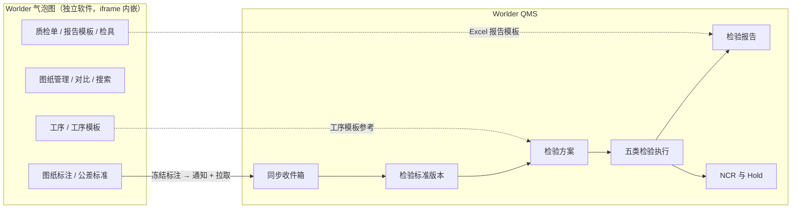
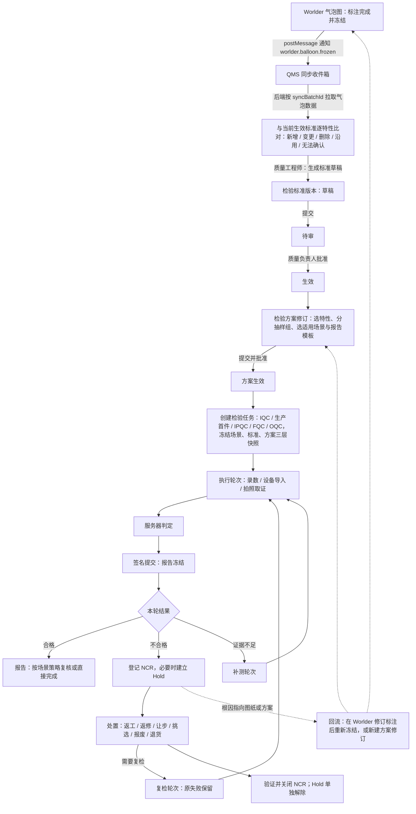
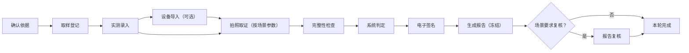
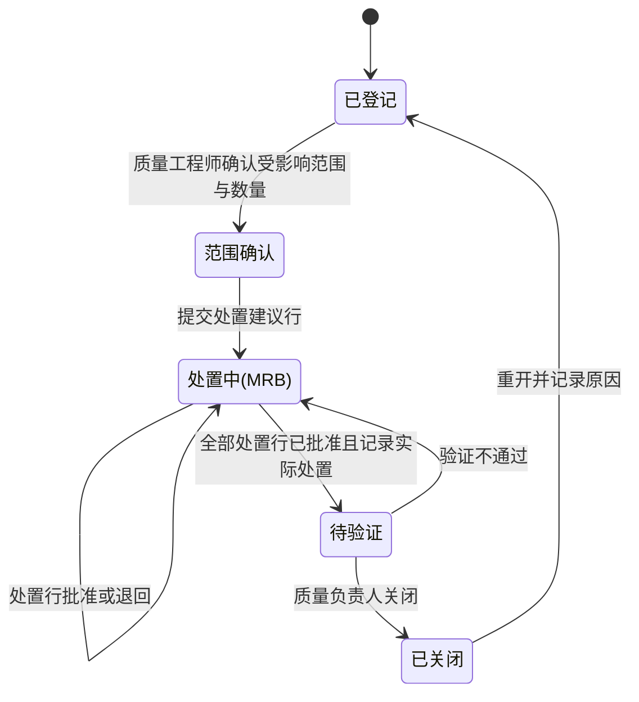
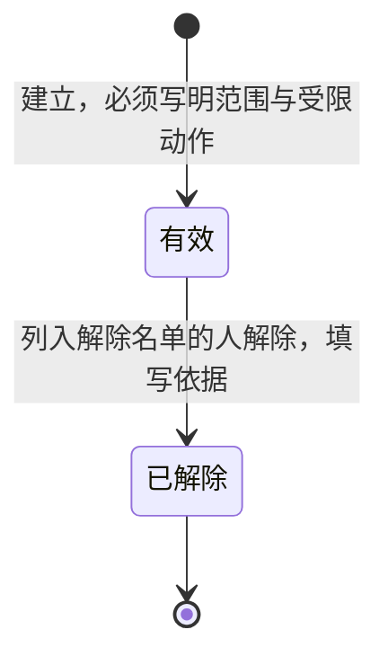
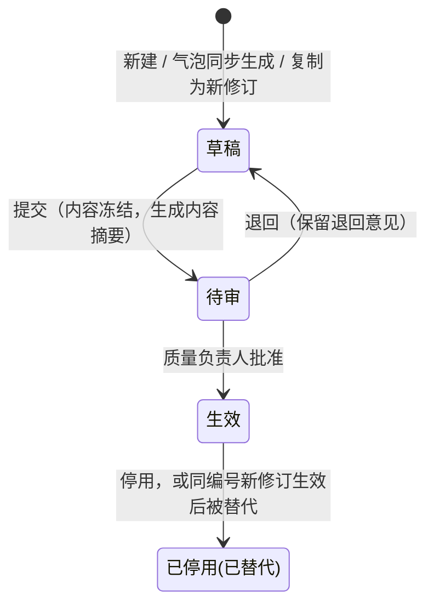
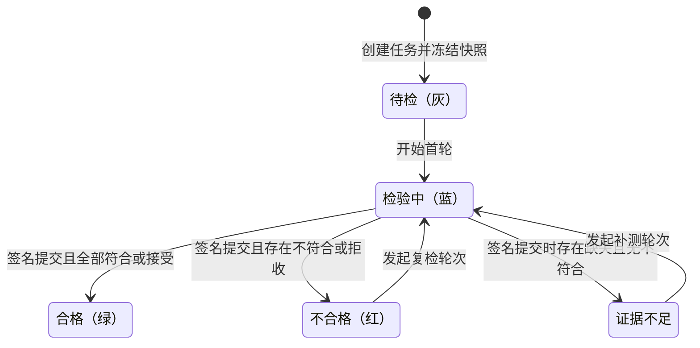
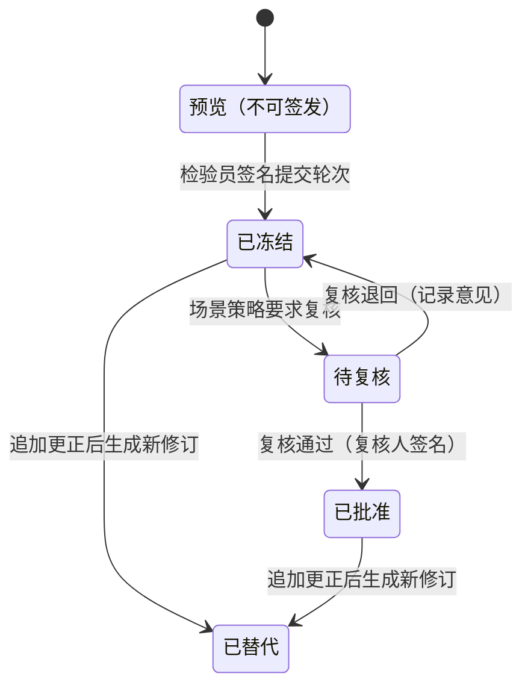
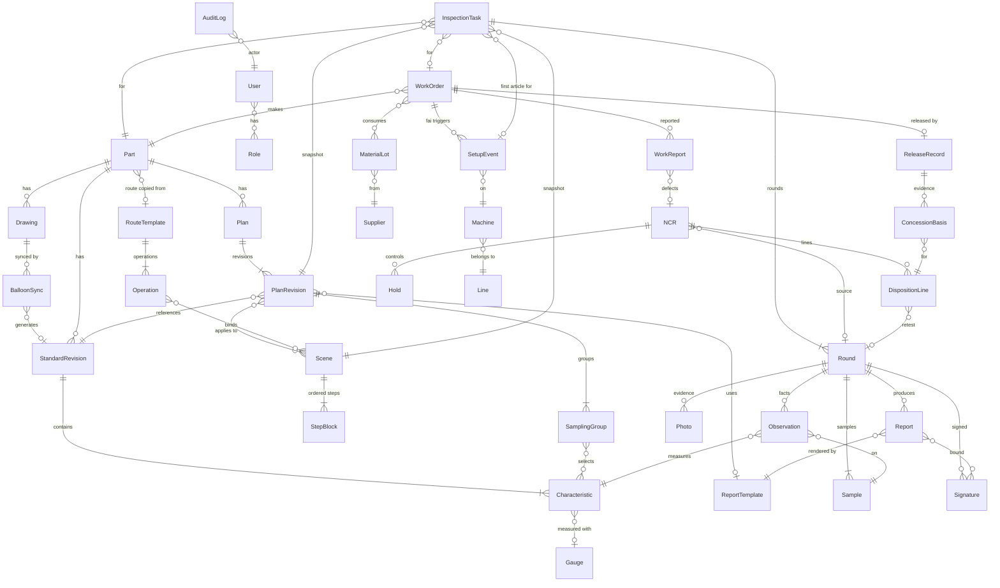
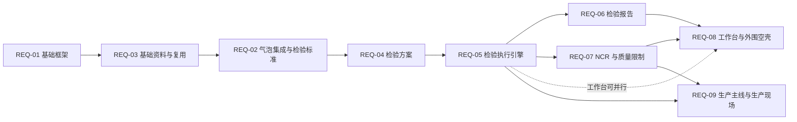

# Worlder QMS 功能需求分析与 PRD 初稿

## 0 文档信息

| 项 | 内容 |
|---|---|
| 产品 | Worlder QMS：与 Worlder 气泡图配套、可私有化部署的质量管理系统 |
| 版本 / 日期 | v0.3 / 2026-11-17 |
| 修订记录 | v0.1 初稿。v0.2 按用户试用原型后的两条反馈补充“任务驱动”的界面要求：FR-WB-009 ~ 014、FR-INS-035 ~ 036、AC-WB-4 ~ 7；这些条目归入需求包 REQ-08（第 10 章）；附录 A 的导航分组同步更新，附录 B 增加两行。v0.3 按用户 2026-11-17 的两条要求新增 §6.11 生产主线与生产现场：以生产工单为主线（FR-ML-001 ~ 010），以及从工厂生产角度提出的六项（报工与良率、首件按机台与触发事件、流转卡与扫码、批次追溯、现场看板、让步放行依据，FR-PROD-001 ~ 028）；FR-WB-009 的各身份流程和 AC-WB-4 的步数、FR-WB-013 的首页内容随之更新；新增数据实体（§9）、需求包 REQ-09（§10）、待确认问题 Q-17 ~ 22（§11）；附录 A、B 同步 |
| 状态 | 初稿，待产品、研发、测试联合评审 |
| 读者 | 产品经理、项目组长、前后端研发、测试 |
| 依据 | 《资料研读综述》（`00_资料研读/资料研读综述.md`）；《QMS系统完整设计方案V3》（下称 V3方案）；《QMS功能与页面设计目录V3》（下称 V3目录）；云质QMS 资料（YZ方案、YZ汇总、YZ规划）；Worlder 气泡图现有界面截图 12 张；用户最初的 HTML 原型；用户 2026-11-16 的三项决定 |
| 配套交付 | 可运行原型（单文件 HTML）、《开发流程确定方案》（`02_开发流程/`） |

**标注约定**

| 标注 | 含义 |
|---|---|
| 【V3方案 pN】【V3目录 Pxx/Axx/Rxx/Qxx】 | V3 设计资料出处 |
| 【YZ方案 pN】【YZ汇总 #N】【YZ规划 §x】 | 云质资料出处（参照厂商，不是本产品） |
| 【Worlder截图】 | 用户提供的 Worlder 气泡图界面截图 |
| 【用户决定】 | 用户 2026-11-16 明确的决定 |
| 【用户反馈】 | 用户 2026-11-16 试用原型后提出的要求：界面要让使用者一眼知道该点哪里（参考黑湖小工单的流程设计）；每种身份要有自己的流程进度提示，从左到右，可以点击。2026-11-17：工厂生产需要一条所有人围着走的主线（用户选定以生产工单为主线）；并从工厂生产角度要求补齐报工与良率、首件按机台与换型触发、工单流转卡二维码、批次正反向追溯、产线班次视图、让步放行留依据 |
| 【审查发现】 | 2026-11-18 多个独立审查代理逐项核实后确认的问题，按此补充或修正的规则 |
| 【建议】 | 资料没有、由本文推断的设计 |
| 【待确认】 | 需要企业或用户拍板，见第 11 章 |

**优先级**：P0 = 首期可运行 demo 与首个生产版本必须；P1 = 二期；P2 = 远期。

---

## 1 背景与目标

### 1.1 为什么要做私有 QMS

1. **Worlder 气泡图已经能产出结构化的检验要求，但没有地方承接后续的质量业务。**
   - 气泡图现有能力：图纸标注、公差标准库、图纸管理与对比、相似图纸搜索、工序管理与工序模板、质检单、检具与检验方法、质检报告模板【Worlder截图】。
   - 缺少：检验标准的版本与生效管理、按场景的检验方案、五类检验任务的执行与判定、真实报告的冻结与复核、不合格处置闭环。
2. **通用 QMS 不认识图纸气泡。**云质QMS 的检验条目靠手工维护或批量导入，图纸只是检验规则的参考附件【YZ规划 §3.2#5、img_04】。气泡识别能把“读图 → 抄公差 → 建检验项”这一步自动化，这是本产品的差异化所在。
3. **客户需要私有化部署。**目标客户的图纸与质量数据属于敏感资料，要求部署在客户自有环境【建议，见 Q-01】。

### 1.2 产品目标

| # | 目标 | 衡量方式【建议】 |
|---|---|---|
| G1 | 气泡冻结的特性能在 QMS 中一键形成检验标准草稿，不再手抄公差 | 气泡同步生成标准草稿的特性字段无人工录入；同步差异可逐条核对 |
| G2 | 五类检验共用一个执行引擎，按场景配置差异 | 新增一个场景配置不需要新开发页面 |
| G3 | 检验事实可信：服务器判定、精确十进制、缺失不补零、复检不覆盖原失败 | V3 验收场景 A01–A11 通过 |
| G4 | 外观检验可现场拍照取证，检验员与复核人手写签名 | 签名绑定内容摘要；内容变化后旧签名失效（A13） |
| G5 | 不合格从检验结果直接发起，处置、限制、复检分别留痕 | A20–A22 通过 |
| G6 | 每道工序、每个流程都能复用（工序路线模板、方案模板、报告模板、流程步骤库） | 见第 5 章 |
| G7 | 可私有化交付：离线安装、备份恢复、审计 | 第 8 章非功能需求 |

### 1.3 与 Worlder 气泡图的关系



- **分工**【用户决定】：图纸标注在 Worlder 气泡图内完成，QMS 通过 iframe/webview 内嵌，不自建标注引擎。QMS 只接收“已冻结”的气泡数据，并负责业务适用、生效、执行、判定、签审与处置。
- **一个批准权威**：同一份检验依据只在 QMS 中批准生效，不要求用户在两边分别批准【V3方案 p13；V3目录 R02】。
- **气泡号只是显示号**：跨版本识别同一特性靠稳定的 `characteristicId`，不靠气泡号或名称【V3方案 p13】。

### 1.4 参照取舍原则

**以 V3 为骨架，吸收云质的体验点，不照搬云质的平台形态。**

| 来源 | 采纳 | 不采纳 |
|---|---|---|
| V3 | 标准与方案分离、三层快照、measurement 与 single_count 分开、服务器判定、轮次与复检、六类结果独立、NCR 与 Hold 分开、显式动作策略【V3方案 §5–§8】 | 依赖 Axis 原生方案编辑的桥接细节（本产品改为 iframe 内嵌 Worlder，见第 7 章） |
| 云质 | 报检单四色状态（灰/蓝/绿/红）【YZ规划 §4.3.2】、抽样组录入网格【YZ规划 img_16】、工作台角标【YZ规划 img_28】、移动端拍照取证【YZ规划 §4.11】、全景追溯思路【YZ规划 §4.6】 | 多租户与域隔离、通用审批流引擎、字段任意自定义、自动判 P/F 并回写 ERP 作为默认行为【YZ汇总 #20、#21；YZ规划 §3.2#3】 |
| 用户原型 | 左图右表联动、气泡颜色区分特殊特性、CMM/量具导入入口、研发排期看板 | 页签式平铺导航、前端随意计算 Ppk、随机生成 NCR 编号、一键全部生效 |

---

## 2 范围

### 2.1 首期核心（6 个模块，可运行 demo + 首个生产版本）【用户决定】

| 模块 | 编号 | 说明 |
|---|---|---|
| 图纸与气泡集成 | M02 | iframe 内嵌 Worlder 气泡图；同步收件箱 |
| 检验标准 | M03 | 标准版本：气泡同步或手工录入 |
| 检验方案 | M04 | 引用标准版本，配置抽样组、适用场景、报告模板 |
| 检验执行（五类检验） | M05 | 来料 IQC、生产首件、过程 IPQC、完工 FQC、出货 OQC 共用执行引擎 |
| 不合格处置 NCR 与质量限制 Hold | M06 | 登记、范围确认、处置、验证、关闭；Hold 独立 |
| 检验报告与报告模板 | M07 | 冻结、签名、复核、打印 |

支撑模块（首期同样需要）：M01 工作台、M08 基础资料、M09 系统管理。

### 2.2 空壳入口（M10，只留入口和规划说明）

CAPA/8D、客户投诉、供应商质量、量具与校准、MSA、SPC 过程分析、审核管理、受控文件、培训管理。规划见 §6.10。

### 2.3 明确不做（保持 V3 候选状态）

| 内容 | 依据 |
|---|---|
| APQP（P52）、PPAP（P55）、DOE（P56） | 【V3目录 §7 p71】 |
| 结构化 FMEA（P53）、控制计划（P54）；首期只能作为受控文件附件 | 【V3目录 §7；V3方案 §9.7】 |
| 管理评审与质量目标（P57）、执行与差异对账（P59） | 【V3目录 §7】 |
| 行业 FAI 鉴定套件（P60，AS9102 类表单与流程）；首期只做“生产首件” | 【V3方案 p10、p46】；是否纳入见 Q-06 |
| 供方门户、供应商外网录入 | 【V3方案 §17】 |
| 多租户、多工厂选择器、域隔离 | 【V3方案 p31、p47】 |
| 通用 BPM 审批引擎、动态菜单、自定义检验类型 | 【V3目录 P61；V3方案 §7.2】 |
| 库存、物流执行账；ERP/MES 回写 | 【V3方案 p2、A11】；外部单号只做可空引用 |
| 周期性试验、质量成本、项目管理、网络销售、采购订单（云质独有模块） | 【研读综述 KQ18】 |

---

## 3 用户角色与权限

### 3.1 演示身份

以下六种身份沿用 V3 原型，**均为待确认的示例配置，不是企业岗位制度**【V3目录 p3–4】。正式上线前须由企业提供岗位与动作授权（Q-05）。

| 身份 | 职责摘要 | 边界 |
|---|---|---|
| 检验员 | 按已生效方案开检、录数、导入、拍照、签名提交；登记 NCR | 不改标准和方案；不能复核报告；不做处置批准 |
| 质量工程师 | 编制并提交标准、方案；维护基础资料与场景配置；开检录数；安排复检；NCR 范围确认与处置建议；建立 Hold | 不批准自己提交的标准和方案【建议】；不复核报告 |
| 质量负责人 | 批准标准、方案生效与停用；复核报告；批准 NCR 处置并关闭；解除 Hold | 不代录数；不是所有业务的超级权限【V3目录 p4】 |
| 生产主管 | 查看质量事实；对 NCR 提出返工、返修、挑选类处置建议 | 建议不等于批准；不改检验事实、不签审报告、不解除 Hold【V3目录 p4】 |
| 仓库执行人 | 查看与实物相关的质量事实与 Hold | 只读；不做质量判定和批准 |
| 系统管理员 | 用户、角色、集成设置；查看操作日志 | 无任何质量审批权（A15）【V3目录 R25】 |

### 3.2 权限矩阵

图例：✓ 可执行；○ 只读；◐ 按策略配置后可执行；— 不可见或不可执行。

| 动作 | 检验员 | 质量工程师 | 质量负责人 | 生产主管 | 仓库执行人 | 系统管理员 |
|---|---|---|---|---|---|---|
| 查看工作台、任务、报告、NCR | ✓ | ✓ | ✓ | ✓ | ○ | ○（无业务明细导出）【建议】 |
| 打开气泡识别工作台（iframe） | ○ | ✓ | ○ | — | — | — |
| 同步收件箱：生成标准草稿 / 忽略 | — | ✓ | ○ | — | — | — |
| 编制、提交检验标准 | — | ✓ | — | — | — | — |
| 批准标准生效、停用 | — | — | ✓ | — | — | — |
| 编制、提交检验方案；另存为模板 | — | ✓ | — | — | — | — |
| 批准方案生效、停用 | — | — | ✓ | — | — | — |
| 维护零部件、工序路线与模板、检具方法 | — | ✓ | ○ | ○ | — | — |
| 维护检验场景与流程步骤参数 | — | ✓ | ◐（场景参数变更需批准时） | — | — | — |
| 创建检验任务（开检） | ✓ | ✓ | — | — | — | — |
| 录数、设备导入、拍照 | ✓ | ✓ | — | — | — | — |
| 签名提交轮次 | ✓ | ✓ | — | — | — | — |
| 发起复检 / 补测轮次 | — | ✓ | — | — | — | — |
| 复核报告（复核人≠本轮签名人） | — | — | ◐ | — | — | — |
| 登记 NCR | ✓ | ✓ | — | — | — | — |
| NCR 范围确认 | — | ✓ | — | — | — | — |
| 提出处置建议 | — | ✓ | — | ✓（返工、返修、挑选） | — | — |
| 批准处置、关闭 NCR、重开 NCR | — | — | ◐ | — | — | — |
| 记录实际处置与验证 | — | ✓ | — | ✓（返工实际记录） | — | — |
| 建立 Hold | — | ✓ | ✓ | — | — | — |
| 解除 Hold | — | — | ◐（列入解除名单） | — | — | — |
| 用户、角色、集成设置 | — | — | — | — | — | ✓ |
| 查看操作日志 | — | ○（本人相关） | ○ | — | — | ✓ |
| 研发排期看板（内部工具） | 不属于产品权限体系，见《开发流程确定方案》 | | | | | |

**授权规则**

1. 服务端按“动作 × 对象 × 当前版本”逐次校验；菜单可见不代表可执行【V3方案 §10.1；R24】。
2. 前端对无权动作显示禁用并说明原因（例如“当前身份无复核权限”），不隐藏事实【建议】。
3. 同一个有权限的人可连续完成“维护标准 → 方案 → 开检 → 录数”的主路径，不强迫换人【V3目录 p3】。
4. 需要人工签审的动作必须有显式策略；未配置时返回 `POLICY_NOT_CONFIGURED`，不默认批准【V3方案 p18–19、A6.3】。
5. 系统管理员调用任何质量批准命令一律拒绝（A15）。
6. 复核人不得为本轮签名人。原型按账号校验；正式版需按自然人（person_id）校验，以防一人多账号自审（A14）【V3目录 A14】。

---

## 4 业务主链与流程

### 4.1 主链：气泡 → 标准 → 方案 → 检验 → 报告 → 问题 → 回流



**主链规则**
- 主链各环节可在同一人连续完成，也可分角色接力。
- 普通合格的检验完成即结束，不额外增加放行申请【V3方案 p2、§7.2；V3目录 R14】。
- 产品、批次、检验三条生命周期不是一条必须走完的流水线；同一批次不必依次经过五类检验【V3方案 p9】。

### 4.2 检验执行步骤流（五类检验共用）



说明：步骤库中的“报告复核”在执行顺序上位于“生成报告”之后，因为复核对象是已冻结的报告修订。

### 4.3 NCR 状态机



### 4.4 质量限制 Hold 状态机



规则：NCR 关闭不自动解除 Hold；解除一个 Hold 不影响其他 Hold（A20）【V3目录 R15】。

### 4.5 标准版本与方案修订状态机



方案修订使用同一套状态机，最终状态名称为“已停用”；同一方案的新修订生效后，旧修订自动转为“已停用”【建议】。

### 4.6 检验任务与报告状态





---

## 5 复用机制专章：每道工序、每个流程都能复用

用户要求“每一道工序 / 流程都要能复用”。本产品通过下面五种机制落地，**全部是“固定类型 + 参数 + 复制即独立”的模式，不做任意 BPM**【V3目录 P61：五个场景代码固定，不新增自定义类型、动态菜单或 BPM】。

### 5.1 流程步骤库（FR-MD-010 ~ FR-MD-013）

**固定步骤类型（10 种）**

| 代码 | 步骤 | 作用 | 可配参数 |
|---|---|---|---|
| BASIS | 确认依据 | 展示并确认三层快照、被检对象、场景上下文 | 需确认的上下文字段（如工序、设备、程序号） |
| SAMPLING | 取样登记 | 登记实体样本编号、来源（新取 / 原样本子集） | 样本编号规则；是否必须扫码【P1】 |
| MEASURE | 实测录入 | 计量组逐值录入、计数组录入不良数 | 键盘录入顺序（按特性 / 按样本） |
| IMPORT | 设备导入 | CSV/Excel/CMM 文件或接口导入 | 允许的导入来源；映射模板 |
| PHOTO | 拍照取证 | 拍照或上传图片，挂到特性、样本或轮次 | 拍照要求：不要求 / 不合格项必须拍照 / 外观类特性必须拍照 |
| CHECK | 完整性检查 | 列出缺失值、未拍照项、未登记样本 | 缺失时是否允许以“证据不足”提交（默认允许） |
| JUDGE | 系统判定 | 服务器按规则判定，展示结果 | 无（判定规则来自方案，不可在场景改） |
| SIGN | 电子签名 | 检验员手写签名，绑定本轮内容摘要 | 是否必须签名（默认必须） |
| REPORT | 生成报告 | 冻结报告修订 | 默认报告模板（方案可覆盖） |
| REVIEW | 报告复核 | 复核人核对并签名 | 是否需要复核；复核人角色名单；复核人不得为签名人（固定开启） |

**五类场景的默认组合**【建议，参数待企业确认 Q-04】

| 场景（代码） | 默认步骤顺序 | 默认参数 |
|---|---|---|
| 来料检验 IQC | BASIS → SAMPLING → MEASURE → IMPORT → PHOTO → CHECK → JUDGE → SIGN → REPORT | 拍照：不合格项必须拍照；复核：关闭 |
| 生产首件 FIRST_ARTICLE | BASIS（工序、设备、程序号）→ SAMPLING → MEASURE → IMPORT → PHOTO → CHECK → JUDGE → SIGN → REPORT → REVIEW | 拍照：外观类特性必须拍照；复核：开启，复核角色＝质量负责人【待确认】 |
| 过程检验 IPQC | BASIS（工序、时段）→ SAMPLING → MEASURE → CHECK → JUDGE → SIGN → REPORT | 拍照：不合格项必须拍照；复核：关闭 |
| 完工检验 FQC | BASIS → SAMPLING → MEASURE → IMPORT → PHOTO → CHECK → JUDGE → SIGN → REPORT | 拍照：外观类特性必须拍照；复核：关闭 |
| 出货检验 OQC | BASIS（客户、出货单）→ SAMPLING → MEASURE → PHOTO → CHECK → JUDGE → SIGN → REPORT → REVIEW | 拍照：外观类特性必须拍照；复核：开启【待确认】；CoC 按合同【V3方案 §7.3】 |

**规则**
- 步骤类型只能从库里选；可以调整顺序（受依赖约束：JUDGE 必须在 MEASURE 之后，SIGN 必须在 JUDGE 之后，REPORT 必须在 SIGN 之后，REVIEW 必须在 REPORT 之后）、开关可选步骤、改参数。
- BASIS、MEASURE、CHECK、JUDGE、SIGN、REPORT 为必选步骤，不可移除【建议】。
- 场景配置保存为 `definitionVersion`；任务创建时冻结当时的场景定义版本，后续修改不影响在途任务（A50）【V3目录 R01】。

### 5.2 工序路线模板（FR-MD-005 ~ FR-MD-009）

对应 Worlder 气泡图的“工序管理 / 工序模板”【Worlder截图：#/drawing-processes、#/process-templates】。

**配置示例**

| 工序号 | 工序名称 | 工作中心 | 绑定的检验场景 |
|---|---|---|---|
| 10 | 下料 | 锯床组 | — |
| 20 | 粗车 | 数控车一组 | 生产首件（每班首件）；过程检验 IPQC（每 2 小时） |
| 30 | 精车 | 数控车二组 | 生产首件；过程检验 IPQC（每 2 小时） |
| 40 | 电镀（外协） | 外协 | 来料检验 IQC（外协回厂） |
| 50 | 终检包装 | 质检区 | 完工检验 FQC；出货检验 OQC |

**规则**
- 模板有修订号；“应用到零件”时生成该零件的**独立路线副本**，记录来源模板及修订；模板后续修改**不回写**已应用的零件路线【V3方案 p13：模板只提供编制起点】。
- 零件路线中的“工序 × 场景”绑定，用于：开检时自动带出工序上下文；方案按“零件 + 场景 + 工序”过滤适用【V3目录 P14、P46】。
- 按频次自动建任务（如每 2 小时）在首期只做“到期提醒”，不自动派工【V3目录 P14：自动按频次创建任务未接通】。

### 5.3 检验方案模板（FR-PLN-010 ~ FR-PLN-012）

| 操作 | 结果 |
|---|---|
| 另存为模板 | 保存方案的**结构**：适用场景、抽样组划分规则（按特性类别分组）、各组抽样参数、报告模板、备注。**不保存具体零件的特性与公差**【V3目录 P07：不自动复制其他产品公差】 |
| 从模板新建 | 选模板 + 选零件的生效标准版本 → 系统按“特性类别 → 抽样组”规则自动分组 → 编制人逐条核对后保存为新方案草稿 |
| 复制为新修订 | 复制当前方案修订为新草稿（新 ID），可改选标准版本或项目；原修订不变 |

**分组规则示例**：线性尺寸、角度尺寸、形位公差、螺纹、表面粗糙度 → 计量组（measurement，n=5）；外观 → 计数组（single_count，按 AQL 或企业授权表给出 n/Ac/Re）。

规则：模板与方案是“复制来源”关系，不是“运行绑定”；模板修改不会让已有方案或在途任务自动变更【V3目录 P07】。

### 5.4 报告模板（FR-RPT-010 ~ FR-RPT-014）

- 多个方案可引用同一个报告模板；方案未指定时用场景默认模板。
- 模板来源两种：QMS 内置模板；从 Worlder 气泡图“质检报告模板”导入的 Excel 模板【Worlder截图：#/inspection-templates，模板如“首件检验报告（系统）”“制程巡检报告-A班（系统）”“出货报告模版（系统）”】。
- 模板只决定**呈现**，不改变底层判定、单位与原始值【V3目录 P22】。

### 5.5 共用检验执行引擎（FR-INS 全部）

- 五个检验入口（IQC、生产首件、IPQC、FQC、OQC）是同一个执行页面加不同的过滤条件与场景配置；差异只来自**场景配置**（步骤与参数）和**方案**（特性、抽样组、判定规则）。
- 新增一个场景差异（例如出货检验要求复核）只改场景参数，不改代码。
- 任务总览（P11）用于跨场景检索，不取代五个入口【V3方案 p38】。

---

## 6 功能需求明细

每个模块按“页面 → 字段 → 需求条目 → 规则与边界 → 验收”组织。需求条目列：编号、需求、优先级、出处。

### 6.1 M01 工作台（FR-WB）

**页面**：我的工作（首页）；数据看板；全局组件：身份流程条、下一步提示条、⌘K 命令面板、通知中心、演示身份切换、待办角标。

**设计原则**【用户反馈】：界面按“使用者下一步该做什么”组织，而不是按功能模块平铺。每个页面只突出一个主要动作；不是当前身份该做的事，说明在等谁，而不是摆一个点不了的按钮。

| 编号 | 需求 | 优先级 | 出处 |
|---|---|---|---|
| FR-WB-001 | 按当前身份聚合待办：待检任务、我的检验中任务、待复核报告、待处理 NCR（按状态）、待批准标准/方案、同步收件箱待处理、有效 Hold；每类显示数量角标并可一键进入对象当前状态 | P0 | 【V3目录 P01】【YZ规划 img_28】 |
| FR-WB-002 | 同一业务对象在待办中只出现一次；只显示当前身份有权访问的对象；首期不把空间内全部任务当作“我的任务” | P0 | 【V3目录 P01、p4】 |
| FR-WB-003 | 指标卡：批接受率、首次通过率、NCR 开口数、本期检验任务数；每个指标显示分子、分母、统计区间、口径说明，并可下钻到明细 | P0 | 【V3方案 §13.1；R27】 |
| FR-WB-004 | 指标口径：批接受率只统计 single_count 组形成的批接受；仅 measurement 的任务计入“被检范围符合率”，不计入批接受率；分母为 0 时显示“—”，不显示 0% | P0 | 【V3方案 p17、p25–27；A45】 |
| FR-WB-005 | 最近动态：最近 20 条与本人相关的操作记录（来自审计日志） | P1 | 【建议】 |
| FR-WB-006 | ⌘K / Ctrl+K 命令面板：搜索页面、零件、任务、标准、方案、报告、NCR；执行常用动作（新建检验任务、登记 NCR、打开气泡工作台）；无命中时显示“无匹配”，不得退化为返回前 N 条 | P0 | 【V3目录 A19、R34】 |
| FR-WB-007 | 通知中心：同步收件箱新消息、待复核报告、NCR 指派、Hold 建立/解除；站内通知，首期不发邮件和 IM | P0 | 【研读综述 KQ14】 |
| FR-WB-008 | 演示身份切换（仅演示环境）：切换后菜单、按钮可用性和待办即时变化；生产环境以登录身份为准，不提供切换 | P0 | 【V3目录 p3】 |
| FR-WB-009 | 身份流程条：每种身份有一条自己的工作流程，从左到右排列；每一步显示序号、名称、一句说明和“这一步现在等我处理的数量”。首页用卡片版；其它页面在顶栏下方固定显示一行，当前页面所属的步骤高亮。各身份的步骤见下表 | P0 | 【用户反馈】 |
| FR-WB-010 | 流程条的每一步都可以点：这一步有待办时直接打开第一件待办对象，没有待办时打开对应的清单页。步骤上的数量与待办清单（FR-WB-001）同一口径，不允许出现“有数字、点进去是空的” | P0 | 【用户反馈】 |
| FR-WB-011 | 检验员打开一张检验后，流程条变成“这张检验的进度”：已完成的步骤打勾，当前步骤显示进度（已录读数 / 应录读数，或还差几项照片），不再显示其它任务的数量。点“录数据 / 拍照取证 / 签名提交”时留在当前页面并定位到对应操作，不跳到别的任务 | P0 | 【用户反馈】 |
| FR-WB-012 | 下一步提示条：标准、方案、检验任务、报告、NCR 的详情页顶部用一句话说明下一步做什么、由谁做、按钮在哪里。当前身份无权执行时显示“等待某岗位操作”（演示环境可以一键切换到该身份继续）；对象已办结时显示“已完成”和后续可做的事（如查看报告） | P0 | 【用户反馈】 |
| FR-WB-013 | 首页是“生产主线”（FR-ML-001 ~ 003）：工单看板（默认只列轮到我的工单）、按工单号 / 批次号 / 检验单号查找、不在工单上的待办（可折叠，每条带一个动作按钮）。指标卡和图表（FR-WB-003、004）放到“数据看板”页，只在质量工程师、质量负责人、生产主管的导航里显示 | P0 | 【用户反馈】 |
| FR-WB-014 | 导航分级：侧栏默认只显示日常入口（做检验、定标准、看数据，按身份裁剪），基础资料、系统、规划中的模块收进“更多功能”；当前页面在“更多功能”里时自动展开；系统管理员的“系统”分组直接显示 | P0 | 【用户反馈】 |

**各身份的流程步骤（FR-WB-009）**

| 身份 | 流程（从左到右） | 每一步的数量口径 |
|---|---|---|
| 检验员 | 看现场 → 接任务 → 录数据 → 拍照取证 → 签名提交 → 看结果 | “看现场”计现场看板上本人能做的要紧项（巡检超时、等首件、进行中的首件和巡检、30 分钟内到点的巡检，FR-PROD-024）；其余为指派给本人的未提交任务，按所处阶段各计一次：还没开始 / 读数没录完 / 读数录完但差照片 / 都齐了等签名；“看结果”计本人不合格但未登记 NCR 的任务和被退回的报告 |
| 质量工程师 | 收气泡 → 定标准 → 编方案 → 盯主线 → 处置不合格 → 看报告 | 待处理的气泡同步 / 标准草稿 / 方案草稿和待决定是否采用新标准的方案 / 主线上轮到质量工程师的工单 / 轮到质量工程师操作的 NCR / 被退回的报告 |
| 质量负责人 | 审标准 → 审方案 → 复核报告 → 批准处置 → 验证关闭 → 质量放行 → 看数据 | 待审标准 / 待审方案 / 待复核报告 / 有处置行待批准的 NCR / 待验证关闭的 NCR 和已关闭但仍有有效 Hold 的 NCR / 主线走完、等待放行的工单 |
| 生产主管 | 看主线 → 报工 → 核对不合格 → 提返工建议 → 跟进处置 → 看数据 | 主线上有问题的工单 / 已开始生产、本班还没报工的工单 / 新登记的 NCR / 范围已确认待提建议的 NCR / 处置中和待验证的 NCR |
| 仓库执行人 | 看质量限制 → 发货前核对 → 可发货的工单 → 查报告 | 有效 Hold 条数 / 查询入口不计数 / 已质量放行的工单 / 查询入口不计数 |
| 系统管理员 | 管账号 → 接气泡服务 → 查日志 | 气泡服务未握手时“接气泡服务”计 1 |

以上步骤是按首期六种演示身份给出的示例【待确认】，正式上线前随岗位与授权（Q-05）一起由企业确认；步骤定义放在配置里，不写死在页面中。

**验收**
- AC-WB-1：Given 检验员登录，When 打开工作台，Then 只看到分配给本人或本人创建的待检/检验中任务，看不到“待批准标准”。
- AC-WB-2：Given 本期没有 single_count 任务，When 查看批接受率，Then 显示“—”并提示“本期无计数判批任务”。
- AC-WB-3（A19）：Given 命令面板输入不存在的批次号，Then 结果为空并提示“无匹配”。
- AC-WB-4：Given 依次切换六种身份（检验员、质量工程师、质量负责人、生产主管、仓库执行人、系统管理员），When 打开任意页面，Then 流程条的步骤分别是 6、6、7、6、4、3 步，内容与上表一致；每一步点击后都打开一个可用页面。
- AC-WB-5：Given 质量负责人有 2 份待复核报告，When 看流程条，Then “复核报告”显示 2；点击后打开其中第一份报告；签批后数字变成 1。
- AC-WB-6：Given 检验员打开一张读数没录完的检验，When 看流程条，Then “接任务”打勾、“录数据”高亮并显示“已录 / 应录”；点“签名提交”，Then 页面不跳转，弹出签名提交窗口。
- AC-WB-7：Given 质量工程师打开一份待审核的标准，When 看下一步提示条，Then 显示“等待质量负责人操作”；页面上的批准按钮置灰并说明原因。

### 6.2 M02 图纸与气泡集成（FR-DRW）

**页面**：气泡识别工作台（iframe 内嵌）；同步收件箱（工作台右侧抽屉 + 独立列表）。

**路由映射**（来自 Worlder 气泡图现有导航）【Worlder截图】

| 分组 | 页面 | Worlder 路由 |
|---|---|---|
| 标注 | 图纸标注 | `#/drawing-packages` |
| 标注 | 公差标准 | `#/tolerances` |
| 图纸 | 相似图纸搜索 | `#/drawing-search` |
| 图纸 | 图纸库数据集 | `#/drawing-datasets` |
| 图纸 | 图纸管理 | `#/drawing-management` |
| 图纸 | 图纸对比与标注 | `#/drawing-compare` |
| 工序 | 工序管理 | `#/drawing-processes` |
| 工序 | 工序模板 | `#/process-templates` |
| 质检 | 质检单 | `#/inspection-reports` |
| 质检 | 质检单模板 | `#/inspection-reports/templates` |
| 量具 | 检具与检验方法 | `#/gauges` |
| 模板 | 质检报告模板 | `#/inspection-templates` |

**同步收件箱字段**

| 字段 | 类型 | 必填 | 来源 | 说明 |
|---|---|---|---|---|
| syncBatchId | string | 是 | Worlder | 同步批次号，幂等键之一 |
| drawingNo / drawingRev | string | 是 | Worlder | 图号、图纸版本 |
| partNo | string | 否 | Worlder / 人工关联 | 未带零件号时须人工关联零件 |
| contentHash | string | 是 | Worlder | 冻结内容摘要；与 syncBatchId 共同去重 |
| balloonCount | int | 是 | Worlder | 气泡数量 |
| receivedAt | datetime | 是 | QMS | 收到通知时间（服务器时间） |
| fetchStatus | enum | 是 | QMS | 待拉取 / 已拉取 / 拉取失败 |
| diffSummary | object | 否 | QMS | 与当前生效标准比对：新增 n、变更 n、删除 n、沿用 n、无法确认 n |
| status | enum | 是 | QMS | 待处理 / 已生成草稿 / 已忽略 |
| handledBy / handledAt / ignoreReason | — | 条件必填 | QMS | 忽略时必须填原因 |
| standardRevisionId | uuid | 否 | QMS | 生成的标准草稿 |

| 编号 | 需求 | 优先级 | 出处 |
|---|---|---|---|
| FR-DRW-001 | 以 iframe 内嵌 Worlder 气泡图；顶部分组页签按上表路由切换，保留 Worlder 自身导航可用 | P0 | 【用户决定】 |
| FR-DRW-002 | 气泡服务基础地址可在集成设置中配置（默认 `https://223.106.198.62:3080`）；修改后无需重新部署前端 | P0 | 【建议】 |
| FR-DRW-003 | 加载握手：iframe 加载后 8 秒内未收到 `worlder.ready`，显示“未连接”提示及排查指引（证书未信任、CSP frame-ancestors 未放行、服务不可达），并提供“在新窗口打开” | P0 | 【建议】 |
| FR-DRW-004 | 收到 `worlder.ready` 后，QMS 向 iframe 发送 `qms.context`（当前零件号、图号、短期令牌），使 Worlder 打开对应图纸 | P1 | 【建议】 |
| FR-DRW-005 | 只处理白名单 origin 发来的消息；非白名单消息丢弃并写安全日志 | P0 | 【建议】 |
| FR-DRW-006 | 收到 `worlder.balloon.frozen` 后在收件箱新增一条待处理记录；浏览器消息只作通知，权威数据由 QMS 后端按 syncBatchId 拉取 | P0 | 【建议】 |
| FR-DRW-007 | 同一 syncBatchId + contentHash 重复通知不重复建记录（幂等）；同 syncBatchId 不同 contentHash 视为冲突，提示人工核对 | P0 | 【V3方案 A6.1 幂等】 |
| FR-DRW-008 | 差异比对：按 `characteristicId` 与该零件当前生效标准逐条比对，结果分“新增 / 变更（列出旧值→新值、放宽或收紧）/ 删除 / 沿用 / 无法确认”；不按气泡号或名称合并 | P0 | 【V3方案 p13–14；业务图 04】 |
| FR-DRW-009 | “生成标准草稿”：以拉取的数据新建标准修订（来源＝气泡同步），记录 syncBatchId、contentHash、图纸版本；“无法确认”的特性必须人工映射或标注为新增后才能提交 | P0 | 【V3方案 p13】 |
| FR-DRW-010 | “忽略”须填写原因并留痕 | P0 | 【建议】 |
| FR-DRW-011 | 演示环境提供“模拟一次冻结同步”按钮，生成带差异的模拟数据，便于无网络时演示；生产环境隐藏 | P0（仅 demo） | 【建议】 |
| FR-DRW-012 | 图纸与零件关联：同步数据未带零件号时，在收件箱中选择或新建零件后才能生成草稿 | P0 | 【V3目录 P02、P45】 |

**边界与异常**
- 自签名证书：浏览器会阻止 iframe 首次加载，需用户先在新窗口访问并信任，或由运维更换有效证书（Q-02）。
- Worlder 页面内的编辑、标注、导出行为由 Worlder 自身权限控制；QMS 不代理 Worlder 的写操作。
- 收件箱拉取失败可重试；失败不影响已生效标准和在途任务。

**验收**
- AC-DRW-1：Given 气泡服务未放行 frame-ancestors，When 打开气泡工作台，Then 8 秒后显示“未连接”及指引，“在新窗口打开”可用。
- AC-DRW-2：Given 同一冻结结果被通知两次，Then 收件箱只有一条记录。
- AC-DRW-3（A10 前半）：Given 新图版收紧了 #1 公差，When 打开收件箱差异，Then #1 显示为“变更（收紧）”并列出旧值与新值。
- AC-DRW-4：Given 消息来自非白名单 origin，Then 收件箱无变化，安全日志新增一条记录。

### 6.3 M03 检验标准（FR-STD）

**页面**：标准列表；标准详情（特性表 + 图纸缩略图与气泡 + 修订谱系 + 引用方案）；修订对比。

**标准修订字段**

| 字段 | 类型 | 必填 | 来源 | 说明 |
|---|---|---|---|---|
| standardRevisionId | uuid | 是 | 系统 | 每个修订一个新 ID |
| standardCode | string | 是 | 人工 / 规则生成 | 标准编号；同一编号下多个修订 |
| revision | string | 是 | 系统 | 修订号（A、B…或 1、2…）【待确认编号规则】 |
| partId | uuid | 是 | 关联 | 零件 |
| source | enum | 是 | 系统 | 气泡同步 / 手工录入 |
| drawingNo / drawingRev / syncBatchId | string | 来源为气泡同步时必填 | 同步 | 追溯来源 |
| specSource | string | 来源为手工时必填 | 人工 | 规范或文件来源（无图纸时） |
| status | enum | 是 | 系统 | 草稿 / 待审 / 生效 / 已停用(已替代) |
| contentHash | string | 提交后必有 | 系统 | 内容摘要；提交后内容不可改 |
| submittedBy/At、approvedBy/At、retiredBy/At、retireReason | — | 按状态 | 系统 | 审计字段 |
| parentRevisionId | uuid | 否 | 系统 | 复制来源修订 |

**特性字段**

| 字段 | 类型 | 必填 | 来源 | 说明 |
|---|---|---|---|---|
| characteristicId | string | 是 | Worlder / 系统 | 稳定特性 ID，跨修订不变 |
| balloonNo | string | 气泡来源必填 | Worlder | 显示号，不作主键 |
| name | string | 是 | Worlder / 人工 | 特性名称 |
| category | enum | 是 | Worlder / 人工 | 线性尺寸、角度尺寸、形位公差、螺纹、表面粗糙度、外观、理化、功能、其他 |
| gdtSymbol | string | 否 | Worlder | 形位公差符号 |
| nominal | decimal string | 计量必填 | Worlder / 人工 | 名义值，按原文字符串保存 |
| upperTol / lowerTol | decimal string | 否 | Worlder / 人工 | 上下偏差 |
| usl / lsl | decimal string | 至少一个（计量） | 计算 / 人工 | 规格上下限；单边公差允许只有一个 |
| unit | string | 计量必填 | Worlder / 人工 | mm、μm、°、N、HRC 等 |
| specialClass | enum | 是 | Worlder / 人工 | CTQ 关键特性 / CC 重要特性 / 一般 |
| judgeType | enum | 是 | 人工（默认按类别） | 计量 / 计数 |
| nonConcession | bool | 否 | 人工 | 不可让步标识【V3目录 R16】 |
| gaugeTypeId / method | ref / string | 否 | 人工（按类别推荐） | 检具与检验方法 |
| sourceRef | object | 气泡来源必填 | Worlder | 页码、坐标、原文片段 |
| remark | string | 否 | 人工 | 备注 |

| 编号 | 需求 | 优先级 | 出处 |
|---|---|---|---|
| FR-STD-001 | 标准列表：按零件、来源、状态、编号、关键字筛选；列显示编号、修订、零件、来源、状态、特性数、生效时间、被引用方案数 | P0 | 【V3目录 P06】 |
| FR-STD-002 | 手工新建标准（无图纸时可用），全部特性字段可编辑 | P0 | 【V3方案 p13】 |
| FR-STD-003 | 从同步收件箱生成标准草稿（见 FR-DRW-009） | P0 | 【V3目录 P02】 |
| FR-STD-004 | 气泡来源草稿中，名义值、公差、单位、气泡号、图纸来源字段只读；需修改时回到 Worlder 修订并重新冻结同步。QMS 只维护质量属性：特殊特性等级、判定类型、检验方法/检具、不可让步、备注 | P0 | 【建议】（避免两边各有一套公差） |
| FR-STD-005 | 提交审核：校验必填项（计量特性至少有一个规格限、单位有效、characteristicId 唯一）；提交后生成 contentHash，内容不可再改 | P0 | 【V3方案 p13；V3目录 R01】 |
| FR-STD-006 | 质量负责人批准生效或退回；退回回到草稿并保留意见；提交人不得批准本人提交的修订【建议，待确认 Q-05】 | P0 | 【V3方案 §7.2】 |
| FR-STD-007 | 同一标准编号同时最多一个生效修订；新修订生效时旧修订自动变为“已停用(已替代)” | P0 | 【建议】 |
| FR-STD-008 | “复制为新修订”：生成新 ID 的草稿，记录父修订；不改动原修订 | P0 | 【V3目录 P06】 |
| FR-STD-009 | 停用：只阻止新方案引用和新任务采用；在途任务和历史报告不受影响 | P0 | 【V3目录 A50】 |
| FR-STD-010 | 新标准修订生效**不自动更换**任何方案的引用；在标准详情显示“仍引用旧修订的方案”列表并提示编制人 | P0 | 【V3目录 A51】 |
| FR-STD-011 | 修订对比：选择两个修订，按 characteristicId 显示新增、删除、变更（旧值→新值，放宽/收紧）；对比本身不产生任何采用决定 | P1 | 【V3目录 P04】 |
| FR-STD-012 | 标准详情左图右表联动：点击气泡高亮特性行，点击行定位气泡；按特殊特性着色（CTQ 红、CC 橙、一般蓝） | P0 | 【V3目录 F008/F009】【用户原型】 |
| FR-STD-013 | 被方案或任务引用的修订不可删除；草稿可删除 | P0 | 【V3方案 §3.2】 |
| FR-STD-014 | 导出特性清单（Excel） | P1 | 【V3目录 F025】 |

**验收**
- AC-STD-1（A49）：Given 从气泡同步生成并批准了标准 A 修订，When 编制方案，Then 方案只能选择该标准某一修订的特性，不能另录公差。
- AC-STD-2（A51）：Given 方案 P 引用标准修订 A，When 标准修订 B 生效，Then P 仍引用 A，标准详情提示“1 个方案仍引用旧修订”。
- AC-STD-3（A50）：Given 任务 T 已按修订 A 开始，When 修订 A 被停用，Then T 可继续录数、提交和复检；新建任务时不能再选用修订 A。
- AC-STD-4（A13）：Given 修订 A 已生效，When 尝试修改特性 #1 公差，Then 系统拒绝并引导“复制为新修订”。

### 6.4 M04 检验方案（FR-PLN）

**页面**：方案列表；方案编辑（特性选择、抽样组、适用场景、报告模板、预览）；方案模板列表。

**方案修订字段**

| 字段 | 类型 | 必填 | 说明 |
|---|---|---|---|
| planId / planRevisionId | uuid | 是 | 方案根与修订 |
| planCode / name / revision | string | 是 | 编号、名称、修订号 |
| partId | uuid | 是 | 适用零件 |
| standardRevisionId | uuid | 是 | 引用的一个标准修订 |
| sceneCodes | enum[] | 是 | 适用场景：IQC / FIRST_ARTICLE / IPQC / FQC / OQC |
| operationRefs | ref[] | 否 | 适用工序（来自零件路线），用于生产首件、IPQC 过滤 |
| samplingGroups | object[] | 是 | 见下表 |
| reportTemplateId | ref | 否 | 为空时用场景默认模板 |
| boundaryRule | enum | 是 | 规格限是否包含端点，默认“包含”【待确认】 |
| status | enum | 是 | 草稿 / 待审 / 生效 / 已停用 |
| sourceTemplateId / sourceTemplateRev | ref | 否 | 从模板新建时记录 |
| contentHash、审计字段 | — | 按状态 | 同标准 |

**抽样组字段**

| 字段 | 类型 | 必填 | 说明 |
|---|---|---|---|
| groupCode / groupName | string | 是 | 如“#1 计量组”“#2 外观 AQL 组” |
| strategy | enum | 是 | measurement（计量组）/ single_count（计数组） |
| characteristicIds | string[] | 是 | 本组特性，必须属于所引用的标准修订；一个特性只能在一个组 |
| n | int | 是 | 样本数；measurement 为固定 n，逐值录入 |
| ac / re | int | single_count 必填 | 接收数、拒收数；须 Re = Ac + 1（一次抽样） |
| samplingRef | object | 否 | 抽样依据：标准名称、检验水平、AQL、批量范围；仅作说明 |
| earlyReject | bool | single_count | 不良达到 Re 时是否允许提前结束并拒收 |
| countUnit | enum | single_count | 计数口径，首期只支持“件” |

| 编号 | 需求 | 优先级 | 出处 |
|---|---|---|---|
| FR-PLN-001 | 方案列表：按零件、场景、状态、标准修订筛选；显示方案编号、修订、零件、引用标准修订、适用场景、状态、在途任务数 | P0 | 【V3目录 P08】 |
| FR-PLN-002 | 新建方案：先选零件，再选该零件**生效**的标准修订，再勾选特性；不得另录公差、单位 | P0 | 【V3目录 P08；A49】 |
| FR-PLN-003 | 抽样组编辑：新建、删除、拖拽特性到组；计量组设 n；计数组设 n / Ac / Re / 提前拒收 | P0 | 【YZ规划 img_16】【V3目录 R03】 |
| FR-PLN-004 | 抽样辅助：按批量与 AQL 给出 n/Ac/Re 建议。原型只内置 GB/T 2828.1 一般检验水平 II、正常检验一次抽样的**演示子集**；子集外的组合明确提示“不支持，请按企业授权表人工填写”，不猜测 | P0（演示）/ P1（企业授权表导入） | 【V3目录 A44、Q05；研读综述 KQ11】 |
| FR-PLN-005 | 计数组校验：n ≥ 1，0 ≤ Ac < Re，Re = Ac + 1；计数组特性的判定类型须为“计数” | P0 | 【建议】 |
| FR-PLN-006 | 一个特性必须且只能属于一个抽样组；标准中未选入的特性在方案中显示为“本方案不检”，并须填写理由【建议】 | P0 | 【V3方案 R04】 |
| FR-PLN-007 | 选择适用场景（可多选）与适用工序；开检时按“零件 + 场景（+ 工序）”只列出生效方案 | P0 | 【V3目录 P08】 |
| FR-PLN-008 | 提交、批准生效、退回、停用，规则同标准（FR-STD-005 ~ 009）；批准后内容不可改 | P0 | 【V3目录 R01、R02】 |
| FR-PLN-009 | 复制为新修订：可改选新的标准修订；系统按 characteristicId 带出原分组，新增特性进入“待分组”，删除的特性提示移除 | P0 | 【V3目录 A51】 |
| FR-PLN-010 | 另存为模板：保存结构与分组规则，不含具体特性和公差 | P0 | 第 5.3 节 |
| FR-PLN-011 | 从模板新建：选模板 + 标准修订，按类别规则自动分组，人工核对后保存为草稿 | P0 | 第 5.3 节 |
| FR-PLN-012 | 方案模板列表：名称、修订、适用场景、分组规则摘要、被复制次数；模板修订不影响已复制方案 | P1 | 【V3目录 P07】 |
| FR-PLN-013 | 方案预览：按场景预览检验员看到的录入网格（不可录数） | P1 | 【建议】 |
| FR-PLN-014 | 检验指导书（SIP）由方案与标准生成，可打印 | P1 | 【V3目录 P10】 |

**规则与边界**
- 开检时 n / Ac / Re 从方案继承，任务创建界面不可修改【V3目录 R03】。
- 新标准修订不自动更换方案引用；新方案修订不回写在途任务【V3目录 A51】。
- 一个方案修订只引用一个标准修订【V3目录 P08】。

**验收**
- AC-PLN-1（A44）：Given 批量 1241、AQL 0.010，When 点“抽样建议”，Then 提示“该组合不在已授权抽样规则内”，不自动填值。
- AC-PLN-2：Given 计数组 Ac=3、Re=5，When 保存，Then 拒绝并提示“一次抽样须 Re = Ac + 1”。
- AC-PLN-3：Given 模板“机加件通用”，When 用它为零件 X 新建方案，Then 尺寸类特性进入计量组 n=5、外观类进入计数组，所有公差来自 X 的标准修订。

### 6.5 M05 检验执行（五类检验共用引擎，FR-INS）

**页面**：生产工单（工单 → 工序 → 检验点）；检验任务（列表，用页签按来料、生产首件、过程、完工、出货五类筛选）；新建检验三步向导与完整表单；检验执行页（共用）；复检 / 补测轮次对话框；签名板；拍照与照片查看。

**任务字段**

| 字段 | 类型 | 必填 | 说明 |
|---|---|---|---|
| taskNo | string | 是 | 服务器生成，规则如 `IQC-20261116-0001`【待确认】 |
| sceneCode / sceneDefinitionVersion | enum / int | 是 | 冻结 |
| partId | uuid | 是 | 零件 |
| planRevisionId / standardRevisionId | uuid | 是 | 冻结快照 |
| batchNo | string | 是 | 质量批次号；同一批次可建多个独立任务 |
| lotQty | int | 含计数组时必填 | 批量，整数件 |
| 场景上下文 | — | 按场景 | IQC：供应商（可空）、到货单号（可空）；生产首件：工单、工序、设备、程序号/设置；IPQC：工单、工序、时段；FQC：工单、完工数量；OQC：客户、出货单号、是否需要 CoC |
| externalRefs | string[] | 否 | ERP/MES 单号，全部可空【V3目录 R31】 |
| assignee / dueAt | ref / datetime | 否 | 负责人、期限 |
| status | enum | 是 | 待检 / 检验中 / 合格 / 不合格 / 证据不足 |

**轮次字段**

| 字段 | 类型 | 说明 |
|---|---|---|
| roundNo | int | 1, 2, 3… |
| roundType | enum | 首轮 / 复检 / 补测 |
| parentRoundId / reason | ref / string | 复检、补测必填 |
| sampleSource | enum | 新取样本 / 原样本子集（复检时选择）【V3方案 p17】 |
| samples | object[] | 样本编号；同一实体样本跨特性共享身份【V3目录 R07】 |
| executionState | enum | 进行中 / 已提交 |
| result | object | 每特性结论、每抽样组结论、本轮总结论（服务器生成） |
| signature | ref | 检验员签名（图片、时间、身份、内容摘要） |
| contentDigest | string | 本轮内容摘要 |

**观测值（Observation）字段**

| 字段 | 类型 | 说明 |
|---|---|---|
| characteristicId / sampleId | ref | 特性 × 实体样本 |
| rawValue | string | 原始输入，原样保存 |
| normalizedValue | decimal string | 规范化十进制；判定用 |
| valueState | enum | 已测 / 缺失 / 无效 / 不适用（须有依据）【V3目录 R04】 |
| unit / unitConversion | string / object | 输入单位与换算记录（换算时必填系数与来源） |
| source | enum | 手工 / 文件导入 / 设备接口 |
| measuredAt / recordedAt | datetime | 测量时间、记录时间 |
| gaugeRef | ref | 所用检具（可空，首期不做量具台账校验） |
| supersedesId / correctionReason | ref / string | 提交后更正时必填（追加，不覆盖） |

**计数组记录**：每个计数特性的不良数；本组不良单位数 d（同一件多处缺陷只计一件）；本组已检件数。

| 编号 | 需求 | 优先级 | 出处 |
|---|---|---|---|
| FR-INS-001 | 任务总览：跨场景列表，按场景、状态、零件、批次、负责人、日期筛选；四色状态标签（灰待检、蓝检验中、绿合格、红不合格），证据不足用独立标签；支持列表/卡片切换 | P0 | 【V3目录 P11】【YZ规划 §4.3.2】 |
| FR-INS-002 | 五个场景入口：同一列表组件按场景过滤，入口内“新建任务”自动带场景 | P0 | 【V3方案 p38】 |
| FR-INS-003 | 新建任务：选场景 → 选零件 → 只列出该零件、该场景（及工序）下**生效**的方案 → 填批次与场景上下文；n / Ac / Re 只读展示 | P0 | 【V3目录 P11、R03】 |
| FR-INS-004 | 创建时在同一事务冻结场景定义版本、标准修订、方案修订三层快照 | P0 | 【V3方案 p15】 |
| FR-INS-005 | 外部单号全部可空；无 ERP/MES 也能建单与闭环 | P0 | 【V3目录 R31】 |
| FR-INS-006 | 执行页头部：任务号、场景、零件、批次、三层快照版本、步骤进度条（按场景配置的步骤渲染）、当前轮次页签 | P0 | 【建议】 |
| FR-INS-007 | 执行页左侧：图纸缩略图与气泡，气泡按本轮结论着色（未测灰、符合绿、超差红、缺失黄）；点击气泡定位到录入行，反之亦然 | P0 | 【V3目录 F037、F066】【用户原型】 |
| FR-INS-008 | 计量组录入网格：行为特性，列为样本 1..n；显示规格限与单位；回车按配置顺序跳格；超差格标红并显示↑/↓；每行显示最小、最大、均值 | P0 | 【YZ规划 img_16】【V3目录 F044】 |
| FR-INS-009 | 计数组录入：每个计数特性录入不良数；本组录入不良单位数 d（默认等于各特性不良数之和，可下调，但不得小于单特性最大不良数、不得大于之和），显示 n、Ac、Re 与实时结论 | P0 | 【V3目录 A02】 |
| FR-INS-010 | 数值输入只接受十进制数字串（可带正负号与小数点）；原样保存 rawValue；非法输入不保存为数值并提示 | P0 | 【V3方案 p16】 |
| FR-INS-011 | 缺失、无效、不适用分别表达；缺失不得补零或补 NA；“不适用”须选择依据 | P0 | 【V3目录 R04；A03】 |
| FR-INS-012 | 草稿自动保存（离开、切换轮次时保存）；多页签并行录入不串单，保存绑定任务 ID + 轮次 ID | P0 | 【V3目录 A42】 |
| FR-INS-013 | 拍照取证：每行、每格、本轮均可挂照片；移动端调用相机（`capture`），PC 可上传；前端压缩后上传；照片记录拍摄时间、上传人、文件摘要 | P0 | 【用户决定】【YZ规划 §4.11】 |
| FR-INS-014 | 拍照要求按场景参数校验：“不合格项必须拍照”或“外观类特性必须拍照”，未满足时完整性检查给出阻断项 | P0 | 第 5.1 节 |
| FR-INS-015 | 设备导入：上传 CSV/Excel（列：特性 ID 或气泡号、样本序号、值、单位、测量时间），预览后原子提交；格式错误整批不写并列出错误行；真实超差照常入账并判不符合 | P0（CSV/Excel）/ P1（CMM 报告格式、量具实时采集） | 【V3目录 A05–A07、R06、R08】 |
| FR-INS-016 | 导入幂等：同一文件摘要 + 同一轮次重复导入提示“已导入”，不重复写入 | P0 | 【V3目录 A07】 |
| FR-INS-017 | 重复读数不凑样本：同一实体样本多次读数保存为同一 sampleId 下的多条读数，不计为多个样本 | P1 | 【V3目录 A04、R07】 |
| FR-INS-018 | 完整性检查面板：列出缺失格、未登记样本、缺照片项、计数组未检完件数；可点击定位 | P0 | 【建议】 |
| FR-INS-019 | 判定在服务器执行；前端只显示服务器返回结论（原型在本地模拟同一算法） | P0 | 【V3目录 R30】 |
| FR-INS-020 | 计量判定：值以 Decimal 比较；任一样本超出规格限 → 该特性“不符合”；无超差但有缺失 → “证据不足”；全部已测且在限内 → “符合”；单边公差只比较存在的一侧；端点按方案 boundaryRule | P0 | 【V3方案 p16–17】 |
| FR-INS-021 | 精确比较：上限 10.02、实测 10.0200000000000001 判超差；显示舍入不改变判定 | P0 | 【V3方案 p16；A08】 |
| FR-INS-022 | 计数判定：已检件数 = n 且 d ≤ Ac → 接受；d ≥ Re → 拒收（未检完时仅在方案允许提前拒收时可提前得出）；已检件数 < n 且 d < Re → 继续抽样（不得提前接受） | P0 | 【V3方案 p14、p17】 |
| FR-INS-023 | 本轮总结论：存在不符合或拒收 → 不合格；否则存在证据不足或继续抽样 → 证据不足；否则 → 合格。仅含计量组的“合格”须在界面与报告注明“仅覆盖被检样本与项目，不构成整批接受” | P0 | 【V3方案 p17；V3目录 R14】 |
| FR-INS-024 | 计数组接受后，已发现的不良件仍须单独处置：结论区提示“批接受，但发现 d 件不良”，并可直接登记 NCR | P0 | 【V3目录 A02】 |
| FR-INS-025 | 电子签名：提交前弹出手写签名板（鼠标、触控笔、手指均可），支持清除与重签；签名图片、签名人、服务器时间、本轮内容摘要一起保存 | P0 | 【用户决定】 |
| FR-INS-026 | 签名提交：一次提交本轮全部事实（原子），轮次变“已提交”，生成报告修订（已冻结）；提交后事实只读 | P0 | 【V3目录 R08】 |
| FR-INS-027 | 从不合格结论一键登记 NCR：自动带入任务、轮次、不合格特性、样本、实测值、规格限与照片 | P0 | 【V3目录 F075】 |
| FR-INS-028 | 复检 / 补测：质量工程师发起新轮次，选“原样本子集”或“新取样本”并填写原因；不能改变方案的策略类型；原轮次结论与报告保留且仍可查看 | P0 | 【V3目录 A09、R09】 |
| FR-INS-029 | 子集复检符合不推导整批接受；任务列表显示“含历史不合格轮次”标记 | P0 | 【V3方案 p17】 |
| FR-INS-030 | 提交后更正：追加更正记录（原值、新值、原因、更正人），生成新报告修订，原报告“已替代”，原签名不适用于新内容 | P1 | 【V3目录 R09、A13】 |
| FR-INS-031 | 移动端适配：手机竖屏以“一个特性一张卡片”录入，大号数字键盘，底部固定“拍照”“下一个”“提交” | P0 | 【建议】【YZ规划 img_29】 |
| FR-INS-032 | 生产首件：结论只覆盖本次设置条件（工序、设备、程序号），不等于行业 FAI，不产生出货许可 | P0 | 【V3目录 P13】 |
| FR-INS-033 | 过程检验：按零件路线中工序绑定的频次显示“到期提醒”；首期不自动派工 | P1 | 【V3目录 P14】 |
| FR-INS-034 | 出货检验：技术结果、报告状态、Hold 分列显示；存在有效“发运”Hold 时显示“发运受限”，但不阻止录数与提交 | P0 | 【V3目录 P16、A20】 |
| FR-INS-035 | 生产工单视图（工单 → 工序 → 检验点）：一张工单按零件的工序路线横向排开，每道工序下列出绑定的检验点；检验点用颜色表示状态（未开始、检验中、合格、不合格、证据不足）。点未开始的检验点直接开检（只有一个生效方案时不再询问），点已有任务的检验点打开该任务；过程检验可以在同一检验点再开一次。没有 ERP / MES 时工单可以在本页登记，工单号只用来把各道工序的检验串在一起 | P0 | 【用户反馈】【V3目录 R31】 |
| FR-INS-036 | 新建检验三步向导：选零件 → 选检验点（按工序路线选，或不挂工序直接选检验类型）→ 确认开始；只列出有生效方案的零件和检验点；确认页显示将冻结的方案、标准和样本量。任何页面的顶栏都能发起；需要改负责人、期限等全部字段时可以切到完整表单（FR-INS-003） | P0 | 【用户反馈】 |

**验收（映射 V3 验收场景）**
- AC-INS-1（A01）：Given 零件 X 的 IQC 方案只有计量组 n=5，When 检验员录完 5 件全部特性且都在限内并签名提交，Then 任务“合格”，报告注明“仅覆盖被检样本与项目”，不要求外部订单或人工放行。
- AC-INS-2（A02）：Given 计数组 n=125、Ac=1、Re=2，When 检完 125 件、d=1，Then 计数组“接受”，提示存在 1 件不良，可登记 NCR；不能把 125 件写成逐件合格。
- AC-INS-3（A03）：Given 计量组要求 5 件，When 只录 4 件且都合格就提交，Then 结论“证据不足”，不补 NA、不补零。
- AC-INS-4（A05）：Given 导入文件格式正确但 #1 超上限，Then 该值入账并判不符合，不被过滤。
- AC-INS-5（A06/A07）：Given 文件中有一行列映射错误，Then 整批不写入并列出错误行；同一文件重复导入提示已导入。
- AC-INS-6（A08）：Given USL=10.02，When 录入 10.0200000000000001，Then 判超差；界面显示两位小数时仍显示为超差。
- AC-INS-7（A09/A22）：Given 首轮 5 件中 1 件超差，When 质量工程师发起复检（原样本子集：超差那件，原因“返工后复检”）并录入合格值，Then 首轮“不合格”与报告保留，复检轮“合格”，任务显示“含历史不合格轮次”。
- AC-INS-8（A42）：Given 两个浏览器页签分别打开两个任务录数，When 交替保存，Then 数据不串单。
- AC-INS-9：Given 场景参数“外观类特性必须拍照”，When 外观特性没有照片就提交，Then 完整性检查阻断并定位到该行。
- AC-INS-10：Given 未签名，When 点击提交，Then 必须先完成签名。

### 6.6 M06 不合格处置 NCR 与质量限制 Hold（FR-NCR）

**页面**：NCR 列表；NCR 详情（来源证据、范围、处置行、验证、关联 Hold、时间线）；Hold 台账（NCR 详情内页签 + 独立列表）。

**NCR 字段**

| 字段 | 类型 | 必填 | 说明 |
|---|---|---|---|
| ncrNo | string | 是 | 服务器生成，如 `NCR-20261116-0001` |
| source | object | 是 | 来源任务、轮次、特性、样本、实测值、规格限、照片；也可手工登记（来源“其他”须写明） |
| partId / batchNo | ref / string | 是 | 零件、批次 |
| description | string | 是 | 问题描述 |
| severity | enum | 是 | 严重 / 一般 / 轻微【待确认分级】 |
| suspectQty / confirmedQty | int | 范围确认时必填 | 疑似数量、确认受影响数量 |
| scopeNote | string | 范围确认时必填 | 受影响范围说明（样本、批次、在制、库存） |
| status | enum | 是 | 已登记 / 范围确认 / 处置中(MRB) / 待验证 / 已关闭 |
| capaLink | ref | 否 | CAPA 空壳入口，首期仅记录“需发起 CAPA”标记 |
| 审计字段 | — | — | 登记人、各状态变更人与时间、重开原因 |

**处置行字段**

| 字段 | 类型 | 必填 | 说明 |
|---|---|---|---|
| target | object | 是 | 处置对象：样本编号集合或批次范围 |
| qty | int | 是 | 数量 |
| action | enum | 是 | 返工 / 返修 / 让步接收 / 挑选 / 报废 / 退货 |
| reason | string | 是 | 理由 |
| proposedBy | ref | 是 | 建议人（质量工程师或生产主管） |
| approvalState / approvedBy | enum / ref | 按策略 | 待批准 / 已批准 / 已退回；批准人 |
| concessionScope | object | 让步接收必填 | 用途、期限、客户、数量【V3目录 R16】 |
| actualRecord | object | 关闭前必填 | 实际执行数量、执行人、时间、凭据；与“决定”分开保存【V3目录 R18、R21】 |
| retestRoundId | ref | 返工/返修后需复检时 | 关联复检轮次 |

**Hold 字段**

| 字段 | 类型 | 必填 | 说明 |
|---|---|---|---|
| holdNo | string | 是 | 编号 |
| scope | object | 是 | 范围：零件 + 批次 + 可选样本/数量 |
| restrictedActions | enum[] | 是 | 使用 / 发运 / 加工（至少一项） |
| reason / ncrId | string / ref | 是 / 否 | 原因；关联 NCR（可多个 Hold 关联同一 NCR） |
| status | enum | 是 | 有效 / 已解除 |
| createdBy / releasedBy / releaseBasis | — | 按状态 | 解除须填写依据 |

| 编号 | 需求 | 优先级 | 出处 |
|---|---|---|---|
| FR-NCR-001 | NCR 列表：按状态、零件、批次、严重度、来源场景、日期筛选；可按状态看板展示 | P0 | 【V3目录 P23】 |
| FR-NCR-002 | 从检验结论登记（见 FR-INS-027），也可手工登记 | P0 | 【V3目录 P23】 |
| FR-NCR-003 | 来源证据只读展示：原轮次实测值、规格限、气泡位置、照片；原检验结果不因 NCR 处置而改写 | P0 | 【V3目录 R09】 |
| FR-NCR-004 | 范围确认：质量工程师填写受影响范围与数量；可在此建立 Hold | P0 | 【V3目录 P24】 |
| FR-NCR-005 | NCR **不自动**冻结整批；是否建立 Hold 由质量工程师明确决定 | P0 | 【V3目录 R15】 |
| FR-NCR-006 | 处置建议：按行登记；质量工程师可提全部处置方式，生产主管仅可提返工、返修、挑选 | P0 | 【V3目录 p4】 |
| FR-NCR-007 | 数量核对：处置行数量之和必须等于确认受影响数量；同一样本不能出现在两条冲突去向中 | P0 | 【V3目录 R18；A22】 |
| FR-NCR-008 | 处置批准：按策略由质量负责人逐行批准或退回；未配置策略时返回 POLICY_NOT_CONFIGURED【待确认默认策略 Q-05】 | P0 | 【V3方案 §7.2】 |
| FR-NCR-009 | 让步接收必须写明用途、期限、客户、数量；标记为“不可让步”的特性不允许选择让步接收 | P0 | 【V3目录 R16】 |
| FR-NCR-010 | 实际处置记录与决定分开：记录实际执行数量、凭据；未知状态不得写成完成 | P0 | 【V3目录 R18、R21】 |
| FR-NCR-011 | 返工、返修后需复检的，从处置行一键发起复检轮次（转 FR-INS-028） | P0 | 【V3目录 A09】 |
| FR-NCR-012 | 进入“待验证”的条件：全部处置行已批准且已有实际记录，需复检的复检轮次已提交 | P0 | 【建议】 |
| FR-NCR-013 | 关闭：质量负责人确认验证结果后关闭；关闭不解除 Hold；关闭后可重开并记录原因 | P0 | 【V3目录 R26】 |
| FR-NCR-014 | Hold 建立：必须指定范围与至少一个受限动作 | P0 | 【V3目录 R15】 |
| FR-NCR-015 | Hold 解除：只有列入解除名单的身份可解除，填写依据；解除一个 Hold 不影响其他 Hold | P0 | 【V3目录 A20】 |
| FR-NCR-016 | Hold 判定：某对象某动作是否受限 = 有效 Hold 的范围与受限动作的交集；界面分开显示“同批存在相关风险”与“本对象本动作受限” | P0 | 【V3方案 §7.4】 |
| FR-NCR-017 | 受控返工：在“使用、发运”受限的 Hold 下，可批准返工处置；该批准不构成发运许可 | P1 | 【V3目录 A21】 |
| FR-NCR-018 | “发起 CAPA”按钮链接 CAPA 空壳入口，首期只记录“需发起 CAPA”标记与原因；CAPA 通过 sourceNcrId 引用原 NCR（二期） | P0（标记）/ P1（CAPA） | 【V3方案 §9.1】 |
| FR-NCR-019 | NCR 时间线：展示所有状态变更、处置行批准、Hold 建立/解除、复检轮次 | P0 | 【建议】 |
| FR-NCR-020 | NCR 打印 / 导出 | P1 | 【V3目录 F079】 |

**验收**
- AC-NCR-1（A20）：Given 同一批次有“发运”Hold 和“使用”Hold，When 解除“发运”Hold，Then “使用”Hold 仍有效，录数和调查仍可操作。
- AC-NCR-2（A22）：Given 5 件样本中 3 件检验合格、2 件不合格，NCR 确认受影响数量为 2，When 处置为 1 件返工、1 件报废，Then 处置行数量合计须为 2；返工件复检合格后，该批 5 件记录为 4 件接受 + 1 件实际报废，首轮失败、返工与报废记录全部保留。
- AC-NCR-3（A15）：Given 系统管理员身份，When 调用处置批准，Then 拒绝。
- AC-NCR-4：Given 特性标记“不可让步”，When 选择让步接收，Then 拒绝。
- AC-NCR-5：Given NCR 已关闭但 Hold 仍有效，Then Hold 台账仍显示有效。

> 说明：AC-NCR-2 依据 V3目录 A22“3 件合格、1 件返工、1 件报废”。检验已证明合格的 3 件不需要处置行，处置行只针对 2 件不良；“确认受影响数量”按此口径只计不良件，评审时请确认【待确认 Q-12】。

### 6.7 M07 检验报告与报告模板（FR-RPT）

**页面**：报告列表；报告详情 / 打印预览（A4）；报告复核；报告模板列表与详情。

**报告修订字段**

| 字段 | 类型 | 说明 |
|---|---|---|
| reportNo / revision | string | 报告编号、修订 |
| taskId / roundId | ref | 报告上下文固定为“任务 + 轮次”，不得静默换成最新轮次【V3方案 p50】 |
| state | enum | 预览 / 已冻结 / 待复核 / 已批准 / 已替代 |
| templateId / templateRev | ref | 模板与模板修订 |
| snapshot | object | 场景、标准、方案修订；抽样组；结论；原失败与复检关系 |
| contentDigest | string | 报告内容摘要 |
| signatures | object[] | 检验员签名、复核人签名（图片、身份、服务器时间、所签内容摘要） |
| reviewOpinion | object[] | 复核意见、退回记录 |
| supersededBy | ref | 被哪个修订替代 |

| 编号 | 需求 | 优先级 | 出处 |
|---|---|---|---|
| FR-RPT-001 | 报告列表：按场景、零件、批次、结论、报告状态、日期筛选；列表分开显示“技术结论”与“报告状态” | P0 | 【V3目录 P17】 |
| FR-RPT-002 | 报告内容：抬头、报告编号/修订、零件与图纸版本、场景、批次与上下文、三层快照版本、抽样组与 n/Ac/Re、带气泡的图纸缩略图、逐特性逐样本实测值与结论、计数组 d 与结论、照片、原失败与复检关系、签名与内容摘要、适用范围声明 | P0 | 【V3方案 §7.3】【V3目录 F066】 |
| FR-RPT-003 | 未签名提交前只能“预览”，预览带“预览·不可签发”水印，不可打印为正式报告 | P0 | 【V3目录 R12、A11】 |
| FR-RPT-004 | 缺失值在报告中显示“缺失”，不得补值；不提供任何“模拟补值”选项 | P0 | 【V3目录 A11；V3方案 p3–4】 |
| FR-RPT-005 | 复核：场景要求复核时，报告冻结后进入“待复核”；复核人查看报告后签名通过，或填写意见退回 | P0 | 【V3目录 P21】 |
| FR-RPT-006 | 复核人不得为本轮签名人；系统管理员不能复核 | P0 | 【V3目录 A14、A15】 |
| FR-RPT-007 | 不合格报告可以被复核通过（复核确认的是报告真实完整，不是产品合格）；复核无权改结论 | P0 | 【V3目录 A12、P21】 |
| FR-RPT-008 | 签名绑定内容摘要；内容变化（更正）生成新修订，旧修订“已替代”，旧签名不适用于新修订 | P0（规则）/ P1（更正功能） | 【V3目录 A13】 |
| FR-RPT-009 | 打印 / 导出 PDF：A4 版式，页眉含公司抬头与报告编号，页脚含页码与内容摘要；原型用浏览器打印 | P0 | 【YZ规划 img_18】 |
| FR-RPT-010 | 报告模板列表：名称、来源（内置 / Worlder Excel 导入）、适用场景、修订、状态、是否默认 | P0 | 【V3目录 P22】【Worlder截图】 |
| FR-RPT-011 | 从 Worlder 气泡图导入 Excel 报告模板（`.xlsx/.xls`），保存原文件与摘要 | P1 | 【Worlder截图：导入 Excel】 |
| FR-RPT-012 | 模板字段映射：Excel 占位符 → QMS 字段（报告编号、零件、图号、批次、特性表、结论、签名图片等）；预览映射效果 | P1 | 【V3目录 F070】 |
| FR-RPT-013 | 场景默认模板与方案指定模板；方案指定优先 | P0 | 第 5.4 节 |
| FR-RPT-014 | 模板修订不改变已冻结报告；历史报告始终按冻结时的模板修订呈现 | P0 | 【V3方案 p3–4：报告使用当前主模板导致依据漂移】 |

**验收**
- AC-RPT-1（A11）：Given 某特性缺测，When 生成报告，Then 显示“缺失”，无补值入口。
- AC-RPT-2（A12）：Given 报告结论不合格，When 复核人通过，Then 报告“已批准”，技术结论仍为不合格，不产生出货资格。
- AC-RPT-3（A14）：Given 检验员 A 签名提交，When 同一账号尝试复核，Then 拒绝。
- AC-RPT-4（A13）：Given 已批准报告，When 追加更正，Then 生成新修订（待复核），旧修订“已替代”，旧签名仍显示在旧修订上。

### 6.8 M08 基础资料（FR-MD）

**页面**：零部件；工序路线与模板；检验场景与流程步骤；检具与检验方法。

| 编号 | 需求 | 优先级 | 出处 |
|---|---|---|---|
| FR-MD-001 | 零部件：料号、名称、图号、客户（可空）、默认供应商（可空）、状态；显示关联图纸版本、生效标准、生效方案、零件路线 | P0 | 【V3目录 P45】 |
| FR-MD-002 | 零件被引用后不可硬删除，只能停用 | P0 | 【V3方案 §3.2】 |
| FR-MD-003 | 零件可从气泡同步自动建档（同步数据带零件号时），需人工确认 | P1 | 【建议】 |
| FR-MD-004 | 供应商、客户简表（名称、编码），供 IQC、OQC 上下文选择；首期不做供应商质量管理 | P0 | 【V3目录 R31】 |
| FR-MD-005 | 工序路线模板：模板编号、名称、修订；工序列表（工序号、名称、工作中心、绑定场景与频次说明）；工序可拖拽排序 | P0 | 第 5.2 节【Worlder截图：工序模板】 |
| FR-MD-006 | 应用模板到零件：生成零件独立路线副本，记录来源模板与修订；可在副本上增删工序 | P0 | 第 5.2 节 |
| FR-MD-007 | 模板修订不回写已应用的零件路线；模板详情显示“已应用零件”列表 | P0 | 【V3目录 P07 同理】 |
| FR-MD-008 | 零件路线的“工序 × 场景”绑定用于开检上下文与方案过滤 | P0 | 【V3目录 P46】 |
| FR-MD-009 | 从 Worlder“工序模板”导入工序结构 | P2 | 【建议】 |
| FR-MD-010 | 检验场景：五个固定代码（IQC、FIRST_ARTICLE、IPQC、FQC、OQC），维护名称、目的、结果用途说明、启停、definitionVersion；不可新增场景代码 | P0 | 【V3目录 P61】 |
| FR-MD-011 | 流程步骤库：十种固定步骤类型（见 5.1），只读说明与参数定义 | P0 | 第 5.1 节 |
| FR-MD-012 | 场景步骤配置：从步骤库选择、拖拽排序（受依赖约束校验）、开关可选步骤、改参数；保存生成新 definitionVersion | P0 | 第 5.1 节 |
| FR-MD-013 | 场景停用只阻止新建任务，在途任务按冻结的定义版本继续 | P0 | 【V3目录 A50】 |
| FR-MD-014 | 检具与检验方法：名称、类别（检具 / 检验方法）、量程与精度、适用公差类别（线性尺寸、角度尺寸、形位公差、螺纹、表面粗糙度、焊接）、检测项（如位置度、圆跳动、Ra、M 螺纹）、别名（如三次元＝CMM） | P0 | 【Worlder截图：#/gauges】 |
| FR-MD-015 | 默认推荐：按特性类别给出默认检具（如形位公差 → 三次元，表面粗糙度 → 粗糙度仪）；编制标准时自动带出，可修改 | P0 | 【Worlder截图：默认推荐设置】 |
| FR-MD-016 | 检具方法库的权威源：首期以 QMS 本地维护为准，可从 Worlder 导入；正式版的主数据归属待确认（Q-03） | P0 | 【待确认】 |
| FR-MD-017 | 区分“检具类型/检验方法”（基础资料，首期做）与“量具实物台账、校准”（M10 空壳，二期做） | P0 | 【V3方案 §9.4】 |

**验收**
- AC-MD-1：Given 模板 RT-01 已应用到零件 X，When 修改 RT-01 新增一道工序，Then 零件 X 的路线不变。
- AC-MD-2：Given 修改 IQC 场景参数（开启复核），When 已在途的 IQC 任务提交，Then 按原定义版本（不复核）处理；之后新建的 IQC 任务需要复核。
- AC-MD-3：Given 将 SIGN 拖到 JUDGE 之前，Then 保存被拒绝并提示依赖关系。

### 6.9 M09 系统管理（FR-SYS）

| 编号 | 需求 | 优先级 | 出处 |
|---|---|---|---|
| FR-SYS-001 | 登录：账号密码；可选 OIDC 对接企业身份源【待确认】；会话超时可配置 | P0 | 【V3方案 A1、A9】 |
| FR-SYS-002 | 用户管理：账号、姓名、人员编号（person_id，用于自审校验）、部门、角色、状态 | P0 | 【V3目录 A14】 |
| FR-SYS-003 | 角色管理：内置六种演示身份；角色 × 动作授权矩阵可编辑；对象范围（零件/场景）可选【P1】 | P0 | 【V3方案 §10】 |
| FR-SYS-004 | 动作策略：标准批准、方案批准、报告复核（按场景）、处置批准、Hold 解除的名单与开关；未配置时相关命令返回 POLICY_NOT_CONFIGURED | P0 | 【V3方案 §10.3；A6.3】 |
| FR-SYS-005 | 系统管理员不能获得任何质量批准权限，即使在角色矩阵中勾选也被服务端拒绝 | P0 | 【V3目录 R25】 |
| FR-SYS-006 | 操作日志：时间（服务器）、操作人、身份、动作、对象类型与编号、结果、变更前后摘要、request_id、来源 IP；只追加，不可删改 | P0 | 【V3方案 A8】 |
| FR-SYS-007 | 操作日志查询：按人、对象、动作、时间筛选；导出受权限控制 | P0 | 【V3目录 R24】 |
| FR-SYS-008 | 集成设置：气泡服务基础地址、允许的 origin 白名单、路由表、连接测试 | P0 | 第 7 章 |
| FR-SYS-009 | 集成设置：balloon-sync 与设备导入的接口凭据（API Key/客户端证书）管理，可轮换 | P0 | 第 7 章 |
| FR-SYS-010 | 公司信息：名称、Logo、报告抬头 | P0 | 【YZ规划 img_18】 |
| FR-SYS-011 | 演示数据重置（仅演示环境） | P0（仅 demo） | 【建议】 |
| FR-SYS-012 | 界面语言资源外置，首期仅中文，预留英文 | P1 | 【研读综述 KQ17】 |

**验收**
- AC-SYS-1（A15）：Given 系统管理员在角色矩阵为自己勾选“复核报告”，When 复核，Then 服务端拒绝。
- AC-SYS-2：Given 报告复核策略未配置，When 场景要求复核的报告冻结，Then 复核命令返回 POLICY_NOT_CONFIGURED，界面提示“请先在系统设置中配置复核名单”，报告停留在“已冻结”。

### 6.10 M10 外围模块空壳入口（FR-EXT）

| 编号 | 需求 | 优先级 |
|---|---|---|
| FR-EXT-001 | 左侧“外围（规划中）”分组列出 9 个入口，带“规划中”标识 | P0 |
| FR-EXT-002 | 每个入口打开统一的规划说明页：模块用途、计划阶段、与核心对象的关系、关键规则摘要；**不展示虚构业务数据** | P0 |
| FR-EXT-003 | 核心页面中指向外围模块的按钮（如 NCR“发起 CAPA”）显示为“规划中”，点击打开对应说明页 | P0 |
| FR-EXT-004 | 规划说明页提供“登记需求意向”（记录到操作日志），用于二期需求收集 | P2 |

**外围模块规划**【建议阶段，依据研读综述 §4 优先级建议】

| 入口 | V3 对应 | 计划阶段 | 二期关键规则 |
|---|---|---|---|
| CAPA / 8D | P25 | P1 | 8D 采用 ASQ 命名；措施实施与有效性验证分开；通过 sourceNcrId 引用原 NCR【V3方案 §9.1】 |
| 客户投诉 | P26 | P1 | 客户陈述与内部事实分开；客户未回复不推定认可（A37） |
| 供应商质量 | P27–P30 | P1 | 只做供方资料、真实 IQC 统计、在原 NCR 登记供方回复；不建第二套 SCAR（A45–A48） |
| 量具与校准 | P31–P36 | P1 | As Found / As Left；失准影响评估；恢复不追认历史（A30–A32） |
| MSA | P51 | P1 | 平衡交叉型 Gage R&R，保留交互项的 ANOVA（A33） |
| SPC 过程分析 | P37、P38、P50 | P1 | 按 characteristicId 选数据；I-MR；规格限与控制限分开；高 Cpk 不放行（A34、A35） |
| 审核管理 | P39、P40 | P2 | 计划、取证、发现、整改、验证分开（A39） |
| 受控文件 | P41、P42 | P2 | 修订、发布、撤回、红线对比 |
| 培训管理 | P43、P44 | P2 | 学习、考核、资格分开（A38） |

### 6.11 M11 生产主线与生产现场（FR-ML / FR-PROD）

**背景**【用户反馈】：工厂生产需要一条所有人围着走的主线，否则进了系统不知道要做什么。用户 2026-11-17 选定以生产工单为主线；随后又从工厂生产角度要求补齐六项：报工数量与良率、首件按机台和换型触发、工单流转卡二维码、批次正反向追溯、产线班次视图、让步放行留依据。

**页面**：生产主线（首页，工单看板）、工单详情（工单质量档案）、工序视图、现场看板、批次追溯、工单流转卡（打印）、扫码；全局弹窗：登记工单、报工、登记首件触发、扫码、质量放行。

**权限**：登记工单 `order.create`（生产主管、质量工程师）；报工 `order.work`（生产主管）；登记首件触发 `order.setup`（生产主管、检验员、质量工程师）；质量放行（含让步放行）`order.release`（质量负责人）；一键质量限制沿用 `hold.create` 与 `ncr.create`。

**工单主线**

| 编号 | 需求 | 优先级 | 出处 |
|---|---|---|---|
| FR-ML-001 | 以生产工单为主线：每张工单一条从左到右的线——技术准备（图纸气泡 → 检验标准 → 检验方案）→ 按零件工序路线先后排列的各类检验（来料、首件、巡检、外协回厂、完工、出货）→ 质量放行 | P0 | 【用户反馈】 |
| FR-ML-002 | 每个节点说明：状态（已完成 / 进行中 / 有问题 / 未开始 / 不适用）、在等谁、已经等了多久、下一步的按钮；不是当前身份的事，说明在等哪个岗位 | P0 | 【用户反馈】 |
| FR-ML-003 | 工单看板默认只列“轮到我”的工单，可切换全部在制 / 有问题 / 已放行，可按工单号、零件、批次搜索；交期两天内还没放行的标“交期临近” | P0 | 【用户反馈】 |
| FR-ML-004 | 检验任务、报告、NCR 的页面顶部显示所属工单和所处节点，一键回到主线 | P0 | 【用户反馈】 |
| FR-ML-005 | 检验任务属于哪张工单：任务上写了工单号；或任务批次登记为工单的投入物料批次 / 成品批次（来料、完工、出货检验常按批次开单）；没写工序的任务算在这类检验第一次出现的工序上 | P0 | 【建议】 |
| FR-ML-006 | NCR 挂在出问题的节点上；没关闭的 NCR 让节点“有问题”，并挡住放行 | P0 | 【V3方案 §9】 |
| FR-ML-007 | 巡检按工序上的频次（每 N 小时 / 每班 / 每天；“每班”按设置的班次时长）计时，从“上次巡检”和“这道工序最近一次首件合格”中较晚的时刻起算；只对还在生产的工序（报工数还没到“能到这道工序的件”）提醒，超时后过程巡检节点重新变成“该巡检了” | P0 | 【建议】 |
| FR-ML-008 | 质量门禁：首件没合格时开巡检、完工检验，完工检验没合格时开出货检验，先弹确认（不强制禁止，留给试制、补录等例外）；巡检按工序判断这道工序在用机台的首件 | P0 | 【建议】Q-17 |
| FR-ML-009 | 质量放行由质量负责人逐项核对：各节点完成、不合格已关闭、没有有效质量限制、数量平衡（FR-PROD-007）；有让步接收时要附批准依据（FR-PROD-027） | P0 | 【建议】 |
| FR-ML-010 | 没有 ERP / MES 时在 QMS 登记工单：工单号、零件、计划数量、交期、投入物料批次；有接口时同步（Q-18） | P0 | 【建议】 |

**报工与良率**

| 编号 | 需求 | 优先级 | 出处 |
|---|---|---|---|
| FR-PROD-001 | 报工：按工序报合格数、不良数，记录机台、班次、报工人、时间；第一次报工时确认投产数量；报工只追加，报错的可以撤销（FR-PROD-008） | P0 | 【用户反馈】 |
| FR-PROD-002 | 有不良时必须写不良现象；系统自动登记 NCR（只登记事实，范围与处置走 MRB），NCR 记下来源工单与工序 | P0 | 【用户反馈】 |
| FR-PROD-003 | 一道工序累计报工不得超过“能到这道工序的件”（投产减去前道已报废、退货的件）加本工序已执行的返工、挑选数量 | P0 | 【建议】 |
| FR-PROD-004 | 工单数量台账：投产、入库合格、不良、返工 / 挑选、报废、让步、退货、待处置、在制；NCR 处置行登记执行后自动回写 | P0 | 【用户反馈】 |
| FR-PROD-005 | 不良归属：每张 NCR 落在发生的工序上。报工登记的按报工工序，检验登记的按检验单上的工序；检验单没写工序（完工、出货检验常按批次开单）时，按这类检验在工序路线上第一次出现的工序算；对不上任何工序的算作终检之后发现的。报工登记的不良按 NCR 确认数计（确认前按报工数）；检验发现的不良从该工序的报工合格数里扣除。只通过质量限制、共用的来料批次（来料检验）关联上的 NCR 不计入本工单数量，但照样挡放行，这样一张隔离单不会在几张工单上重复扣，来料不良也不算到生产直通率里 | P0 | 【建议】 |
| FR-PROD-006 | 一次合格率 =（第一次加工的件 − 不良）÷ 第一次加工的件，第一次加工的件不超过能到这道工序的件（返工后补报的不算第一次）；直通率 = 各工序一次合格率相乘；在工单卡片和工单详情上显示 | P0 | 【用户反馈】 |
| FR-PROD-007 | 数量平衡（放行条件）：已报工、有入库合格、待处置为 0、在制为 0，即投产 = 入库合格 + 报废 + 退货。入库合格 = 终检工序合格数 + 终检工序上让步接收的件 − 终检之后发现的、已报废 / 退货 / 还没处置的件；不平衡时说清差在哪 | P0 | 【建议】Q-19 |
| FR-PROD-008 | 撤销报工：工单放行前，生产主管可以撤销报错的报工（写明原因，留记录，不再参与计算）；这条报工自动登记的 NCR 还没开始处置时一起关闭（0 件），已经在处置的要先在 NCR 里处理 | P0 | 【审查发现】 |
| FR-PROD-009 | 报工登记的 NCR 如果是重复登记（检验已经登记过同一批不良）或报错，确认范围时可以填 0 件直接关闭；报工弹窗在本工序已有检验判定的不良时提示“这些件不要再报成不良” | P0 | 【审查发现】 |

**首件按机台与触发事件**

| 编号 | 需求 | 优先级 | 出处 |
|---|---|---|---|
| FR-PROD-010 | 机台、产线主数据；工序的工作中心是机台时，可以选同一产线上的其它机台 | P0 | 【用户反馈】Q-22 |
| FR-PROD-011 | 首件要求按“工序 × 机台”：默认机台（工序路线上的工作中心，或最早一次不是因登记事件而做的首件所用机台）要做开工首件，别的机台先做了首件也不取消，直到默认机台登记“下机”；登记开工、换型、换刀、修机后、停机恢复、工艺变更后，这台机台要有事件之后的新首件；“下机”表示这台机台不再做这张工单。报工、登记触发时机台默认取这张工单这道工序实际在做的机台 | P0 | 【用户反馈】 |
| FR-PROD-012 | 开班首件（设置里可关）：上一班首件已经合格、本班还在生产的机台，开班后要再做一次 | P0 | 【用户反馈】Q-17 |
| FR-PROD-013 | 班次在设置里维护（名称、开始时间）；跨午夜的班次归属它开始的那一天 | P0 | 【建议】 |
| FR-PROD-014 | 首件任务记下机台、触发原因和对应的登记事件；工单的首件节点逐条列出要求和对应的首件单 | P0 | 【建议】 |
| FR-PROD-015 | 生产主管、检验员、质量工程师都可以登记首件触发；登记后检验员在现场看板上马上看到 | P0 | 【建议】 |

**工单流转卡与扫码**

| 编号 | 需求 | 优先级 | 出处 |
|---|---|---|---|
| FR-PROD-016 | 工单流转卡（A4 打印）：工单、零件、图号版本、材料、客户、数量、交期、投入批次；工序表（工序、工作中心、质量控制点，合格数、不良数、操作者、日期、检验员留空手写）；右上角二维码 | P0 | 【用户反馈】 |
| FR-PROD-017 | 二维码内容是“扫码地址 + #/scan/工单号”；扫码地址可配置成局域网地址，没配置时取当前访问地址；是本机地址时页面提示平板扫不到 | P0 | 【建议】Q-20 |
| FR-PROD-018 | 扫码去哪：检验单号 → 检验页；工单号 → 我在这张工单上没做完的检验，其次是轮到我的节点，否则工单主线；NCR、报告编号 → 详情；批次号、发货单号 → 批次追溯 | P0 | 【用户反馈】 |
| FR-PROD-019 | 扫码入口：顶栏扫码按钮（输入框；浏览器支持时可用摄像头识别）；扫码枪在任意页面直接扫（光标不在输入框里时，识别快速输入加回车） | P0 | 【建议】 |

**批次追溯**

| 编号 | 需求 | 优先级 | 出处 |
|---|---|---|---|
| FR-PROD-020 | 收货批次台账：来料批次、物料、供应商、收货单号、数量、收货时间（没有 ERP / WMS 时手工登记或从来料检验带出） | P0 | 【建议】Q-18 |
| FR-PROD-021 | 往回查：发货单 / 成品批次 / 客户 → 出货检验 → 工单 → 来料批次 → 供应商；同时列出同批来料还用在哪些工单（遏制范围） | P0 | 【用户反馈】 |
| FR-PROD-022 | 往后查：来料批次 / 收货单 / 供应商 → 用到它的工单 → 成品批次 → 出货与客户；分清在制、已放行、已发货 | P0 | 【用户反馈】 |
| FR-PROD-023 | 一键质量限制：按追溯结果列出候选范围（来料批次禁止使用和继续加工；在制工单禁止继续加工和发运；没发货的成品批次禁止发运；已发货的批次提示另行通知客户），勾选后先登记一张 NCR，再逐条建立限制；已有同样限制的范围不再列出 | P0 | 【用户反馈】【V3方案 Hold 规则】 |

**现场看板（产线、班次视图）**

| 编号 | 需求 | 优先级 | 出处 |
|---|---|---|---|
| FR-PROD-024 | 待检队列按紧急程度排：巡检超时 > 等首件 > 首件或巡检不合格 > 进行中的检验 > 30 分钟内到点的巡检 > 之后的巡检；按产线筛选，可以只看我能做的 | P0 | 【用户反馈】 |
| FR-PROD-025 | 机台卡片：状态（首件不合格、巡检不合格、巡检超时、待首件、首件检验中、生产中、空闲）、在做的工单与工序、下次巡检时间；卡片上直接报工、登记换型换刀 | P0 | 【用户反馈】 |
| FR-PROD-026 | 本班统计：首件完成、巡检完成、新登记不合格、报工合格、报工不良 | P1 | 【建议】 |

**让步放行**

| 编号 | 需求 | 优先级 | 出处 |
|---|---|---|---|
| FR-PROD-027 | 工单上有已执行的让步接收时，放行检查里提示；放行时每一行让步都要填批准方（客户书面批准 / 技术评审批准）、批准文件编号、批准人，文件编号从处置理由和执行凭据里预填 | P0 | 【用户反馈】 |
| FR-PROD-028 | 放行记录保存放行方式（质量放行 / 让步放行）和批准依据明细，显示在工单详情和工单卡片上，写入审计日志 | P0 | 【用户反馈】 |

**验收**
- AC-ML-1：Given 检验员登录，When 打开首页，Then 只列轮到检验员的工单，轮到的节点有橙点，按钮直接开检。
- AC-ML-2：Given 来料检验按批次开单、没写工单号，When 该批次登记为工单的投入批次，Then 主线的来料节点算这张检验。
- AC-PROD-1：Given 工序 20 报工合格 120 件，巡检登记的 NCR 确认不合格 36 件，Then 工序 20 一次合格率 = 84 ÷ 120 = 70%，待处置 36 件。
- AC-PROD-2：Given 生产主管报工不良 3 件但没写不良现象，Then 拒绝；写明后自动登记 NCR，NCR 记下工单和工序。
- AC-PROD-3：Given 登记 CNC-02 换刀，When 打开现场看板，Then 出现“换刀后首件待检 · CNC-02”；换刀前开的首件单不算；这道工序开巡检时提示首件没合格。
- AC-PROD-4：Given 开班首件开启，上一班首件合格、本班还在生产，When 进入新班次，Then 这台机台出现“开班首件待检”。
- AC-PROD-5：Given 工单有让步接收 2 件，When 质量负责人放行，Then 批准方、文件编号、批准人没填完不能放行；放行后记录“让步放行”和批准依据。
- AC-PROD-6：Given 发货单 DN-2611-007，When 追溯，Then 查到工单、来料批次和供应商，并列出同批来料的其它工单。
- AC-PROD-7：Given 某来料批次有问题，When 一键质量限制，Then 登记一张 NCR，来料批次、在制工单、没发货的成品批次各建一条限制，这些工单的放行被挡住；隔离单的数量不计入工单的报工数量。
- AC-PROD-8：Given 扫码地址是局域网地址并打印了流转卡，When 用手机扫二维码，Then 打开这张工单上我要做的检验；扫码枪在任意页面扫工单号，效果相同。
- AC-PROD-9【审查发现】：Given 投产 100、终检报合格 100，出货检验按成品批次开单（没写工序）判退 3 件并报废，Then 入库合格 97、报废 3，数量平衡，可以放行；Given 终检工序报不良 3 件并让步接收，Then 入库合格 100（含让步 3），数量平衡。
- AC-PROD-10【审查发现】：Given 来料批次的来料检验判退 20 件并退货，Then 用这个批次的工单数量台账不计这 20 件；这张 NCR 没关闭前，工单放行检查提示“还有不合格没有关闭”。
- AC-PROD-11【审查发现】：Given 前道报废 10 件，When 终检报 100 件，Then 拒绝并提示“超过能到这道工序的 90 件”；Given 报错了一条报工，When 生产主管撤销并写明原因，Then 这条报工不再计算，自动登记的 NCR 一起关闭。

---

## 7 集成需求

### 7.1 iframe 内嵌与 postMessage 协议

**消息定义**

| 方向 | type | payload | 说明 |
|---|---|---|---|
| Worlder → QMS | `worlder.ready` | `{ version, user? }` | iframe 加载完成；QMS 收到后才视为“已连接” |
| Worlder → QMS | `worlder.balloon.frozen` | `{ syncBatchId, drawingNo, drawingRev, partNo?, contentHash, balloonCount, frozenAt }` | 标注冻结通知；只作通知 |
| Worlder → QMS | `worlder.navigate` | `{ route, title }` | Worlder 内部路由变化，QMS 同步高亮页签 |
| QMS → Worlder | `qms.context` | `{ partNo, drawingNo, drawingRev?, token }` | 告知当前上下文；token 为短期令牌 |

**规则**
1. 双方都必须校验 `event.origin` 白名单；QMS 发消息时 `targetOrigin` 必须是配置的气泡服务 origin，不得用 `*`。
2. 消息结构：`{ type, version: 1, requestId, payload }`；未知 type 忽略。
3. 浏览器消息不可信：QMS 收到 `worlder.balloon.frozen` 后，由**后端**按 syncBatchId 调用 Worlder 接口拉取权威数据并校验 contentHash。
4. iframe 属性【建议】：`sandbox="allow-scripts allow-same-origin allow-forms allow-popups allow-downloads"`，`referrerpolicy="strict-origin"`。

**气泡服务侧需要配合的改造**（见 Q-02）

| 项 | 现状 | 需要 |
|---|---|---|
| TLS 证书 | 自签名（浏览器提示“不安全”）【Worlder截图】 | 有效证书，或在客户内网 CA 签发 |
| 嵌入许可 | 未知 | 响应头 `Content-Security-Policy: frame-ancestors <QMS 域名>`；去掉 `X-Frame-Options: DENY/SAMEORIGIN` |
| 统一登录 | 独立账号（demo1 普通用户）【Worlder截图】 | 令牌交换或共用 OIDC，避免二次登录 |
| postMessage SDK | 无 | 发送上表三类消息、接收 `qms.context` |
| 冻结接口 | 未知 | 提供按 syncBatchId 拉取冻结气泡数据的接口 |

### 7.2 气泡同步接口

**拉取**：`GET /api/v1/open/balloon-sync/{syncBatchId}`（QMS 后端调用 Worlder）
**推送（可选）**：`POST /api/v1/open/balloon-sync`（Worlder 后端主动推送到 QMS），头部带幂等键 `Idempotency-Key: {syncBatchId}:{contentHash}`

**payload 字段**

| 字段 | 类型 | 必填 | 说明 |
|---|---|---|---|
| syncBatchId | string | 是 | 同步批次号 |
| partNo | string | 否 | 零件号 |
| drawingNo / drawingRev | string | 是 | 图号、版本 |
| contentHash | string | 是 | 冻结内容摘要（建议 SHA-256） |
| annotatedFileUrl | string | 否 | 带气泡图纸文件地址（QMS 下载后存私有对象存储） |
| frozenAt / frozenBy | datetime / string | 是 | 冻结时间、冻结人 |
| balloons[] | object[] | 是 | 见下表 |

| balloons[] 字段 | 类型 | 必填 | 说明 |
|---|---|---|---|
| balloonNo | string | 是 | 显示号 |
| characteristicId | string | 是 | 稳定特性 ID；换版沿用同一特性时必须保持不变 |
| itemName | string | 是 | 特性名称 |
| category | string | 是 | 线性尺寸 / 角度尺寸 / 形位公差 / 螺纹 / 表面粗糙度 / 外观 / 理化 / 功能 / 其他 |
| nominal | string | 计量必填 | 十进制字符串，不用浮点数 |
| upperTol / lowerTol | string | 否 | 十进制字符串 |
| lsl / usl | string | 否 | 十进制字符串 |
| unit | string | 计量必填 | 单位 |
| specialClass | string | 否 | CTQ / CC / NORMAL |
| gdtSymbol | string | 否 | 形位公差符号 |
| coord | object | 是 | `{ page, x, y, bbox? }` |
| sourceText | string | 否 | 图面原文 |

**示例**

```json
{
  "syncBatchId": "SYNC-9081",
  "partNo": "1.2020.01.1",
  "drawingNo": "DWG-2026-011",
  "drawingRev": "A3",
  "contentHash": "sha256:4f1c…",
  "frozenAt": "2026-11-16T09:30:00+08:00",
  "frozenBy": "yangyuanyuan",
  "balloons": [
    {
      "balloonNo": "1",
      "characteristicId": "CH-011-0001",
      "itemName": "1-1轴直径",
      "category": "线性尺寸",
      "gdtSymbol": "Ø",
      "nominal": "20.00",
      "upperTol": "0.10",
      "lowerTol": "-0.10",
      "lsl": "19.90",
      "usl": "20.10",
      "unit": "mm",
      "specialClass": "CTQ",
      "coord": { "page": 1, "x": 78, "y": 150 },
      "sourceText": "Ø20.00±0.10"
    }
  ]
}
```

> 示例中的零件号、图号沿用用户原型中的演示数据，不代表真实客户资料。

### 7.3 设备数据导入接口

`POST /api/v1/iot/gage-measurements`，头部 `Idempotency-Key`

| 字段 | 类型 | 必填 | 说明 |
|---|---|---|---|
| deviceCode | string | 是 | 设备编码 |
| inspectionTaskNo / roundNo | string / int | 是 | 目标任务与轮次（必须处于“进行中”） |
| measurements[] | object[] | 是 | `balloonNo` 或 `characteristicId`（二选一，优先 characteristicId）、`sampleIndex`、`value`（字符串）、`unit`、`measuredAt` |

**处理规则**【V3目录 A05–A07、R06、R08】
- 结构错误（缺字段、特性无法匹配、样本序号越界）：整批不写，返回 422 及错误行清单。
- 单位未知：原文保存为“未采纳”，不进入判定。
- 真实超差：照常入账并判不符合，不得过滤。
- 同幂等键同参数重试返回同一结果；同键不同参数返回 409 `IDEMPOTENCY_CONFLICT`。

### 7.4 统一错误结构

沿用 V3：`{ "error": { "code", "message", "details", "retryable" }, "request_id" }`【V3方案 A6.1】

| HTTP | 语义 | 典型 code |
|---|---|---|
| 401 | 未登录或会话过期 | `UNAUTHENTICATED` |
| 403 | 无权执行该动作 | `FORBIDDEN`、`SELF_REVIEW_NOT_ALLOWED` |
| 404 | 对象不存在或无权看到 | `NOT_FOUND` |
| 409 | 版本冲突、幂等冲突、状态冲突 | `VERSION_CONFLICT`、`IDEMPOTENCY_CONFLICT`、`INVALID_STATE` |
| 422 | 结构或业务约束不合法 | `VALIDATION_FAILED`、`SAMPLING_RULE_UNSUPPORTED`、`POLICY_NOT_CONFIGURED`【建议归入 422 或 409，待研发确认】 |
| 429 / 503 | 限流 / 暂不可用 | `RATE_LIMITED`、`UNAVAILABLE` |

状态变更只走领域命令，带 `request_key`（幂等）与 `expected_version`（乐观锁），不提供直接改判定或批准状态的通用接口【V3方案 A6】。

---

## 8 非功能需求

| 编号 | 类别 | 需求 | 出处 |
|---|---|---|---|
| NFR-001 | 部署 | 提供私有化安装包：Docker Compose 一键部署（应用、数据库、对象存储、反向代理），支持离线镜像导入；不依赖公网 CDN（原型使用 CDN 仅为演示） | 【研读综述 KQ1】 |
| NFR-002 | 部署 | 单企业单实例；数据模型不含租户层 | 【V3方案 p31、p47】 |
| NFR-003 | 安全 | 全站 HTTPS；与 Worlder 之间的接口使用双向认证或 API Key + IP 白名单 | 【建议】 |
| NFR-004 | 安全 | 服务端统一鉴权，列表、详情、搜索、附件、导出、后台任务不旁路 | 【V3目录 R24】 |
| NFR-005 | 审计 | 所有写操作记审计日志；日志只追加；保存期限按企业要求【待确认】 | 【V3方案 A8】 |
| NFR-006 | 数据 | 实测值以字符串 + Decimal 保存与比较；时间以 UTC 存储、按本地时区显示 | 【V3方案 A3】 |
| NFR-007 | 数据 | 已提交事实只追加，更正用新记录关联 | 【V3目录 R09】 |
| NFR-008 | 备份 | 每日全量备份数据库与对象存储；每季度至少一次恢复演练并留记录 | 【V3方案 §13.2】 |
| NFR-009 | 性能 | 201 个样本全检的录入网格滚动流畅（虚拟滚动）；单轮提交 p95 ≤ 3 秒 | 【V3方案 §13.2：201 样本场景】【指标为建议】 |
| NFR-010 | 性能 | 千级特性图纸：标准详情首屏 p95 ≤ 2 秒；特性表虚拟滚动 | 【V3方案 §13.2】【指标为建议】 |
| NFR-011 | 性能 | 列表默认分页 20 条，可选 50/100；检索 p95 ≤ 1 秒（10 万级任务） | 【YZ规划 img_07】【指标为建议】 |
| NFR-012 | 兼容 | PC：Chrome / Edge 最近两个大版本；平板与手机：iOS Safari、Android Chrome；录数页面支持 360px 宽度 | 【研读综述 KQ13】 |
| NFR-013 | 照片 | 前端压缩长边 ≤ 1600px、JPEG 质量 0.8；保存原文件摘要；单张上限 10MB；存私有对象存储，鉴权下载 | 【建议】 |
| NFR-014 | 签名 | 手写签名保存为 PNG，与签名人身份、服务器时间、所签内容摘要绑定；**这不等同于 CA 数字签名**，是否需要第三方 CA 或时间戳服务由企业确认（Q-07） | 【建议】 |
| NFR-015 | 交互 | 页面切换、抽屉、对话框使用统一动效（200–300ms，缓动曲线一致）；尊重系统“减少动态效果”设置；长列表使用骨架屏 | 【用户要求：交互丝滑，参考 Apple 官网】 |
| NFR-016 | 可用性 | 录数网格支持全键盘操作；关键操作可撤销或有二次确认；所有禁用按钮提供原因提示 | 【建议】 |
| NFR-017 | 国际化 | 文案资源外置；首期中文 | 【研读综述 KQ17】 |
| NFR-018 | 可观测 | 应用日志、错误日志、接口耗时指标；部署包含健康检查端点 | 【建议】 |
| NFR-019 | 升级 | 数据库迁移可重复执行；升级前自动备份；支持回滚到上一版本 | 【V3方案 A10】 |
| NFR-020 | 测试 | 判定算法（计量、计数、精确十进制）须有独立单元测试覆盖 V3 验收场景 A01–A11 | 【V3方案 A13】 |

---

## 9 数据模型概要



**实体说明**

| 实体 | 要点 |
|---|---|
| Part | 零件；被引用后只能停用 |
| Drawing | 图纸版本引用（内容在 Worlder，QMS 存元数据与带气泡图文件副本） |
| BalloonSync | 同步收件箱记录；`syncBatchId + contentHash` 唯一 |
| StandardRevision / Characteristic | 标准修订与特性；特性按 characteristicId 跨修订识别 |
| Plan / PlanRevision / SamplingGroup | 方案根、修订、抽样组；修订只引用一个标准修订 |
| Scene / StepBlock | 五个固定场景及其有序步骤配置（带 definitionVersion） |
| RouteTemplate / Operation | 工序路线模板与工序；零件路线是模板的独立副本【建议实现为 PartRoute 表，图中简化】 |
| InspectionTask / Round / Sample / Observation | 任务、轮次、实体样本、观测值（唯一事实账） |
| Photo / Signature | 照片证据、手写签名（绑定内容摘要） |
| Report / ReportTemplate | 报告修订、报告模板修订 |
| NCR / DispositionLine / Hold | 不合格、处置行、质量限制 |
| Gauge | 检具与检验方法（基础资料，非实物台账） |
| User / Role / AuditLog | 用户、角色、审计日志 |
| WorkOrder | 生产工单：计划数量、投产数量、交期、投入物料批次、成品批次；主线状态由检验、NCR、Hold、数量实时推导，不另存 |
| WorkReport | 报工：工序、机台、班次、合格数、不良数、不良现象、关联 NCR；只追加 |
| SetupEvent | 首件触发事件：工序、机台、原因（开工 / 开班 / 换型 / 换刀 / 修机后 / 停机恢复 / 工艺变更 / 下机）、时间、登记人 |
| Machine / Line / Shift | 机台、产线、班次（名称、开始时间） |
| MaterialLot | 收货批次台账：物料、供应商、收货单号、数量、收货时间 |
| ReleaseRecord / ConcessionBasis | 放行记录（方式、说明、放行人、时间）与让步批准依据（批准方、文件编号、批准人，对应处置行） |

公共约定【V3方案 A3】：主键 UUID；时间 TIMESTAMPTZ；草稿带 `row_version`；提交后只追加；所有业务表带创建人、创建时间。

---

## 10 首期研发需求包

研发排期看板与《开发流程确定方案》使用同一套编号。

| 需求包 | 内容 | 包含 FR | 依赖 | 优先级 | 复杂度 | 验收要点 |
|---|---|---|---|---|---|---|
| REQ-01 基础框架 | 账号、角色、权限、动作策略、审计、集成设置、公司信息 | FR-SYS-001 ~ 012 | 无 | P0 | M | AC-SYS-1、AC-SYS-2；所有写操作有审计 |
| REQ-03 基础资料与复用 | 零部件、供应商/客户简表、工序路线模板、检验场景与流程步骤库、检具方法 | FR-MD-001 ~ 017 | REQ-01 | P0 | M | AC-MD-1 ~ 3；场景 definitionVersion 冻结 |
| REQ-02 气泡集成与检验标准 | iframe 内嵌、postMessage、同步收件箱、差异比对、标准版本全生命周期 | FR-DRW-001 ~ 012；FR-STD-001 ~ 014 | REQ-03 | P0 | L | AC-DRW-1 ~ 4、AC-STD-1 ~ 4；依赖气泡服务配合（Q-02） |
| REQ-04 检验方案 | 方案编辑、抽样组、抽样辅助、方案模板、复制修订 | FR-PLN-001 ~ 014 | REQ-02 | P0 | M | AC-PLN-1 ~ 3；A49、A51 |
| REQ-05 检验执行引擎 | 任务、三层快照、轮次、录数网格、计数组、导入、拍照、完整性检查、判定、签名、复检、移动端 | FR-INS-001 ~ 034 | REQ-04 | P0 | L | AC-INS-1 ~ 10；A01–A09、A42 |
| REQ-06 检验报告 | 报告冻结、预览水印、复核、打印、模板 | FR-RPT-001 ~ 014 | REQ-05 | P0 | M | AC-RPT-1 ~ 4；A11–A14 |
| REQ-07 NCR 与质量限制 | NCR 状态机、处置行、数量核对、Hold、复检联动 | FR-NCR-001 ~ 020 | REQ-05 | P0 | M | AC-NCR-1 ~ 5；A15、A20、A22 |
| REQ-08 工作台、引导层与外围空壳 | 我的工作、身份流程条、下一步提示条、生产工单视图、新建检验向导、数据看板、命令面板、通知、导航分级、9 个空壳入口 | FR-WB-001 ~ 014；FR-INS-035 ~ 036；FR-EXT-001 ~ 004 | REQ-05（框架与空壳可并行），REQ-06、REQ-07 | P0 | M | AC-WB-1 ~ 7 |
| REQ-09 生产主线与生产现场 | 工单主线、工单详情、质量放行；报工与数量台账；首件按机台与触发事件、班次；现场看板；批次追溯与一键质量限制；流转卡与扫码；让步放行依据 | FR-ML-001 ~ 010；FR-PROD-001 ~ 028 | REQ-05、REQ-07；与 REQ-08 并行 | P0 | L | AC-ML-1 ~ 2、AC-PROD-1 ~ 11 |

**依赖顺序**



**说明**
- 每个需求包按团队流程拆分为后端任务清单与前端任务清单，经产品/组长确认后开发（见《开发流程确定方案》）。
- 复杂度：S ≈ 1 人周以内，M ≈ 1–3 人周，L ≈ 3 人周以上【粗估，待研发拆解后修正】。
- REQ-02 的 iframe 部分受气泡服务改造进度影响，可先用“模拟同步”（FR-DRW-011）推进后续包。

---

## 11 待确认问题

| # | 优先级 | 问题 | 为什么重要 | 建议默认 |
|---|---|---|---|---|
| Q-01 | P0 | 私有化部署形态与客户环境：每个客户一个实例？客户内网是否可访问外网？服务器规格？ | 决定安装包、离线镜像、证书与更新方式 | 每客户一个单企业实例；按完全离线设计安装包 |
| Q-02 | P0 | Worlder 气泡图能否配合 iframe 改造：有效证书、CSP frame-ancestors、统一登录、postMessage SDK、按 syncBatchId 拉取接口 | iframe 方案的前提；不配合则只能“新窗口打开 + 后端接口同步” | 气泡服务团队在 REQ-02 前完成；未完成前 QMS 用模拟同步推进 |
| Q-03 | P0 | 检具与检验方法、公差标准库、工序模板的主数据归属：Worlder 还是 QMS？ | 避免两边各维护一套 | Worlder 为权威源，QMS 只读同步；首期 demo 本地维护 |
| Q-04 | P0 | 五类场景的步骤与参数：哪些场景需要报告复核？哪些需要必须拍照？ | 决定场景默认配置与验收 | 按 §5.1 默认：生产首件、出货检验需复核，其余不复核 |
| Q-05 | P0 | 岗位与动作授权：标准/方案批准人、处置批准人、Hold 解除名单；提交人能否批准本人提交的内容 | 未配置时相关命令无法执行（POLICY_NOT_CONFIGURED） | 按六种演示身份起步；提交人不得批准本人提交 |
| Q-06 | P0 | 首件是否需要支持行业 FAI 报告格式（AS9102 类） | 同类气泡产品常以 FAI 报告为核心交付；V3 列为候选 P60 | 首期不做 FAI 流程；P1 评估“带气泡图 + 特性清单 + 实测”的 FAI 风格报告模板 |
| Q-07 | P0 | 电子签名的法律效力要求：手写签名图片是否足够？是否需要 CA 数字签名、时间戳服务？ | 影响签名实现与成本 | 首期手写签名 + 服务器时间 + 内容摘要；如客户行业要求再接入第三方 CA |
| Q-08 | P0 | 是否基于现有 QMS 代码库（V3 所述 FastAPI + PostgreSQL + React，检出 417e5d2a）增量建设？ | 决定技术栈、迁移与工期 | 按 V3 建议增量建设 |
| Q-09 | P0 | 正式前端框架：React/TypeScript（V3）还是其他？原型用 Vue 3 单文件仅为演示 | 前端任务拆解与组件库选型 | 沿用 V3 的 React/TypeScript；组件库待前端评估 |
| Q-10 | P1 | 抽样标准授权版本：企业是否持有 GB/T 2828.1 / ISO 2859-1 正式文本？ | V3 要求抽样表来自授权标准，原型只有演示子集 | 企业提供授权表后导入；未提供前计数组 n/Ac/Re 人工填写 |
| Q-11 | P1 | 规格限端点是否包含（如 USL=20.10 时 20.10 是否合格） | 影响判定 | 默认包含，方案可改 |
| Q-12 | P1 | NCR 严重度分级、编号规则、“确认受影响数量”的口径（见 AC-NCR-2 说明） | 影响 NCR 字段与统计 | 三级：严重 / 一般 / 轻微；受影响数量只计不良件 |
| Q-13 | P1 | 是否需要车间、产线级数据权限隔离 | 影响权限模型 | 首期按角色 × 动作，不做数据域 |
| Q-14 | P1 | 设备导入格式：首批需要支持哪些 CMM 软件（PC-DMIS、Calypso 等）和量具网关？ | 影响 FR-INS-015 二期范围 | 首期 CSV/Excel；二期按客户设备清单逐个适配 |
| Q-15 | P2 | 通知渠道：是否需要邮件、企业微信、钉钉 | 影响集成范围 | 首期站内通知 |
| Q-16 | P2 | 报告是否需要中英双语 | 影响模板 | 二期支持双语模板 |
| Q-17 | P0 | 质量门禁是“提示确认”还是“强制禁止”：首件没合格能否开巡检、完工检验？开班首件是否所有工序、所有班次都要做？ | 决定门禁实现和现场节奏 | 首期提示确认、留例外并记日志；开班首件默认开启，设置里可关 |
| Q-18 | P0 | 工单、报工、收货批次的数据来源：是否有 ERP / MES / WMS 接口？ | 决定 QMS 里是否手工登记，避免两边各记一套 | 没有接口时在 QMS 登记；有接口时同步，QMS 只读 |
| Q-19 | P1 | 数量平衡是否允许容差（尾数、样件、破坏性检验消耗）？ | 影响放行条件 | 首期严格相等；破坏性取样按报废处置登记 |
| Q-20 | P1 | 车间扫码设备：平板、手机还是扫码枪？网络是否覆盖车间？摄像头识别要求 https | 决定扫码方式与部署 | 二维码用局域网地址；扫码枪通用；正式部署启用 https |
| Q-21 | P1 | 让步放行的批准层级：是否必须上传客户批准附件？是否需要二级审批？ | 影响放行弹窗与审计 | 首期记录批准方、文件编号、批准人；附件上传放二期 |
| Q-22 | P1 | 机台主数据归属：设备台账（量具与校准模块）还是 MES？ | 避免两套设备台账 | 正式系统从设备台账同步；原型用演示数据 |

---

## 12 术语表

| 术语 | 含义 |
|---|---|
| 气泡 / 气泡号 | 图纸上标注特性的编号圈；气泡号只是显示号 |
| 特性 / characteristicId | 一条可检验要求；characteristicId 是跨修订稳定的身份 |
| 检验标准（标准版本） | 某零件的一组特性及其技术要求的不可变修订 |
| 检验方案（方案修订） | 引用一个标准修订，规定抽样组、适用场景、报告模板 |
| 检验场景 | IQC 来料、FIRST_ARTICLE 生产首件、IPQC 过程、FQC 完工、OQC 出货五个固定代码 |
| 流程步骤库 | 十种固定步骤类型，场景由其有序组合而成 |
| 计量组（measurement） | 固定 n、逐值录入；结论只覆盖被检样本与项目 |
| 计数组（single_count） | 按 n / Ac / Re 判定批接受或拒收 |
| d / Ac / Re | 不良单位数 / 接收数 / 拒收数 |
| 三层快照 | 任务创建时冻结的场景定义版本、标准修订、方案修订 |
| 轮次 | 一次检验执行；复检、补测都是新轮次 |
| 证据不足 | 有缺失值且无不符合时的结论 |
| NCR / MRB | 不合格报告 / 物料评审（处置决策机制） |
| Hold（质量限制） | 对明确范围的明确动作（使用、发运、加工）的限制 |
| 内容摘要 | 对一份内容计算的哈希值，签名与之绑定 |
| CTQ / CC | 关键特性 / 重要特性 |
| CoC | 符合性证书，按合同要求提供 |
| SIP | 检验指导书 |
| FAI | 行业首件鉴定，区别于“生产首件” |

---

## 附录 A 原型页面与需求映射

| 原型页面（导航） | 主要 FR |
|---|---|
| 全局：身份流程条、下一步提示条 | FR-WB-009 ~ 012 |
| 全局：⌘K 命令面板、通知、身份切换、导航分级 | FR-WB-006 ~ 008、014 |
| 全局：新建检验（三步向导、完整表单） | FR-INS-003 ~ 005、036 |
| 生产主线（首页：工单看板，默认轮到我；查找；不在工单上的待办） | FR-ML-001 ~ 003、010；FR-WB-001 ~ 002、013 |
| 生产主线 / 工单详情（主线、数量与良率、按机台的首件要求、放行检查、批次） | FR-ML-004 ~ 009；FR-PROD-001 ~ 007、011、014、027 ~ 028 |
| 生产主线 / 工序视图（工单 → 工序 → 检验点） | FR-INS-035 |
| 生产主线 / 现场看板（待检队列、机台卡片、本班） | FR-PROD-010 ~ 015、024 ~ 026 |
| 生产主线 / 批次追溯（往回查、往后查、一键质量限制） | FR-PROD-020 ~ 023 |
| 工单流转卡（打印）、扫码（顶栏、扫码枪、/scan/编号） | FR-PROD-016 ~ 019 |
| 更多功能 / 系统 / 集成设置 / 生产现场（班次、开班首件、扫码地址、机台） | FR-PROD-012 ~ 013、017 |
| 做检验 / 检验任务（来料、生产首件、过程、完工、出货用页签筛选） | FR-INS-001 ~ 002、032 ~ 034 |
| 检验执行页（共用） | FR-INS-006 ~ 031 |
| 做检验 / 检验报告（列表、详情、打印、复核） | FR-RPT-001 ~ 009 |
| 做检验 / 不合格处置 NCR（含 Hold） | FR-NCR-001 ~ 020 |
| 定标准 / 气泡识别（iframe + 同步收件箱） | FR-DRW-001 ~ 012 |
| 定标准 / 检验标准（列表、详情、对比） | FR-STD-001 ~ 014 |
| 定标准 / 检验方案（列表、编辑、模板） | FR-PLN-001 ~ 014 |
| 看数据 / 数据看板（指标卡、图表、最近动态） | FR-WB-003 ~ 005 |
| 更多功能 / 基础资料 / 零部件 | FR-MD-001 ~ 004 |
| 更多功能 / 基础资料 / 工序路线与模板 | FR-MD-005 ~ 009 |
| 更多功能 / 基础资料 / 检验场景与流程步骤 | FR-MD-010 ~ 013 |
| 更多功能 / 基础资料 / 检具与检验方法 | FR-MD-014 ~ 017 |
| 更多功能 / 基础资料 / 报告模板 | FR-RPT-010 ~ 014 |
| 更多功能 / 系统 / 用户与角色 | FR-SYS-001 ~ 005 |
| 更多功能 / 系统 / 操作日志 | FR-SYS-006 ~ 007 |
| 更多功能 / 系统 / 集成设置 | FR-SYS-008 ~ 011 |
| 更多功能 / 规划中（9 个外围入口） | FR-EXT-001 ~ 004 |
| 更多功能 / 研发协作 / 研发排期看板 | 内部工具，不属于产品需求；见《开发流程确定方案》 |

导航分三组日常入口（生产主线、定标准、看数据）加一个“更多功能”，按身份裁剪：“生产主线”组（生产主线、现场看板、检验任务、检验报告、不合格处置、批次追溯）所有身份都显示；生产主管多一个“看数据”；质量工程师、质量负责人三组都显示；系统管理员的“系统”分组直接显示。没有默认显示的分组都在“更多功能”里（FR-WB-014）。

## 附录 B 用户原型的主要问题与本 PRD 的处理

| 原型问题 | 处理 |
|---|---|
| 页签平铺 6 个大模块，缺少对象层级 | 改为左侧分组导航 + 列表 / 详情 / 执行页的对象工作面（§2、附录 A） |
| 气泡“全部审核生效”一键把识别结果变成生效标准 | 改为同步收件箱 → 标准草稿 → 提交 → 批准（FR-DRW-009、FR-STD-005 ~ 006） |
| 抽样方案在标准页随手切换 | 抽样参数只在方案中维护，开检继承（FR-PLN-003、FR-INS-003） |
| 三列固定实测值、前端随意计算 Ppk | 按方案 n 动态生成网格；判定在服务器；过程能力分析放到 SPC 二期（FR-INS-008、019） |
| “一键导入 CMM”直接把数据改成合格 | 导入按真实值入账，超差照常判不符合（FR-INS-015） |
| NCR 编号随机生成、处置无数量核对 | 服务器编号；处置行数量与样本去向核对（FR-NCR-007） |
| 报告无签名、无冻结 | 签名绑定内容摘要，报告修订化（FR-INS-025、FR-RPT-008） |
| 供应商门户、LPA、8D 做成可操作页面但没有业务依据 | 列为外围空壳，二期按 V3 规则建设（FR-EXT） |
| 重构后的界面内容很全，但使用者不知道该点哪里、哪里可以操作【用户反馈】 | 改成任务驱动：首页只放流程、待办和查找；生产工单按“工单 → 工序 → 检验点”一条线开检；新建检验改三步向导；详情页顶部说明下一步；不常用的入口收进“更多功能”（FR-WB-012 ~ 014、FR-INS-035 ~ 036） |
| 不同岗位看不到自己的工作走到哪一步【用户反馈】 | 每种身份一条从左到右、可以点击的流程条，带待办数量；检验员在一张检验里时显示这张检验的进度（FR-WB-009 ~ 011） |
| 模块和岗位流程都清楚，但缺一条所有人围着走的主线，进系统不知道做什么【用户反馈 2026-11-17】 | 以生产工单为主线（§6.11 FR-ML）：首页是工单看板，每张工单从技术准备走到质量放行，每个节点说清在等谁、等了多久、按哪个按钮 |
| 从工厂生产角度看：没有报工数量和良率；首件一道工序只做一次；找单子靠搜索；追溯靠人工翻记录；检验员没有按机台排的待检队列；让步放行没有依据【用户反馈 2026-11-17】 | 报工与数量台账、首件按机台与触发事件、流转卡二维码与扫码、批次追溯与一键质量限制、现场看板、让步放行依据（§6.11 FR-PROD-001 ~ 028） |
