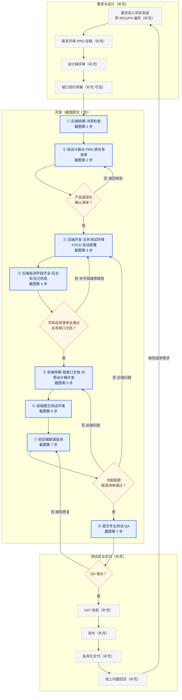
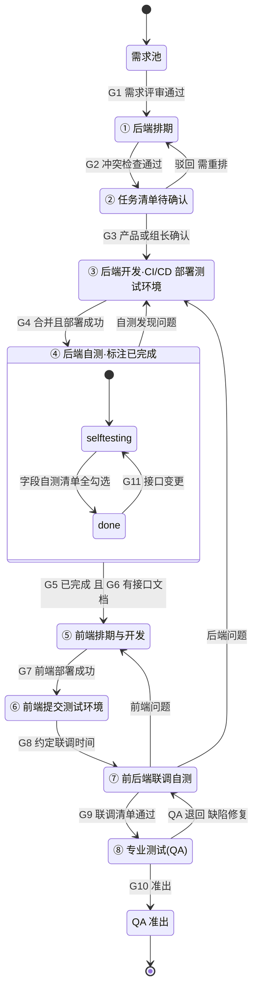
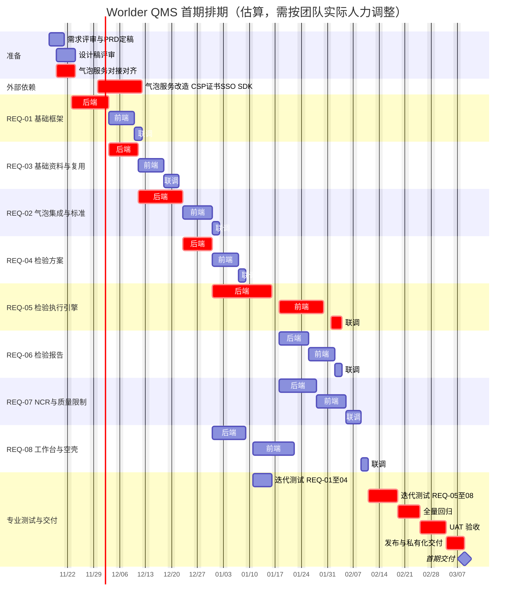

# Worlder QMS 开发流程确定方案

> 版本 v0.2（初稿，待评审）｜ 日期 2026-11-16 ｜ 适用：Worlder QMS 首期（REQ-01～REQ-08）
> v0.2 变更：REQ-08 的范围和估算随 PRD v0.2 更新（§8.1、§8.2），流程与门禁没有变化
> 读者：产品经理、项目组长、后端、前端、测试（QA），私有化交付时的实施/运维

**标注约定**

| 标注 | 含义 |
|---|---|
| 【截图原文】 | 用户提供的团队开发流程截图原句，属于**强制环节**，顺序不可调整 |
| 【补充】 | 截图未覆盖、本方案补齐的环节（需求、设计、QA 之后的验收、发布、交付等） |
| 【建议】 | 本方案给出的推荐做法，团队可调整 |
| 【待确认】 | 资料中没有依据，须由团队确认后再固定（汇总见 §11） |

---

## 结论先行

1. **截图的 7 句话原样保留为 8 个看板状态**：①后端排期 → ②任务清单待确认 → ③后端开发·CI/CD 部署测试环境 → ④后端自测·标注已完成 → ⑤前端排期与开发 → ⑥前端提交测试环境 → ⑦前后端联调自测 → ⑧专业测试(QA)。第 7 句同时包含“联调自测”和“提交专业测试”，所以拆成 ⑦、⑧ 两个状态。
2. **4 道硬门禁（来自截图）+ 7 道补充门禁**，共 11 道（§4.2）。截图的 4 道是：
   - 未经产品/组长确认任务清单，不得进入 ③；
   - 字段自测清单未全部勾选，不得标注“已完成”；
   - 后端未标注“已完成”且无接口文档链接，前端不得进入 ⑤；
   - 联调自测未通过，不得提交 QA。
3. **把截图里含糊的话落成清单**：
   - “不跟现有需求冲突”→ 冲突检查清单（§3.2）；
   - “任务清单”→ 任务清单模板（附录 T1）；
   - “字段都有”→ 字段自测清单，以 OpenAPI 文档和 PRD 字段表为准（附录 T2）；
   - “接口对接文档”→ 由后端从代码生成 OpenAPI，附示例与 Mock（§3.6）；
   - “项目里备注的设计文档”→ 每个任务必须挂设计稿链接和 PRD 章节（§3.7）；
   - “联调自测没问题、功能能跑”→ 联调清单（附录 T3）。
4. **前后补齐的环节【补充】**：需求进入与评审、设计稿评审、接口契约草案（可选）、UAT 验收、发布、私有化交付、线上问题回流。
5. **关键路径**：REQ-01 → REQ-03 → REQ-02 → REQ-04 → REQ-05（后端 → 前端 → 联调）→ 回归 → UAT。
   - 最大的跨团队风险是 Worlder 气泡识别服务的配合改造：CSP `frame-ancestors`、有效证书、统一登录、postMessage SDK。这项必须在首期第 1～2 周锁定排期（§8）。
6. **工具不做假定**：团队现用的项目管理系统（截图中的“项目系统/后台”）、Git 平台、CI/CD 工具资料中都没有说明，一律【待确认】。本文只规定**必须具备的状态、字段与门禁**，在任何工具上都可以配置。

---

## 0 文档信息与适用范围

| 项 | 内容 |
|---|---|
| 适用产品 | Worlder QMS（私有化 QMS，以图纸气泡识别为“要求入口”） |
| 首期范围 | 6 个核心模块：图纸气泡集成、检验标准、检验方案、五类检验（IQC/生产首件/IPQC/FQC/OQC）、NCR（含质量限制）、检验报告；外围 9 个模块只做空壳入口 |
| 首期需求包 | REQ-01～REQ-08（§8.1） |
| 需求条目编号 | `FR-WB`（工作台）、`FR-DRW`（图纸气泡）、`FR-STD`（标准）、`FR-PLN`（方案）、`FR-INS`（检验执行）、`FR-NCR`、`FR-RPT`（报告）、`FR-MD`（基础资料）、`FR-SYS`（系统）、`FR-EXT`（外围空壳） |
| 关联文档 | 《功能需求分析与 PRD 初稿》（01_功能需求分析，字段表是“字段都有”的核对依据）；单文件 HTML 原型（其中“研发排期看板”演示本流程的 8 个状态和门禁）；资料研读综述（00_资料研读） |
| 技术栈 | 原型：Vue3 + Tailwind 单文件。正式：按 V3 方案 FastAPI + SQLAlchemy async + PostgreSQL + React/TypeScript 模块化单体【待确认】 |
| 不适用 | 外围模块的正式开发（二期起另行排期）；Worlder 气泡识别服务自身的研发流程（只约定双方接口与排期配合） |

---

## 1 流程总览

### 1.1 全流程图

蓝色实线框是【截图原文】环节，灰色虚线框是【补充】环节。

### 1.2 环节对照表

| # | 环节 | 来源 | 看板状态 | 主责 |
|---|---|---|---|---|
| P1 | 需求进入项目系统 | 【补充】 | 待排期（池） | 产品经理 |
| P2 | 需求评审·PRD 定稿 | 【补充】 | 待排期（池） | 产品经理 |
| P3 | 设计稿评审 | 【补充】 | 待排期（池） | 产品经理 / UI 设计 |
| P4 | 接口契约草案（可选） | 【补充】【建议】 | 待排期（池） | 后端 |
| 1 | 后端从项目系统接需求、排期、防冲突 | 【截图原文】第 1 步 | ① 后端排期 | 后端 / 项目组长 |
| 2 | 读设计稿与需求文档，在后台排任务清单，产品或组长确认 | 【截图原文】第 2 步 | ② 任务清单待确认 | 后端；确认人：产品经理或项目组长 |
| 3 | 开发完合并提交测试环境，CI/CD 自动部署测试后台 | 【截图原文】第 3 步 | ③ 后端开发·CI/CD 部署测试环境 | 后端 |
| 4 | 自测确保字段都有，后台标注已完成 | 【截图原文】第 4 步 | ④ 后端自测·标注已完成 | 后端 |
| 5 | 前端看到已完成后排期，要接口文档，对照设计文档做页面、对接接口 | 【截图原文】第 5 步 | ⑤ 前端排期与开发 | 前端 |
| 6 | 前端做完同步提交测试环境 | 【截图原文】第 6 步 | ⑥ 前端提交测试环境 | 前端 |
| 7a | 前后端沟通排期联调自测 | 【截图原文】第 7 步 | ⑦ 前后端联调自测 | 前端 + 后端 |
| 7b | 自测没问题、功能能跑，提交专业测试 | 【截图原文】第 7 步 | ⑧ 专业测试(QA) | QA |
| Q1 | UAT 验收 | 【补充】 | 已准出·待验收 | 产品经理 + 客户/业务方 |
| Q2 | 发布 | 【补充】 | 已发布 | 项目组长 + 运维 |
| Q3 | 私有化交付 | 【补充】 | 已交付 | 实施/运维 |
| Q4 | 线上问题回流 | 【补充】 | 回到 P1 或缺陷单 | 产品经理 + QA |

---

## 2 角色与职责（RACI）

R = 负责执行，A = 最终批准/拍板（每行只有一个 A），C = 需征询，I = 需知会。

| 环节 | 产品经理 | 项目组长 | 后端 | 前端 | 测试 QA | 实施/运维 | UI 设计【补充】 |
|---|---|---|---|---|---|---|---|
| P1 需求进入 | **A/R** | C | I | I | I | C（私有化需求） | I |
| P2 需求评审·PRD 定稿 | **A/R** | C | C | C | C | C | C |
| P3 设计稿评审 | **A** | C | C | C | C | — | R |
| P4 接口契约草案（可选） | C | **A** | R | C | I | — | — |
| ① 后端排期·冲突检查 | C | **A** | R | I | I | I | — |
| ② 排任务清单 | C | C | **R** | I | I | — | — |
| ② 确认任务清单 | **A**（二者之一） | **A**（二者之一） | R | I | I | — | — |
| ③ 开发·合并·CI/CD 部署 | I | C | **A/R** | I | I | C（流水线） | — |
| ④ 自测·标注已完成 | I | C | **A/R** | I | I | — | — |
| ⑤ 前端排期与开发 | C | C | C（接口答疑） | **A/R** | I | — | C |
| ⑥ 前端提交测试环境 | I | I | I | **A/R** | I | C（流水线） | — |
| ⑦ 前后端联调自测 | I | C | R | **A/R**（发起） | I | — | — |
| ⑧ 专业测试 | C | I | C（修缺陷） | C（修缺陷） | **A/R** | I | — |
| Q1 UAT 验收 | **A/R** | C | C | C | R（支持） | C | — |
| Q2 发布 | C | **A** | R | R | C（冒烟） | R | — |
| Q3 私有化交付 | C | **A** | C | C | C | **R** | — |
| Q4 线上问题回流 | **A**（定级与排期） | C | C | C | R（复现与登记） | R（收集） | — |

> ② 的确认人按截图原文是“产品或项目组长”。【建议】在项目系统中把二者都配置为可确认人，任一人确认即可，并留痕（确认人、时间、意见）。
> 截图第 2 步、第 5 步提到的“设计稿/设计文档”由谁产出，资料未说明。如果没有专职 UI 设计，由产品经理兼任【待确认】。

---

## 3 逐环节说明

每个环节按同一格式说明：目的、输入、动作、产出物、准入条件（DoR）、完成条件（DoD）、负责人、后台状态、常见问题。

### 3.1 前置环节【补充】：需求进入 → 需求评审 → 设计稿评审 → 接口契约草案

| 环节 | 目的 | 输入 | 关键动作 | 产出物 | DoR | DoD | 负责人 |
|---|---|---|---|---|---|---|---|
| P1 需求进入 | 让每条需求可追溯、可排期 | 用户诉求、研读结论、缺陷回流 | 在项目系统建需求条目，写清 REQ 编号、FR 编号、来源、优先级（P0/P1/P2） | 需求条目 | 有来源、有业务目标 | 编号齐全、已关联 PRD 章节（可先占位） | 产品经理 |
| P2 需求评审·PRD 定稿 | 在开发前统一理解 | PRD 章节：页面说明、**字段表**、状态机、规则、权限、接口需求、验收标准 | 召开需求评审会（§9），逐条过 FR，记录结论 | 已定稿的 PRD 章节（带版本号） | PRD 章节已写完，含字段表 | 评审结论“通过”；遗留问题有负责人和期限 | 产品经理 |
| P3 设计稿评审 | 确保页面可开发 | 设计稿（高保真或可交互原型） | 逐页对照 PRD 检查字段、状态、空态、错误态、权限受限态、移动端（拍照/签名） | 已定稿设计稿链接（带版本） | 覆盖本 REQ 全部页面 | 评审通过；设计稿链接已回填到需求条目 | 产品经理 / UI 设计 |
| P4 接口契约草案（可选）【建议】 | 减少前端串行等待 | PRD 接口需求清单 | 后端先给出 OpenAPI 草案（路径、请求、响应、错误码），不写实现 | 接口草案 | P2 已通过 | 前后端都看过；标记为“草案”，以 ④ 发布的正式文档为准 | 后端 |

**常见问题**
- PRD 没有字段表 → ④ 的“字段都有”就没有核对依据。**字段表是 PRD 定稿的必要条件**。
- 设计稿只画了正常态 → 要求补齐 QMS 特有的状态：空态、加载、无权限（灰显并说明原因）、证据不足、超差高亮、版本冲突提示。
- P4 是否启用【待确认】。截图原文是“前端看到已完成状态后同样进行排期”，默认遵循原文；启用 P4 也只是让前端**提前熟悉和做 Mock**，⑤ 仍以 ④ 的“已完成”为门禁。

### 3.2 ① 后端排期·冲突检查【截图原文 第 1 步】

> **原文**：“后端从项目系统里接到需求以后先排好期，确保不能跟现有需求冲突。”

| 项 | 内容 |
|---|---|
| 目的 | 在接手前确认人、时间、环境和依赖都不冲突 |
| 输入 | 已通过 P2/P3 的需求条目；当前各人在途任务；测试环境占用日历；发版窗口；外部服务排期 |
| 动作 | 逐项填写**冲突检查清单**（下表），给出开始/结束日期与估时（人天） |
| 产出物 | 排期（起止日期）+ 冲突检查记录（附在需求条目上） |
| DoR | 需求条目带 REQ/FR 编号、PRD 章节链接、设计稿链接，且评审已通过（门禁 G1） |
| DoD | 冲突检查清单全部为“无冲突”，或冲突已由项目组长裁决并记录 |
| 负责人 | 后端（执行），项目组长（裁决冲突） |
| 后台状态 | ① 后端排期 |
| 常见问题 | 只排了自己的时间，没看同一张表是否有人在改；没等外部服务的配合就排上了 |

**冲突检查清单**（每项都要填“无冲突 / 有冲突 + 处理方式”）：

| # | 检查项 | 判定方法 | 有冲突时的处理 |
|---|---|---|---|
| C1 | 人力占用 | 本人在途任务的剩余估时 + 本任务估时，是否超过排期窗口 | 顺延，或由组长调人 |
| C2 | 同模块并行改动 | 是否有其他在途任务改同一后端模块（如 `inspections`、`quality_basis`） | 合并成一个任务，或串行排期 |
| C3 | 同表/同迁移并行改动 | 是否有其他任务改同一张表或在同一迁移链上加迁移 | 指定迁移顺序与负责人；禁止两个分支各自生成冲突迁移 |
| C4 | 上游依赖未完成 | 按 REQ 依赖（§8.1）检查上游是否已到 ④“已完成” | 不得开工，或只做不依赖上游的部分（须在任务清单里写明） |
| C5 | 外部服务排期 | 是否依赖 Worlder 气泡识别服务的改造（CSP `frame-ancestors`、证书、统一登录、postMessage SDK、气泡同步接口） | 先与对方接口人确认排期并记录；对方未排期时不得承诺日期 |
| C6 | 测试环境占用 | 测试环境是否处于提测冻结窗口（§5.3） | 避开冻结窗口合并，或协调 QA |
| C7 | 发版窗口 | 计划完成日期是否跨过发版日或客户交付日 | 调整范围或日期，报组长 |
| C8 | 企业策略未定 | 是否依赖尚未由企业固定的决定（签审策略、抽样标准授权版本、岗位授权等，见研读综述 §3.8） | 按“未配置策略不签审、不默认批准”实现，或等待决定 |
| C9 | 节假日与请假 | 排期窗口内是否有法定节假日（首期跨元旦、春节）或人员请假 | 顺延 |

### 3.3 ② 读设计稿与需求文档·排任务清单·产品/组长确认【截图原文 第 2 步】

> **原文**：“开发前需要先读设计稿和需求文档，并在后台排出任务清单，由产品或项目组长确认以后才能开发。”

| 项 | 内容 |
|---|---|
| 目的 | 开工前把需求拆成可验收的任务，并让产品/组长确认没有遗漏和误解 |
| 输入 | PRD 章节（字段表、状态机、规则、权限、接口需求、验收标准）、设计稿、冲突检查记录 |
| 动作 | 1. 通读 PRD 与设计稿，列出疑问并找产品澄清；2. 按**任务清单模板**（附录 T1）在项目系统后台建子任务；3. 提交确认 |
| 产出物 | 任务清单（子任务列表）+ 澄清记录 |
| DoR | ① 已完成（有排期、冲突检查通过） |
| DoD | 产品经理或项目组长在后台点“确认”，系统记录确认人、时间、意见（门禁 G3） |
| 负责人 | 后端（排清单）；产品经理或项目组长（确认） |
| 后台状态 | ② 任务清单待确认 |
| 常见问题 | 清单只写“开发 XX 接口”，没有对应 FR 编号和字段；漏掉权限、审计、迁移、测试 |

**任务清单必须覆盖的 7 类子任务**【建议】（某类没有就写“不涉及”）：

| 类别 | 说明 | QMS 中的典型例子 |
|---|---|---|
| 表与迁移 | 新增/修改表、字段、索引、约束；迁移脚本 | 检验轮次表、观察事件（实测事实）表 |
| 命令与接口 | 每条接口对应的 FR 编号 | 提交录数、复检开新轮次、报告复核签名 |
| 业务规则 | 判定、状态机、校验 | 服务端 Decimal 判定、缺失不补零、d≤Ac 才接受 |
| 权限 | 动作 × 对象 × 角色 | 系统管理员不能批准报告/MRB |
| 审计 | 哪些动作写审计 | 提交、更正、签名、处置、Hold 解除 |
| 集成 | 外部服务与附件 | 气泡同步接口、照片/签名附件存储与鉴权下载 |
| 测试 | 单元/契约/集成用例 | 对应 PRD 验收标准与 V3 A 编号 |

**确认方式与留痕**
- 确认人在后台对任务清单做“确认 / 驳回”。驳回必须写原因，任务退回 ②（或 ① 重排）。
- 确认后，任务清单**冻结**。开发中如需增删子任务：小改动（不影响接口与字段）由后端追加并备注；影响接口、字段或排期的改动须重新确认。
- 确认人检查要点：每条 FR 都有子任务承接；字段与 PRD 字段表一致；权限、审计、测试没有漏；估时合理。

### 3.4 ③ 后端开发·合并提交测试环境·CI/CD 自动部署【截图原文 第 3 步】

> **原文**：“开发完以后必须合并提交代码到测试环境，然后 CI/CD 流水线会自动部署代码到测试后台。”

| 项 | 内容 |
|---|---|
| 目的 | 让代码在统一测试环境运行，供自测与前端对接 |
| 输入 | 已确认的任务清单；分支与提交规范（§5） |
| 动作 | 1. 从主干拉功能分支开发；2. 本地单元测试通过；3. 发起合并请求（代码评审 ≥1 人通过）；4. 合并到测试分支，触发 CI/CD；5. 确认测试后台部署成功 |
| 产出物 | 合并记录、流水线运行记录（链接）、测试环境版本号 |
| DoR | ② 已确认（门禁 G3） |
| DoD | CI 全部步骤通过、测试环境部署成功、冒烟接口可访问（门禁 G4） |
| 负责人 | 后端 |
| 后台状态 | ③ 后端开发·CI/CD 部署测试环境 |
| 常见问题 | 只在本地跑通就标完成；迁移脚本在测试库执行失败；测试环境用了远程业务库 |

**规则**
- **“必须合并提交”**：未合并到测试环境的代码，一律视为未完成，不得进入 ④。
- 测试环境必须使用**独立测试数据库**，不得在远程业务库上做破坏性验证（V3 方案 p43、p67）。
- 迁移脚本按 §5.5 规范编写，CI 中在空库和“上一版本库”上各跑一次。

### 3.5 ④ 后端自测·确保字段都有·后台标注已完成【截图原文 第 4 步】

> **原文**：“自测以后确保字段都有，在后台里标注已完成。”

| 项 | 内容 |
|---|---|
| 目的 | 交给前端之前，保证接口与文档、PRD 一致 |
| 输入 | 测试环境上已部署的接口；OpenAPI 文档；PRD 字段表 |
| 动作 | 1. 按**字段自测清单**（附录 T2）逐接口、逐字段核对；2. 跑通本 REQ 涉及的主路径与异常路径；3. 发布正式接口文档（OpenAPI 链接 + 示例 + Mock 地址）；4. 在后台标注“已完成”，附自测记录与接口文档链接 |
| 产出物 | 字段自测清单（全部勾选）、接口文档链接、自测记录 |
| DoR | ③ 完成（门禁 G4） |
| DoD | 字段自测清单 100% 勾选、接口文档链接已填（门禁 G5）；系统自动通知前端 |
| 负责人 | 后端 |
| 后台状态 | ④ 后端自测·标注已完成（子状态：自测中 → 已完成） |
| 常见问题 | 字段名与文档不一致（驼峰/下划线混用）；空值语义没处理；只测了成功路径 |

**“确保字段都有”的可执行定义**——以下全部满足才算“字段都有”：

| # | 检查项 | 判定标准 | 依据 |
|---|---|---|---|
| F1 | 字段齐全 | 接口实际返回字段 = OpenAPI 文档字段 = PRD 字段表字段，**三方逐项一致**；不多不少 | PRD 字段表 |
| F2 | 类型 | 类型与文档一致。**实测值、公差、规格限一律以字符串传输**（规范十进制字符串），不用浮点 | V3 A3.1 数值权威 |
| F3 | 必填 | 必填字段缺失时返回 422 与字段级错误 | — |
| F4 | 枚举 | 状态、场景、策略等枚举值与 PRD 完全一致（如五类场景代码 IQC/FIRST_ARTICLE/IPQC/FQC/OQC） | PRD 状态机 |
| F5 | 空值语义 | 区分 `null`（未知）、字段缺失、NA、免检、未测、无效；**缺失 ≠ 0**，不得补零或补合格 | V3 R04；A03、A11 |
| F6 | 时间 | ISO 8601 带时区（存储用 TIMESTAMPTZ，UTC） | V3 A3 |
| F7 | 错误结构 | 统一 `{error:{code,message,details,retryable},request_id}` | V3 A6 |
| F8 | 权限 | 无权限返回 403 并带原因码；**系统管理员调用报告批准/MRB 必须被拒** | V3 A15、R25 |
| F9 | 不存在 | 对象不存在返回 404 | V3 A6 |
| F10 | 版本冲突 | 带 `expected_version` 的写操作，版本不符返回 409 | V3 A6 |
| F11 | 幂等 | 同一 `request_key` 重复提交不产生重复事实，返回同一结果 | V3 A6；A07 |
| F12 | 列表查询 | 分页、排序、筛选按文档；**无匹配时返回空集合**，不能忽略筛选条件 | V3 A19 |
| F13 | 审计 | PRD 要求审计的动作已写入操作日志 | PRD |
| F14 | 判定在服务端 | 接口不接受客户端汇总的判定结果；判定由服务端计算并返回 | V3 §2.3 |
| F15 | 附件 | 照片、签名等附件需鉴权下载；签名绑定内容摘要 | PRD；V3 R11–R12 |

**接口变更规则**（门禁 G11）：标注“已完成”后如需改接口（字段、类型、枚举、错误码、路径），必须：
1. 回到 ④ 子状态“自测中”；
2. 更新 OpenAPI 版本与变更说明；
3. 在任务中@前端并说明影响；
4. 重新完成字段自测清单后再标“已完成”。

### 3.6 接口对接文档（④ 的产出，⑤ 的输入）

> 截图原文第 5 步：“……找后端要接口对接文档……”

| 规则 | 说明 |
|---|---|
| 形式【建议】 | 由后端从代码自动生成 OpenAPI（FastAPI 原生支持【待确认 技术栈】），发布到测试环境固定地址；不另写 Word 版接口文档 |
| 内容 | 每个接口：用途、对应 FR 编号、请求/响应 schema、**示例**（成功 + 至少 2 个错误示例）、错误码、权限要求、幂等键与版本字段说明 |
| Mock【建议】 | 基于 OpenAPI 示例提供 Mock 地址，前端在测试环境不稳定时可先用 Mock |
| 版本 | 文档带版本号；变更记录写在文档首页；变更按 G11 执行 |
| 链接位置 | 填在需求条目的“接口文档”字段；⑤ 的门禁检查此字段非空（G6） |

### 3.7 ⑤ 前端排期·取接口文档·对照设计稿开发【截图原文 第 5 步】

> **原文**：“前端看到已完成状态后同样进行排期，找后端要接口对接文档，并对照项目里备注的设计文档开始做页面、对接后端接口。”

| 项 | 内容 |
|---|---|
| 目的 | 按设计稿与接口文档实现页面 |
| 输入 | ④“已完成”的需求条目；接口文档链接；**项目条目里备注的设计稿链接与 PRD 章节** |
| 动作 | 1. 看到“已完成”通知后，同样做冲突检查（C1、C2、C6、C7、C9）并排期；2. 阅读接口文档，有疑问在任务里提问，后端 1 个工作日内答复【建议】；3. 对照设计稿开发页面并对接接口；4. 自查设计还原度和各状态（空态/加载/无权限/错误/冲突） |
| 产出物 | 页面代码、排期、自查记录 |
| DoR | 后端已标注“已完成” **且** 接口文档链接非空（门禁 G6）；设计稿链接非空 |
| DoD | 页面完成、对接测试环境接口通过、设计稿自查完成 |
| 负责人 | 前端 |
| 后台状态 | ⑤ 前端排期与开发 |
| 常见问题 | 设计稿与接口字段对不上（应在 ② 阶段暴露，此时发现要回溯到 PRD）；前端自己计算判定结果（禁止，判定以服务端返回为准） |

**“项目里备注的设计文档”落地规则**：每个任务都必须在固定字段里挂：
- 设计稿链接（带版本）；
- PRD 章节链接（带版本）；
- 接口文档链接。

三个链接缺任何一个，前端都不得开工。

**QMS 前端特别要求**【建议】
- 实测输入按字符串处理并提交，不做浮点转换；超差高亮只作提示，**判定以服务端为准**。
- 移动端：拍照取证（调用相机/相册，上传前压缩）、手写签名（Canvas，触控/笔/鼠标均可）必须在真机自测。
- 权限受限的按钮灰显并显示原因（与 403 原因码对应），不隐藏关键业务入口。

### 3.8 ⑥ 前端提交测试环境【截图原文 第 6 步】

> **原文**：“前端做完后同步提交测试环境。”

| 项 | 内容 |
|---|---|
| 目的 | 让前后端在同一环境联调 |
| 动作 | 合并请求（代码评审通过）→ 合并测试分支 → CI/CD 自动部署前端 → 确认测试环境可访问 |
| 产出物 | 合并记录、流水线记录、测试环境前端版本号 |
| DoR | ⑤ 完成 |
| DoD | 前端 CI 通过、部署成功、首页与本 REQ 页面可打开（门禁 G7） |
| 负责人 | 前端 |
| 后台状态 | ⑥ 前端提交测试环境 |

### 3.9 ⑦ 前后端联调自测【截图原文 第 7 步】

> **原文**：“前后端沟通排期进行联调自测，自测完觉得没有问题、功能能跑，再提交专业测试进行测试。”

| 项 | 内容 |
|---|---|
| 目的 | 在提测前保证功能端到端可用 |
| 输入 | 测试环境上的前后端版本；**联调清单**（附录 T3） |
| 动作 | 1. 前端发起联调排期，后端确认时间（门禁 G8）；2. 按联调清单逐项执行；3. 问题当场修复或登记，后端问题回 ③，前端问题回 ⑤；4. 全部通过后双方在联调清单上确认 |
| 产出物 | 已执行的联调清单 |
| DoR | ⑥ 完成；联调时间已约定 |
| DoD | 联调清单全部通过（“功能能跑”的定义），双方确认（门禁 G9） |
| 负责人 | 前端发起，后端配合 |
| 后台状态 | ⑦ 前后端联调自测 |

**“没有问题、功能能跑”的可执行定义**——联调清单必须覆盖 4 类场景：

| 类别 | 要求 | QMS 首期示例 |
|---|---|---|
| 主路径 | 本 REQ 的业务主路径从头到尾跑通 | 图纸气泡同步 → 生成标准草稿 → 标准生效 → 编制方案 → 开检 → 录数 → 服务端判定 → 签名提交 → 生成报告 → 登记 NCR |
| 异常路径 | 每个 PRD 列出的错误/边界至少 1 例 | 样本不足判“证据不足”（A03）；边界值与超差（A08）；重复提交幂等（A07）；版本冲突 409 |
| 权限 | 至少 2 个角色正反各 1 例 | 检验员不能批准报告；系统管理员不能批准 MRB（A15） |
| 移动端 | 涉及拍照/签名的 REQ 必须在真机执行 | 手机拍照上传外观缺陷照片；平板手写签名提交 |

### 3.10 ⑧ 提交专业测试 QA【截图原文 第 7 步】

| 项 | 内容 |
|---|---|
| 目的 | 由专职测试做系统测试 |
| 输入 | **提测单**（附录 T4）：版本、覆盖的 FR 与 V3 A 场景、联调清单、已知问题、测试数据与账号 |
| 动作 | QA 做准入检查（§6.2）→ 执行用例 → 登记缺陷（附录 T5）→ 回归 → 准出 |
| 产出物 | 测试报告、缺陷单 |
| DoR | 联调清单全部通过 + 提测单完整（门禁 G9） |
| DoD | 达到 QA 准出标准（门禁 G10） |
| 负责人 | QA |
| 后台状态 | ⑧ 专业测试(QA) |
| 常见问题 | 提测后还在合并新代码 → 测试环境冻结（§5.3） |

### 3.11 后续环节【补充】：UAT → 发布 → 私有化交付 → 线上问题回流

| 环节 | 目的 | 关键动作 | 产出物 | DoD | 负责人 |
|---|---|---|---|---|---|
| Q1 UAT 验收 | 业务方确认可用 | 业务方（质量部门）按验收场景实际操作；问题分“缺陷 / 新需求” | UAT 记录、验收确认单 | 验收确认单签署 | 产品经理 |
| Q2 发布 | 稳定上线 | 按发布单（附录 T6）执行：备份 → 迁移 → 部署 → 冒烟 → 观察 | 发布记录 | 冒烟通过、观察期无 S1/S2 | 项目组长 + 运维 |
| Q3 私有化交付 | 在客户环境落地 | 离线安装包部署、初始化数据、备份恢复演练、培训（§7） | 交付文档、验收单 | 客户签收 | 实施/运维 |
| Q4 线上问题回流 | 闭环改进 | 收集 → QA 复现定级 → 缺陷走缺陷流程，新需求回 P1 | 缺陷单 / 需求条目 | 已登记并分派 | 产品经理 + QA |

---

## 4 状态流与门禁

### 4.1 任务状态枚举

需求条目（以 REQ 或其下的 FR 组为单位）在项目系统中使用以下状态。原型“研发排期看板”的 8 列与 ①～⑧ 一一对应。

| 代码【建议】 | 看板列 | 含义 | 谁能把任务移入 |
|---|---|---|---|
| `POOL` | （需求池，不在 8 列内） | 已评审，待后端接手 | 产品经理 |
| `S1_BE_SCHEDULE` | ① 后端排期 | 后端排期与冲突检查 | 后端（接手） |
| `S2_TASKLIST_PENDING` | ② 任务清单待确认 | 清单已提交，等产品/组长确认 | 后端 |
| `S3_BE_DEV` | ③ 后端开发·CI/CD 部署测试环境 | 开发中，直到测试环境部署成功 | 产品经理 / 项目组长（通过“确认”动作） |
| `S4_BE_SELFTEST` | ④ 后端自测·标注已完成 | 子状态 `selftesting` → `done`（已完成） | 后端 |
| `S5_FE_DEV` | ⑤ 前端排期与开发 | 前端排期并开发 | 前端 |
| `S6_FE_SUBMITTED` | ⑥ 前端提交测试环境 | 前端已部署到测试环境 | 前端 |
| `S7_JOINT_TEST` | ⑦ 前后端联调自测 | 联调中 | 前端（发起，后端确认时间） |
| `S8_QA` | ⑧ 专业测试(QA) | QA 测试中 | 前端或后端（提测人） |
| `QA_PASSED` | （⑧ 之后） | QA 准出，待 UAT/发布 | QA |
| `RELEASED` / `DELIVERED` | （⑧ 之后） | 已发布 / 已私有化交付 | 项目组长 / 实施 |

附加标记（不是状态）：`阻塞`（必须写阻塞原因和解除条件）、`含外部依赖`（依赖 Worlder 气泡服务）、`企业策略待定`。

### 4.2 门禁（共 11 道）

| 门禁 | 状态切换 | 条件（全部满足才允许切换） | 谁操作 | 来源 |
|---|---|---|---|---|
| G1 | `POOL` → ① | REQ/FR 编号、PRD 章节链接、设计稿链接齐全，需求评审已通过 | 后端 | 【补充】 |
| G2 | ① → ② | 冲突检查清单 C1–C9 已填写，冲突项已由组长裁决 | 后端 | 【补充】（细化截图第 1 步） |
| **G3** | ② → ③ | **产品经理或项目组长已确认任务清单**（系统留痕） | 产品经理 / 项目组长 | **【截图原文】第 2 步** |
| G4 | ③ → ④ | 代码已合并到测试分支；CI 全部通过；测试环境部署成功（附流水线链接） | 后端 | 【截图原文】第 3 步（落地为可检查条件） |
| **G5** | ④ 内 `selftesting` → `done` | **字段自测清单 F1–F15 全部勾选**；接口文档链接已填；自测记录已附 | 后端 | **【截图原文】第 4 步** |
| **G6** | ④ → ⑤ | **后端已标注“已完成”且接口文档链接非空**；设计稿链接非空 | 前端 | **【截图原文】第 5 步** |
| G7 | ⑤ → ⑥ | 前端代码已合并；CI 通过；测试环境部署成功；设计稿自查完成 | 前端 | 【截图原文】第 6 步（落地为可检查条件） |
| G8 | ⑥ → ⑦ | 前后端已约定联调时间（双方确认） | 前端发起，后端确认 | 【截图原文】第 7 步 |
| **G9** | ⑦ → ⑧ | **联调清单全部通过**，双方确认；提测单已填写 | 提测人 | **【截图原文】第 7 步** |
| G10 | ⑧ → `QA_PASSED` | 达到 QA 准出标准（§6.2） | QA | 【补充】 |
| G11 | `done` 后改接口 | 必须回到 ④ `selftesting`，更新 OpenAPI 版本与变更说明，通知前端，重新自测 | 后端 | 【补充】 |

> 加粗的 G3、G5、G6、G9 就是统一约定中的 4 道截图门禁，原型看板按这 4 道做了强制校验。其余 7 道为【补充】，建议在项目系统中通过必填字段或检查项实现；工具不支持时，由组长在站会上检查。

### 4.3 状态图

---

## 5 分支、环境与 CI/CD【建议】

团队现用的 Git 平台和 CI/CD 工具【待确认】。以下是与工具无关的规范，在任何 Git 平台和流水线工具上都能实现。

### 5.1 分支策略

| 分支 | 用途 | 规则 |
|---|---|---|
| `main` | 可发布的代码 | 只能经合并请求合入；每次发布打 tag `vX.Y.Z` |
| `feature/REQ-05-FR-INS-012-简述` | 功能开发 | 从 `main` 拉出；一个任务一个分支；生命周期 ≤ 1 个迭代 |
| `test` | 测试环境（截图中的“测试环境/测试后台”） | 功能分支合入后**自动部署测试环境**；`test` 是集成分支，**禁止把 `test` 反向合入 `main` 或功能分支**；可定期从 `main` 重建 |
| `release/X.Y` | 提测与发布 | QA 准出后，从 `main` 拉出（或在 `main` 上打 RC tag），用于 QA 回归与发布 |
| `hotfix/…` | 线上紧急修复 | 从对应 tag 拉出，修复后同时合入 `main` |

> 截图写的是“合并提交代码到测试环境”。上表用 `test` 分支实现这一点。如果团队已有其他约定（如合并到 `develop`），以现有约定为准，只需保证“合并即自动部署测试环境”【待确认】。

### 5.2 提交与代码评审

- **提交信息**：`<类型>(<模块>): <FR 编号> <说明> [REQ-xx]`，类型取 `feat / fix / refactor / test / docs / chore / migration`。
  - 例：`feat(inspections): FR-INS-012 轮次提交幂等 [REQ-05]`
- **合并请求**：
  - 描述中链接需求条目；
  - 涉及迁移的必须写明迁移步骤与回滚影响；
  - 至少 1 人评审通过【待确认 人数】；
  - CI 全绿才能合并。
- **评审重点**（QMS 特有）：
  - 数值是否全程字符串 + Decimal；
  - 判定是否只在服务端；
  - 是否有可修改已提交事实的 UPDATE/DELETE；
  - 权限检查是否覆盖动作 × 对象；
  - 审计是否写入。

### 5.3 环境

| 环境 | 用途 | 部署方式 | 数据 |
|---|---|---|---|
| 本地开发 | 个人开发 | 本地 / 容器 | 本地种子数据 |
| 测试环境（联调） | 截图中的“测试环境/测试后台”：后端自测、前端对接、联调 | `test` 分支合并后 CI/CD 自动部署 | **独立测试库** + 种子数据脚本；附件存测试对象存储 |
| QA/预发环境【建议】 | QA 系统测试与回归、UAT | `release/*` 或 RC tag 手动触发 | 准生产数据规模（脱敏），用于性能测试 |
| 生产（自有演示/SaaS，如有） | — | tag 发布 | 生产数据 |
| 客户私有化环境 | 客户现场 | 离线安装包（§7） | 客户数据 |

- **资源不足时**：QA 可与联调共用测试环境，但提测后进入**冻结窗口**：只允许合并该提测版本的缺陷修复，其他合并排到窗口之后（冲突检查 C6）【待确认】。
- **跨服务配置**：测试环境的 QMS 必须指向 Worlder 气泡服务的**测试实例**。对方需要：
  - 在 CSP `frame-ancestors` 中加入 QMS 测试域名；
  - 使用浏览器信任的证书（当前演示地址 `https://223.106.198.62:3080` 是自签名证书，浏览器显示“不安全”，iframe 会被拦截）；
  - 开通测试账号与统一登录。

### 5.4 CI/CD 流水线步骤

| # | 步骤 | 后端 | 前端 | 失败处理 |
|---|---|---|---|---|
| 1 | 代码规范检查（lint/format） | ✓ | ✓ | 阻断合并 |
| 2 | 类型检查 | ✓（如 mypy） | ✓（tsc） | 阻断 |
| 3 | 单元测试 + 覆盖率 | ✓（判定算法、抽样规则、状态机覆盖率要求更高【建议】） | ✓（关键组件） | 阻断 |
| 4 | OpenAPI 契约检查 | ✓（生成文档并与上一版 diff，破坏性变更需在合并请求中声明） | ✓（按 OpenAPI 生成类型并编译） | 阻断 |
| 5 | 迁移检查 | ✓（空库全量迁移 + 上一版本库增量迁移） | — | 阻断 |
| 6 | 构建镜像 / 静态包 | ✓ | ✓ | 阻断 |
| 7 | 安全扫描（依赖漏洞）【建议】 | ✓ | ✓ | 高危阻断 |
| 8 | 自动部署测试环境 | ✓（仅 `test` 分支） | ✓（仅 `test` 分支） | 通知提交人 |
| 9 | 部署后冒烟 | 健康检查 + 核心接口 | 首页 + 登录 | 通知提交人与组长 |

### 5.5 数据库迁移规范（呼应 V3 附录 A10）

1. **先扩展、后收紧**：新增表与可空列 → 回填可证明的内容 → 建索引与外键 → 双版本兼容读取 → 切换写入口 → 最后收紧约束（NOT NULL、唯一约束等）。
2. **不覆盖已产生的事实**：一旦产生新的检验事实（实测、签名、处置），不得 DROP 相关表，不得用旧备份覆盖。实测事实只追加，更正以新记录关联原记录。
3. **一个迁移只做一件事**，命名带 REQ/FR 编号；同一迁移链上的并行改动在 ① 冲突检查 C3 中协调。
4. **可回滚性**：每个迁移在合并请求中说明回滚方式。因为采用扩展式迁移，回滚通常是“应用回退、数据库保持兼容”。
5. **历史数据**：如果需要从现有系统迁移旧单（V3 A40），旧检验头只有人员和日期时保持“结果未知”，不制造过去的合格数【待确认 是否迁移】。

---

## 6 测试与质量

### 6.1 测试分层

| 层次 | 负责人 | 内容 | 环节 |
|---|---|---|---|
| 单元测试 | 后端 / 前端 | 判定算法（Decimal 边界、inch/mm 换算）、抽样规则（d≤Ac 接受、d≥Re 拒收、未完成为继续抽样）、状态机迁移、内容摘要 | ③ |
| 契约测试 | 后端 | 接口与 OpenAPI 一致；字段自测清单自动化部分 | ③④ |
| 集成测试 | 后端 | 真实 PostgreSQL：幂等、版本冲突、事务、审计、权限 | ③④ |
| 联调测试 | 前端 + 后端 | 联调清单（主路径、异常、权限、移动端） | ⑦ |
| 系统测试 | QA | 用例库全量执行；跨模块链路（标准 → 方案 → 检验 → 报告 → NCR） | ⑧ |
| 端到端浏览器测试【建议】 | QA | 关键路径自动化（如 Playwright 类工具【待确认】） | ⑧ 回归 |
| 真机测试 | QA | 手机/平板拍照取证、手写签名、弱网上传 | ⑧ |
| 集成测试（跨服务） | QA + 气泡服务方 | iframe 内嵌、统一登录、postMessage 握手、气泡同步接口 | ⑧ |
| 性能测试 | QA + 后端 | 按 V3 非功能要求：201 个样本全检、千级特性的图纸，记录 p95 | 发布前 |
| 备份恢复演练 | 运维 | 备份 → 恢复 → 校验数据完整 | 发布前 / 交付前 |

### 6.2 QA 准入与准出

**准入**（不满足时 QA 可拒收提测）：
1. 提测单完整（附录 T4）；
2. 联调清单全部通过并有双方确认；
3. 测试环境版本与提测单一致；
4. 冒烟用例通过（每个 REQ 准备 3～5 条）；
5. 测试数据与账号已准备；
6. 已知问题已列出。

**准出**【建议，阈值待确认】：
1. S1、S2 缺陷为 0；
2. S3 缺陷如有遗留，须经产品与组长评审同意，并记录计划修复版本；
3. 计划用例执行率 100%，通过率 ≥ 95%；
4. 本 REQ 映射的 V3 验收场景（§6.3）全部通过；
5. 回归范围（§6.5）通过。

### 6.3 用例来源与 V3 验收场景映射

用例来源有两个：
- PRD 每条 FR 的验收标准；
- V3 验收场景 A01–A51（共 41 个，有缺号），作为底稿。

V3 文档中的“验证层”标注（reference / prototype-contract / future-browser 等）说明的是 V3 原型的验证程度，**不等于本项目已测**。

| 需求包 | 映射的 V3 场景 | 说明 |
|---|---|---|
| REQ-01 基础框架 | A15 管理员直接批准、A16 委托越权*、A18 导出途中撤权、A14 多账号自审* | *依赖企业策略：未启用时，测试“未配置策略不批准” |
| REQ-02 气泡集成与标准 | A10 图版更新、A49 标准与方案独立采用、A51 标准和方案换版 | 气泡同步结果须人工核对后才能生效 |
| REQ-03 基础资料与复用 | A50 停用不阻断在途任务（场景停用部分） | — |
| REQ-04 检验方案 | A49、A50、A51、A44 计划转移规则缺依据 | 不支持的抽样算法必须明确拒绝 |
| REQ-05 检验执行引擎 | A01 普通逐项 IQC、A02 计数抽样接受但发现不良、A03 样本不足、A04 重复读数不凑样本、A05 真实超差导入、A06 格式与单位异常、A07 重复导入和部分失败、A08 公差边界与换算、A09 返工后复检、A19 无匹配样本搜索、A42 多产品并行 | 首期核心，用例最多 |
| REQ-06 检验报告 | A11 正式报告缺值、A12 失败报告签审*、A13 内容变化后的旧签名 | *依赖企业签审策略 |
| REQ-07 NCR 与质量限制 | A20 多 Hold、A21 受控返工、A22 五件多去向 | — |
| REQ-08 工作台与空壳 | （无对应 A 场景） | 以 PRD 验收标准为准 |
| 不在首期 | A30–A33 计量与 MSA、A34–A35 SPC、A36 CAPA、A37 客诉、A38 文件与岗位资格、A39 审核自验、A45–A48 供方 | 外围模块为空壳，二期启用时再纳入 |
| 待确认 | A40 旧单迁移 | 视是否从现有系统迁移旧数据而定 |

### 6.4 缺陷等级与流转

| 等级 | 定义 | QMS 示例 | 处理时限【建议】 |
|---|---|---|---|
| S1 致命 | 质量结论错误、事实丢失或被篡改、越权批准、安全问题 | 超差判为合格；提交后的实测被覆盖；系统管理员能批准 MRB；签名未绑定内容摘要 | 立即修复，阻断提测与发布 |
| S2 严重 | 主路径阻断，没有替代办法 | 无法提交录数；报告无法生成；气泡同步失败且无提示 | 当前迭代内修复 |
| S3 一般 | 非主路径功能问题，或有替代办法 | 列表筛选不准；导出格式问题 | 按排期修复，可评审遗留 |
| S4 提示 | 界面、文案、体验问题 | 文案错别字、对齐 | 视情况 |

**流转**：新建 → 已确认（QA/产品确认有效）→ 修复中 → 待验证 → 已关闭；分支：已拒绝（非缺陷/重复，须写原因）、重新打开、延期（须评审）。
- 缺陷修复同样走 ③ → ④ 或 ⑤ → ⑥ 的合并与部署规则。
- 改了接口的修复同时触发 G11。

### 6.5 回归范围

| 触发 | 回归范围 |
|---|---|
| 每次提测 | 本 REQ 全部用例 + 冒烟集 |
| 改动判定、抽样、数值处理 | 全部 REQ-05 用例 + 报告与 NCR 中引用判定结果的用例 |
| 改动权限、认证 | 权限矩阵全量 |
| 改动迁移/表结构 | 迁移升级测试（上一版本库升级）+ 关联模块主路径 |
| 发布前 | 全量回归 + 关键路径端到端 + 备份恢复演练 |

---

## 7 发布与私有化交付【补充】

### 7.1 版本号

- 语义化版本 `主版本.次版本.修订号`：
  - 主版本：不兼容的数据或接口变更；
  - 次版本：新增功能（一般按 REQ 批次）；
  - 修订号：缺陷修复。
- 每个版本有发布说明，内容包括新增 FR、修复缺陷、迁移说明、配置变更、依赖的 Worlder 气泡服务最低版本。

### 7.2 发布清单（详见附录 T6）

发布前确认：
1. QA 准出；
2. UAT 验收确认单已签署（首次交付或重大版本）；
3. 生产或客户环境**已完成备份并验证可恢复**；
4. 迁移脚本已在准生产数据上演练；
5. 配置变更已列明；
6. 回滚方案已准备；
7. 气泡服务版本与配置匹配。

### 7.3 私有化离线安装包

| 内容 | 说明 |
|---|---|
| 镜像 | 应用、数据库（如客户不自备）、对象存储的镜像导出包，附 SHA256 校验值 |
| 编排 | 容器编排文件 + 安装脚本，参数化：域名、证书、端口、存储路径【建议 容器化部署；客户环境待确认】 |
| 迁移脚本 | 随应用启动或单独执行，支持从任一已发布版本升级 |
| 初始化数据 | 五类检验场景定义、流程步骤库、角色模板（6 个演示身份只是示例配置，需按企业岗位调整）、基础字典；**演示数据默认不安装** |
| 配置模板 | 气泡服务地址与允许的 origin、统一登录配置、附件存储、备份计划 |
| 工具 | 备份/恢复脚本、健康检查脚本、日志收集脚本 |

### 7.4 备份恢复、升级与回滚

- **备份**：数据库定期全量 + 增量，附件同步备份；保存期限按企业策略【待确认】。
- **恢复演练**：每次交付前，以及每季度【建议】，在独立环境恢复并校验记录数、附件可下载、签名摘要可复核。
- **升级**：备份 → 停写（或维护窗口）→ 执行迁移 → 启动新版本 → 冒烟 → 开放。
- **回滚**：扩展式迁移下优先回退应用版本，数据库保持兼容。**已产生新事实后不得用旧备份覆盖**（V3 A10）；如必须回到旧数据，须产品、组长、客户三方书面确认。

### 7.5 交付文档

| 文档 | 读者 | 内容要点 |
|---|---|---|
| 安装部署手册 | 客户 IT / 实施 | 环境要求、安装步骤、证书与域名、与气泡服务的对接配置 |
| 运维手册 | 客户 IT / 运维 | 备份恢复、升级、监控、日志、常见故障 |
| 用户手册 | 质量部门各岗位 | 按岗位写主路径：标准、方案、开检录数、拍照签名、报告复核、NCR |
| 接口文档 | 客户集成方 | OpenAPI（只开放约定的集成接口） |
| 版本说明 | 全部 | 每版变更 |

### 7.6 UAT 与验收（参照云质项目阶段交付物）

云质的规划方案把项目分为启动、调研分析、实施开发、上线、验收几个阶段，交付物有《项目启动大会PPT》《项目整体实施计划》《需求方案确认稿》《上线计划书》《项目实施总结报告》《项目实施验收确认单》（研读综述 §2.9）。私有化交付对应如下：

| 阶段 | 本项目交付物 |
|---|---|
| 启动 | 实施计划（含客户方接口人、环境准备清单） |
| 调研确认 | 需求确认稿（PRD 中与客户相关的范围、角色、策略决定） |
| 实施 | 安装部署记录、初始化数据确认（场景、角色、抽样规则授权版本） |
| 上线 | 上线计划书、培训记录 |
| 验收 | UAT 记录、实施总结报告、**验收确认单**（客户签字） |

> 云质的经验是：主数据梳理占导入的大部分精力，高层参与对上线影响很大，宜分模块导入（研读综述 §2.9）。【建议】私有化交付把“基础资料与主数据准备”单列为客户侧任务，提前启动。

---

## 8 首期排期建议

### 8.1 需求包与依赖

| 需求包 | 内容 | 模块 | 依赖 |
|---|---|---|---|
| REQ-01 | 基础框架：账号/角色/权限/审计/集成设置 | M09 | — |
| REQ-03 | 基础资料与复用：零部件、工序路线模板、检具方法、场景与流程步骤库 | M08 | REQ-01 |
| REQ-02 | 气泡集成与检验标准 | M02、M03 | REQ-03；**外部：Worlder 气泡服务改造** |
| REQ-04 | 检验方案 | M04 | REQ-02 |
| REQ-05 | 检验执行引擎：任务、轮次、录数、判定、拍照、签名 | M05 | REQ-04 |
| REQ-06 | 检验报告 | M07 | REQ-05 |
| REQ-07 | NCR 与质量限制 | M06 | REQ-05 |
| REQ-08 | 工作台、引导层与外围空壳入口。引导层指 PRD v0.2 新增的身份流程条、下一步提示条、生产工单视图、新建检验向导（FR-WB-009 ~ 014、FR-INS-035 ~ 036） | M01、M05 的入口视图、M10 | 工作台待办、流程条数量和工单视图依赖 REQ-05/06/07 的数据，**框架与空壳可与 REQ-05 并行** |

### 8.2 甘特图（估算，需按团队实际人力调整）

**估算前提**【待确认】：
- 人力：2 名后端、2 名前端、1 名 QA；
- 起点：2026-11-23；
- 按工作日计，**未扣除元旦和 2027 年春节（2 月上中旬）假期**，实际需顺延；
- 严格执行截图流程：每个需求包都是“后端完成 → 前端开发 → 联调”。
- REQ-08 已按 PRD v0.2 新增的引导层调整：后端 5 → 7 天（流程条与待办的数量接口、工单登记），前端 4 → 9 天（身份流程条、下一步提示条、生产工单视图、新建检验向导）。这两段与 REQ-05 至 07 并行，联调仍排在 REQ-07 之后，首期交付时间不变。

**里程碑（按上图推算，未扣假期）**

| 里程碑 | 约在 | 判断标准 |
|---|---|---|
| M0 准备完成 | 2026-11-21 | REQ-01～03 的 PRD 章节与设计稿已评审；气泡服务方确认改造排期 |
| M1 基础可用 | 2026-12 下旬 | REQ-01、REQ-03 联调完成 |
| M2 策划链可用 | 2027-01 上旬 | REQ-02、REQ-04 联调完成：气泡同步 → 标准 → 方案 |
| M3 检验主链可用 | 2027-02 初 | REQ-05 联调完成：开检 → 录数 → 判定 → 拍照 → 签名 |
| M4 首期功能完成 | 2027-02 上旬 | REQ-06、07、08 联调完成 |
| M5 首期交付 | 春节后（约 2027-03 上旬） | 回归、UAT、私有化交付完成 |

### 8.3 关键路径与跨团队依赖

- **关键路径**：REQ-01 后端 → REQ-03 后端 → REQ-02 后端 → REQ-04 后端 → REQ-05 后端 → REQ-05 前端 → REQ-05 联调 → 迭代测试 → 回归 → UAT → 交付。
  - REQ-05 是首期最大的包，前后端合计约 25 个工作日，**任何延误都直接推迟交付**。
- **跨团队依赖：Worlder 气泡识别服务**（冲突检查 C5 的重点）：

| 依赖项 | 需要对方做什么 | 不满足的后果 | 最晚时间 |
|---|---|---|---|
| CSP `frame-ancestors` | 允许 QMS 各环境域名内嵌 | iframe 被浏览器拒绝显示 | REQ-02 后端开工前 |
| 有效证书 | 测试与生产使用受信任证书（当前演示地址为自签名） | iframe 加载失败、浏览器拦截 | 同上 |
| 统一登录（SSO） | 与 QMS 共用身份或支持令牌传递 | 用户在 iframe 内需二次登录 | REQ-02 联调前 |
| postMessage SDK | 就绪握手、标注冻结事件、上下文下发 | QMS 无法感知标注结果，只能手工同步 | REQ-02 联调前 |
| 气泡同步接口 | 冻结后的气泡与特性数据（含稳定特性 ID、版本、内容摘要） | 无法生成标准草稿 | REQ-02 后端开工前（至少接口契约） |

- **缓解措施**【建议】：
  1. 首周召开双方对接会，锁定接口契约与改造排期，记录到风险登记表；
  2. REQ-02 后端先按契约用 Mock 开发同步接口的接收侧；
  3. QMS 保留“手工录入标准”的路径（V3：无图纸可用手动标准），气泡服务延误时不阻断 REQ-04/05。
- **可压缩点**【待确认】：启用 P4“接口契约草案”，前端在后端开发期间先用 Mock 做页面，④ 标注“已完成”后只做对接。预计可让每个需求包的前端时长缩短约 30%～50%，但要求接口草案质量高、变更少。

---

## 9 例会与协作机制

| 机制 | 频率 | 参与人 | 内容 | 产出 |
|---|---|---|---|---|
| 需求评审会 | 每个 REQ 进入 ① 前 | 产品、组长、前后端、QA（私有化相关时加实施） | 逐条过 FR、字段表、状态机、验收标准 | 评审结论、遗留问题 |
| 设计评审会 | 每个 REQ 进入 ① 前 | 产品、设计、前端、后端 | 页面、状态、移动端 | 设计稿定稿链接 |
| 任务清单确认 | ② 每次提交后 1 个工作日内【建议】 | 产品或组长 | 确认/驳回任务清单 | 确认记录 |
| 每日站会 | 每日 15 分钟 | 研发全员 | 昨日完成、今日计划、阻塞；组长检查门禁执行情况 | 阻塞清单 |
| 联调排期 | ④ 标注“已完成”时预约 | 前端、后端 | 约定 ⑦ 的时间窗 | 联调时间 |
| 提测评审 | 提测时 | 提测人、QA | 检查准入条件 | 接收/拒收 |
| 周会 + 周报 | 每周 | 全员 + 产品 | 进度（按看板状态统计）、风险、下周计划 | 周报 |
| 跨团队对接会 | 首周 1 次，之后按需（建议每周 1 次） | QMS 组长、气泡服务接口人 | 外部依赖进度 | 依赖进度表 |
| 迭代回顾 | 每个迭代末 | 研发全员 | 流程问题与改进 | 改进项 |

**风险登记表**（在项目系统或共享文档中维护）：

| 编号 | 风险 | 影响 | 可能性 | 应对 | 负责人 | 状态 |
|---|---|---|---|---|---|---|
| R1 | 气泡服务改造排期未锁定 | REQ-02 延误，关键路径推迟 | 高 | 首周对接会；手工标准兜底 | 项目组长 | 开放 |
| R2 | 企业签审策略、抽样标准授权版本未定 | REQ-04/05/06 返工 | 中 | 先按“未配置策略不签审”实现；需求评审时提请决策 | 产品经理 | 开放 |
| R3 | 严格串行导致前端等待 | 交付推迟 | 中 | 评估启用 P4 接口草案 + Mock | 项目组长 | 开放 |
| R4 | 春节假期 | 交付推迟 | 高 | 排期预留；M4 前完成主链 | 项目组长 | 开放 |

---

## 10 模板附录

### T1 任务清单模板（② 后端在后台排出，产品/组长确认）

| 序号 | 任务名 | FR 编号 | PRD 章节 | 设计稿链接 | 类别 | 接口 / 表 / 字段 | 估时(人天) | 依赖 | 风险 | 负责人 |
|---|---|---|---|---|---|---|---|---|---|---|
| 1 | （示例）检验轮次表与迁移 | FR-INS-0xx | §M05.x | （链接） | 表与迁移 | 轮次表：`round_no`、`parent_round_id`、`execution_state`… | 1.5 | REQ-04 方案快照 | 与 NCR 复检轮次共用，需与 REQ-07 对齐 | 后端A |
| 2 | （示例）提交录数命令 | FR-INS-0xx | §M05.x | （链接） | 命令与接口 | `POST …/rounds/{id}:submit`（request_key、expected_version） | 2 | 1 | 幂等与版本冲突 | 后端A |
| 3 | （示例）服务端判定 | FR-INS-0xx | §M05.x | — | 业务规则 | measurement / single_count 判定，Decimal 比较 | 2 | 2 | 边界值 | 后端B |
| 4 | （示例）照片与签名附件 | FR-INS-0xx | §M05.x | （链接） | 集成 | 附件上传、鉴权下载、签名绑定内容摘要 | 1.5 | 2 | 存储容量 | 后端B |
| 5 | （示例）权限与审计 | FR-SYS-0xx | §M09.x | — | 权限/审计 | 检验员可提交，不可批准；提交写审计 | 1 | REQ-01 | — | 后端A |
| 6 | （示例）单元与集成测试 | — | — | — | 测试 | 对应 A01、A03、A07、A08 | 1.5 | 1–5 | — | 后端A |

> 表中 FR 编号与章节以 PRD 定稿为准，示例只演示粒度。确认栏：确认人 ____ ／ 时间 ____ ／ 意见 ____

### T2 字段自测清单模板（④ 后端自测，全部勾选后才能标注“已完成”）

**A. 逐字段核对**（每个接口一张）

| 接口 | 字段 | 文档定义（类型/必填/枚举/空值语义） | PRD 字段表 | 实际返回 | 一致 | 备注 |
|---|---|---|---|---|---|---|
| `GET …` | `measuredValue` | string，必填，规范十进制；缺失用 `null` + `missingReason` | ✓ | `"20.012"` | ☐ | — |
| … | … | … | … | … | ☐ | — |

**B. 通用检查项**（对应 §3.5 F1–F15）

| # | 检查项 | 结果 |
|---|---|---|
| F1 | 字段三方一致（实际 = OpenAPI = PRD） | ☐ |
| F2 | 数值字段为字符串、Decimal 比较 | ☐ |
| F3 | 必填缺失返回 422 | ☐ |
| F4 | 枚举一致 | ☐ |
| F5 | 空值语义区分，缺失 ≠ 0 | ☐ |
| F6 | 时间带时区 | ☐ |
| F7 | 统一错误结构 | ☐ |
| F8 | 无权限 403（含系统管理员不能批准） | ☐ |
| F9 | 不存在 404 | ☐ |
| F10 | 版本冲突 409 | ☐ |
| F11 | 幂等重复提交 | ☐ |
| F12 | 列表无匹配返回空集合 | ☐ |
| F13 | 审计已写入 | ☐ |
| F14 | 判定只在服务端 | ☐ |
| F15 | 附件鉴权、签名绑定摘要 | ☐ |

接口文档链接：____ ／ 文档版本：____ ／ 自测人：____ ／ 时间：____

### T3 联调清单模板（⑦ 前后端联调自测）

| # | 页面 | 接口 | 场景类别 | 操作 | 期望结果 | 结果 | 问题单 |
|---|---|---|---|---|---|---|---|
| 1 | （示例）来料检验·录数 | 提交录数 | 主路径 | 录满 5 件全部合格并签名提交 | 判“符合”，生成报告草稿 | ☐ | — |
| 2 | 同上 | 提交录数 | 异常 | 只录 4 件 | 判“证据不足”，不能补零（A03） | ☐ | — |
| 3 | 同上 | 提交录数 | 异常 | 上限 10.02，录入 10.0200000000000001 | 判超差（A08） | ☐ | — |
| 4 | 同上 | 提交录数 | 异常 | 同一提交重复点击 | 只产生一次事实（A07） | ☐ | — |
| 5 | 报告详情 | 报告复核 | 权限 | 系统管理员点击批准 | 403，按钮灰显并说明原因（A15） | ☐ | — |
| 6 | 来料检验·录数 | 附件上传 | 移动端 | 手机拍照上传外观缺陷照片 | 压缩上传成功，缩略图可预览 | ☐ | — |
| 7 | 来料检验·提交 | 签名 | 移动端 | 平板手写签名后提交 | 签名图与内容摘要绑定 | ☐ | — |

前端确认：____ ／ 后端确认：____ ／ 日期：____

### T4 提测单模板（⑧ 提交专业测试）

| 项 | 内容 |
|---|---|
| 需求包 / FR 范围 | REQ-0x；FR-…～FR-… |
| 前端版本 / 后端版本 | 提交号或 tag |
| 测试环境地址 | |
| 接口文档链接 / 版本 | |
| 设计稿链接 / PRD 章节 | |
| 覆盖的 V3 验收场景 | A0x、A0x… |
| 联调清单链接 | （全部通过） |
| 自测结论 | |
| 已知问题 | 编号、描述、计划 |
| 测试数据 | 种子数据说明 |
| 测试账号 | 角色 × 账号 |
| 风险与注意事项 | 如依赖气泡服务测试实例 |
| 提测人 / 时间 | |
| QA 准入结论 | 接收 / 拒收（原因） |

### T5 缺陷单模板

| 项 | 内容 |
|---|---|
| 编号 / 标题 | |
| 严重度 / 优先级 | S1–S4 ／ 高中低 |
| 模块 / FR 编号 / V3 场景 | |
| 环境 / 版本 | |
| 角色 / 账号 | |
| 前置条件 | |
| 复现步骤 | |
| 期望结果 / 实际结果 | |
| 附件 | 截图、录屏、接口 request_id |
| 指派 / 状态 | 新建 → 已确认 → 修复中 → 待验证 → 已关闭（/已拒绝/重新打开/延期） |
| 修复说明 / 修复版本 | 是否改了接口（是则走 G11） |

### T6 发布单模板

| 项 | 内容 |
|---|---|
| 版本号 / 发布类型 | X.Y.Z ／ 常规 / 热修复 / 私有化交付 |
| 包含需求与缺陷 | REQ、FR、缺陷编号 |
| 迁移脚本 | 名称、预计耗时、是否需停写 |
| 配置变更 | 气泡服务地址、允许的 origin、SSO 等 |
| 依赖服务版本 | Worlder 气泡服务 ≥ x.y |
| 备份确认 | 时间、位置、恢复验证人 |
| 部署步骤 | |
| 冒烟结果 | 用例与结论 |
| 回滚方案 | 应用回退步骤；数据处理说明（不得用旧备份覆盖新事实） |
| 审批 | 项目组长 ____ ／ 产品经理 ____ ／（私有化）客户方 ____ |

---

## 11 待确认事项

| # | 事项 | 为什么要确认 | 建议默认 |
|---|---|---|---|
| D1 | 截图中的“项目系统/后台”是哪套工具，能否自定义状态、必填字段与检查项 | 决定门禁 G1–G11 能否由工具强制 | 在现有工具中按 §4.1 配置 8 列看板 + 自定义字段（REQ/FR 编号、PRD/设计稿/接口文档链接、冲突检查、字段自测清单）；不支持的门禁由组长在站会检查 |
| D2 | Git 平台与 CI/CD 工具 | 决定 §5 的落地方式 | 沿用现有工具；如需新建，私有化场景优先选可自托管的方案 |
| D3 | 正式技术栈：V3 的 FastAPI + PostgreSQL + React/TS，还是沿用原型的 Vue3 | 影响 OpenAPI 生成、前端选型、人员安排 | 按 V3 方案；原型仅作交互参考 |
| D4 | 是否基于现有 QMS 代码库（V3 中的 quality-server/quality-web 与当前 QMS）增量建设 | 影响 REQ-01 工作量与迁移（A40） | 待研发负责人评估代码现状后决定 |
| D5 | 环境资源：是否有独立 QA/预发环境 | 影响冻结窗口与并行 | 至少 1 套测试环境 + 1 套 QA/预发；资源不足时共用并设冻结窗口 |
| D6 | 测试团队规模，是否有专职 QA | 影响 ⑧ 的吞吐与准出标准 | 首期至少 1 名专职 QA |
| D7 | 研发人力（排期假设为 2 后端 + 2 前端 + 1 QA） | 影响 §8 的全部日期 | 按实际人力重排甘特 |
| D8 | 发版频率与迭代周期 | 影响分支与回归节奏 | 双周迭代；对客户按里程碑发版 |
| D9 | 客户私有化环境：操作系统、CPU 架构、是否离线、是否容器化、数据库是否客户自备 | 影响离线安装包形态 | x86 Linux + 容器化离线包，数据库随包提供 |
| D10 | Worlder 气泡服务的接口人与改造排期（CSP、证书、SSO、SDK、同步接口） | 关键路径上的外部依赖 | 首周召开对接会并书面锁定 |
| D11 | 是否启用 P4 接口契约草案 + 前端 Mock 提前开发 | 可压缩工期，但偏离截图“看到已完成再排期”的原文 | 默认按原文；首期 REQ-05 试点启用，看效果再推广 |
| D12 | ② 任务清单的确认人：产品与组长任一即可，还是指定一人 | 影响确认效率与责任 | 任一人确认即可，留痕 |
| D13 | 代码评审人数与 QA 准出阈值（通过率 95%、S3 遗留规则） | 影响质量门槛 | 评审 1 人；准出按 §6.2 |
| D14 | 设计稿由谁产出、用什么工具、存放在哪里 | 截图第 2、5 步依赖“设计稿/设计文档” | 有专职设计则由设计产出，否则产品兼任；链接统一挂在需求条目 |
| D15 | 企业策略类决定（签审策略、抽样标准授权版本、岗位与动作授权、保存期限） | 影响 REQ-04/05/06 的实现与验收（V3 §14.2） | 先按“未配置策略不签审、不默认批准”实现，需求评审时逐项提请企业决定 |

---

*本方案为初稿，评审通过后作为首期研发流程基线。流程本身的变更需经项目组长与产品经理确认，并更新版本号。*
